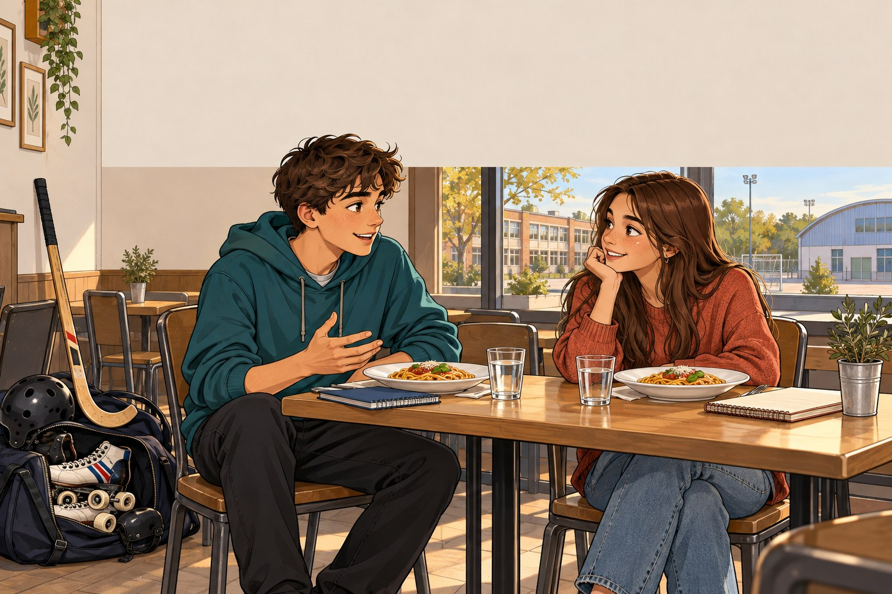

# All about you · Presentarsi e raccontarsi

Tre episodi collegati in inglese, italiano, francese e latino. Personaggi e informazioni personali sono fittizi. Luca e Sara si fanno domande reciproche: entrambi si presentano, esprimono gusti e raccontano la propria quotidianità.

Livello 0: quattro battute brevi; Base: sei battute; Intermedio: otto battute; Avanzato: dieci battute, motivazioni e proposte condivise. Le risposte del livello Intermedio riprendono parti del dialogo Avanzato con un’apertura più guidata.

L’hockey è su pista, con pattini a quattro ruote; non sul ghiaccio. Il latino è un adattamento didattico moderno, con descrizioni per gli oggetti contemporanei e ore dell’orologio moderno. “Placenta” è usato nel senso ampio di focaccia e “oryza” indica il riso: non si presentano pizza e risotto come piatti dell’antica Roma. Le voci latine sono italiane, come nel resto del percorso.

## All about you · Nice to meet you · EN

Presentarsi, dire età e provenienza, chiedere informazioni e trovare interessi comuni.

### Livello 0

- **Luca:** Hi, I’m Luca. What’s your name? _(Ciao, sono Luca. Come ti chiami?)_
- **Sara:** My name’s Sara. I’m sixteen. And you? _(Mi chiamo Sara. Ho sedici anni. E tu?)_
- **Luca:** I’m sixteen, too. I’m from Florence. _(Anch’io ho sedici anni. Sono di Firenze.)_
- **Sara:** I’m from Lucca. Nice to meet you! _(Io sono di Lucca. Piacere!)_

### Base

- **Luca:** Hi, I’m Luca. Are you new in our class? _(Ciao, sono Luca. Sei nuova nella nostra classe?)_
- **Sara:** Yes, my name’s Sara. I’m sixteen. And you? _(Sì, mi chiamo Sara. Ho sedici anni. E tu?)_
- **Luca:** I’m sixteen, too. I live in Florence. Where do you live? _(Anch’io ho sedici anni. Vivo a Firenze. Tu dove vivi?)_
- **Sara:** In Lucca, but now I stay here with my dad during the week. _(A Lucca, ma ora passo la settimana qui con mio padre.)_
- **Luca:** I like sport. What do you like doing? _(Mi piace lo sport. Che cosa ti piace fare?)_
- **Sara:** I like drawing and listening to music. What about you? _(Mi piace disegnare e ascoltare musica. E a te?)_

### Intermedio

- **Luca:** Hi, I’m Luca. Are you new in our class? _(Ciao, sono Luca. Sei nuova nella nostra classe?)_
- **Sara:** Yes, my name’s Sara. I’m sixteen. And you? _(Sì, mi chiamo Sara. Ho sedici anni. E tu?)_
- **Luca:** Welcome! I’m sixteen and I grew up in Florence. Where are you from? _(Benvenuta! Ho sedici anni e sono cresciuto a Firenze. Tu di dove sei?)_
- **Sara:** I’m sixteen, too, and I’m from Lucca. I stay here with my dad during the week. _(Ho sedici anni anch’io e vengo da Lucca. Durante la settimana sto qui con mio padre.)_
- **Luca:** I live with my mum and my younger brother. What do you enjoy doing in your free time? _(Io vivo con mia madre e mio fratello minore. Che cosa ti piace fare nel tempo libero?)_
- **Sara:** I enjoy drawing buildings and listening to music. What are you interested in? _(Mi piace disegnare edifici e ascoltare musica. E tu, che interessi hai?)_
- **Luca:** I play rink hockey, and I like cooking with my family. _(Gioco a hockey su pista e mi piace cucinare con la mia famiglia.)_
- **Sara:** That sounds fun! I don’t play hockey, but I often go cycling. _(Che bello! Io non pratico hockey, ma vado spesso in bicicletta.)_

### Avanzato

- **Luca:** Hi, I think we’re in the same class. I’m Luca. What’s your name? _(Ciao, credo che siamo nella stessa classe. Io sono Luca. Come ti chiami?)_
- **Sara:** Sara, nice to meet you. I’ve just moved here for the school year. _(Sara, piacere. Mi sono appena trasferita qui per l’anno scolastico.)_
- **Luca:** Welcome! I’m sixteen and I grew up in Florence. Where are you from? _(Benvenuta! Ho sedici anni e sono cresciuto a Firenze. Tu di dove sei?)_
- **Sara:** I’m sixteen, too, and I’m from Lucca. I stay here with my dad during the week. _(Ho sedici anni anch’io e vengo da Lucca. Durante la settimana sto qui con mio padre.)_
- **Luca:** I live with my mum and my younger brother. What do you enjoy doing in your free time? _(Io vivo con mia madre e mio fratello minore. Che cosa ti piace fare nel tempo libero?)_
- **Sara:** I enjoy drawing buildings and listening to music. What are you interested in? _(Mi piace disegnare edifici e ascoltare musica. E tu, che interessi hai?)_
- **Luca:** I play rink hockey, and I like cooking with my family. _(Gioco a hockey su pista e mi piace cucinare con la mia famiglia.)_
- **Sara:** That sounds fun! I don’t play hockey, but I often go cycling. _(Che bello! Io non pratico hockey, ma vado spesso in bicicletta.)_
- **Luca:** Perhaps we can share some tips: recipes from me and places to visit from you. _(Magari possiamo scambiarci qualche consiglio: io sulle ricette, tu sui posti da visitare.)_
- **Sara:** I’d like that. After class, I’ll show you my drawings and you can tell me about your team. _(Volentieri. Dopo la lezione ti mostro i miei disegni e mi racconti della tua squadra.)_

## All about you · Rink hockey and Italian food · EN

Descrivere uno sport e i propri gusti, fare domande reciproche ed esprimere preferenze motivate.

### Livello 0

- **Luca:** I play rink hockey. What about you? _(Gioco a hockey su pista. E tu?)_
- **Sara:** I go cycling. Do you like pizza? _(Io vado in bicicletta. Ti piace la pizza?)_
- **Luca:** Yes! I like pizza and pasta. _(Sì! Mi piacciono la pizza e la pasta.)_
- **Sara:** I like pasta, too. I cook with my dad. _(Anche a me piace la pasta. Cucino con mio padre.)_

### Base

- **Luca:** I play rink hockey twice a week. Do you do any sport? _(Gioco a hockey su pista due volte alla settimana. Tu fai sport?)_
- **Sara:** Yes, I go cycling on Saturdays. Do you play on ice? _(Sì, vado in bicicletta il sabato. Giochi sul ghiaccio?)_
- **Luca:** No, I play on a rink with four-wheel roller skates. _(No, gioco su una pista con pattini a quattro ruote.)_
- **Sara:** Interesting! I’m always hungry after sport. What’s your favourite dish? _(Interessante! Dopo lo sport ho sempre fame. Qual è il tuo piatto preferito?)_
- **Luca:** I like Italian food, especially pasta with tomato sauce. What about you? _(Mi piacciono i piatti italiani, soprattutto la pasta al pomodoro. E a te?)_
- **Sara:** I like risotto. I cook with my dad on Sundays. _(A me piace il risotto. La domenica cucino con mio padre.)_

### Intermedio

- **Luca:** I’ve got rink hockey practice later. Shall we get something to eat? _(Più tardi ho l’allenamento di hockey su pista. Ti va di mangiare qualcosa?)_
- **Sara:** I’d love to. I go cycling. How long have you been playing? _(Volentieri. Io vado in bicicletta. Da quanto tempo giochi?)_
- **Luca:** For three years. I use four-wheel roller skates and a stick to hit the ball. _(Da tre anni. Uso pattini con quattro ruote e un bastone per colpire la pallina.)_
- **Sara:** So it isn’t ice hockey. I prefer cycling outdoors. _(Quindi non è hockey sul ghiaccio. Io preferisco andare in bici all’aperto.)_
- **Luca:** Exactly. I train on Tuesdays and Thursdays, and I sometimes have a match on Saturdays. _(Esatto. Mi alleno il martedì e il giovedì e il sabato a volte ho una partita.)_
- **Sara:** I cycle almost every Saturday. What do you enjoy eating after sport? _(Io pedalo quasi ogni sabato. E dopo lo sport che cosa ti piace mangiare?)_
- **Luca:** I love Italian food: pasta with tomato sauce, roast vegetables and homemade pizza. _(Amo la cucina italiana: pasta al pomodoro, verdure al forno e pizza fatta in casa.)_
- **Sara:** I love mushroom risotto. My dad is teaching me how to make it. _(Io adoro il risotto ai funghi. Mio padre mi sta insegnando a prepararlo.)_

### Avanzato

- **Luca:** Shall we get something to eat after school? I’ve got rink hockey practice later. _(Ti va di mangiare qualcosa dopo scuola? Più tardi ho l’allenamento di hockey su pista.)_
- **Sara:** I’d love to. I’ve just been for a bike ride. How long have you been playing? _(Volentieri. Io torno da un giro in bicicletta. Da quanto tempo giochi?)_
- **Luca:** For three years. I use four-wheel roller skates and a stick to hit the ball. _(Da tre anni. Uso pattini con quattro ruote e un bastone per colpire la pallina.)_
- **Sara:** So it isn’t ice hockey. I prefer cycling outdoors. _(Quindi non è hockey sul ghiaccio. Io preferisco andare in bici all’aperto.)_
- **Luca:** Exactly. I train on Tuesdays and Thursdays, and I sometimes have a match on Saturdays. _(Esatto. Mi alleno il martedì e il giovedì e il sabato a volte ho una partita.)_
- **Sara:** I cycle almost every Saturday. What do you enjoy eating after sport? _(Io pedalo quasi ogni sabato. E dopo lo sport che cosa ti piace mangiare?)_
- **Luca:** I love Italian food: pasta with tomato sauce, roast vegetables and homemade pizza. _(Amo la cucina italiana: pasta al pomodoro, verdure al forno e pizza fatta in casa.)_
- **Sara:** I love mushroom risotto. My dad is teaching me how to make it. _(Io adoro il risotto ai funghi. Mio padre mi sta insegnando a prepararlo.)_
- **Luca:** I cook with my family, too. We could exchange our favourite recipes. _(Anch’io cucino in famiglia. Potremmo scambiarci le nostre ricette preferite.)_
- **Sara:** Definitely! You can teach me your sauce, and I’ll explain how we make risotto. _(Certo! Tu mi insegni la tua salsa e io ti spiego come prepariamo il risotto.)_

## All about you · A day in our lives · EN

Raccontare e confrontare orari, abitudini scolastiche e attività del tempo libero.

### Livello 0

- **Luca:** I get up at seven. What about you? _(Mi alzo alle sette. E tu?)_
- **Sara:** I get up at half past seven. I have breakfast at home. _(Mi alzo alle sette e mezza. Faccio colazione a casa.)_
- **Luca:** I go to school by bus. _(Vado a scuola in autobus.)_
- **Sara:** I walk to school. I draw after school. _(Io vado a scuola a piedi. Dopo scuola disegno.)_

### Base

- **Luca:** What time do you get up on school days? _(A che ora ti alzi nei giorni di scuola?)_
- **Sara:** At half past seven. I have breakfast and walk to school. What about you? _(Alle sette e mezza. Faccio colazione e vado a scuola a piedi. E tu?)_
- **Luca:** At seven. I catch the bus at eight. _(Alle sette. Prendo l’autobus alle otto.)_
- **Sara:** What do you do after school? _(Che cosa fai dopo scuola?)_
- **Luca:** I do my homework, then I train or help with the cooking. What about you? _(Faccio i compiti, poi mi alleno o aiuto a cucinare. E tu?)_
- **Sara:** I do my homework and draw. I listen to music in the evening. _(Io faccio i compiti e disegno. La sera ascolto musica.)_

### Intermedio

- **Luca:** What time do you get up on school days? _(A che ora ti alzi nei giorni di scuola?)_
- **Sara:** At half past seven. I have breakfast and walk to school. What about you? _(Alle sette e mezza. Faccio colazione e vado a scuola a piedi. E tu?)_
- **Luca:** I get up at seven because I have to catch the bus. I pack my bag the night before. _(Mi alzo alle sette perché devo prendere l’autobus. Preparo lo zaino la sera prima.)_
- **Sara:** I sometimes pack mine in a hurry in the morning. What do you do as soon as you get home? _(Io a volte lo preparo di fretta al mattino. Che cosa fai appena torni a casa?)_
- **Luca:** I have lunch, take a short break and do my homework before training. _(Pranzo, mi riposo un momento e faccio i compiti prima dell’allenamento.)_
- **Sara:** I do my homework in the afternoon, too, and then I draw or go for a bike ride. _(Anch’io faccio i compiti nel pomeriggio, poi disegno o esco in bicicletta.)_
- **Luca:** On days without practice, I help make dinner. Do you cook during the week as well? _(Nei giorni senza allenamento aiuto a preparare la cena. Tu cucini anche durante la settimana?)_
- **Sara:** Sometimes. In the evening, I usually listen to music and get things ready for the next day. _(Qualche volta. La sera di solito ascolto musica e preparo le cose per il giorno dopo.)_

### Avanzato

- **Luca:** How do you organise a normal day when you have school? _(Come organizzi una giornata normale quando hai lezione?)_
- **Sara:** I get up at half past seven, have breakfast and walk to school. What about you? _(Mi alzo alle sette e mezza, faccio colazione e vado a scuola a piedi. Tu invece?)_
- **Luca:** I get up at seven because I have to catch the bus. I pack my bag the night before. _(Mi alzo alle sette perché devo prendere l’autobus. Preparo lo zaino la sera prima.)_
- **Sara:** I sometimes pack mine in a hurry in the morning. What do you do as soon as you get home? _(Io a volte lo preparo di fretta al mattino. Che cosa fai appena torni a casa?)_
- **Luca:** I have lunch, take a short break and do my homework before training. _(Pranzo, mi riposo un momento e faccio i compiti prima dell’allenamento.)_
- **Sara:** I do my homework in the afternoon, too, and then I draw or go for a bike ride. _(Anch’io faccio i compiti nel pomeriggio, poi disegno o esco in bicicletta.)_
- **Luca:** On days without practice, I help make dinner. Do you cook during the week as well? _(Nei giorni senza allenamento aiuto a preparare la cena. Tu cucini anche durante la settimana?)_
- **Sara:** Sometimes. In the evening, I usually listen to music and get things ready for the next day. _(Qualche volta. La sera di solito ascolto musica e preparo le cose per il giorno dopo.)_
- **Luca:** I try to go to bed at half past ten, especially before a match. _(Io provo ad andare a letto alle dieci e mezza, soprattutto prima di una partita.)_
- **Sara:** I read for a while before going to sleep. Our schedules are different, but we both make time for our interests. _(Io leggo un po’ prima di dormire. Abbiamo orari diversi, ma entrambi troviamo tempo per i nostri interessi.)_

## Tutto su di te · Piacere di conoscerti · IT

Presentarsi, dire età e provenienza, chiedere informazioni e trovare interessi comuni.

### Livello 0

- **Luca:** Ciao, sono Luca. Come ti chiami?
- **Sara:** Mi chiamo Sara. Ho sedici anni. E tu?
- **Luca:** Anch’io ho sedici anni. Sono di Firenze.
- **Sara:** Io sono di Lucca. Piacere!

### Base

- **Luca:** Ciao, sono Luca. Sei nuova nella nostra classe?
- **Sara:** Sì, mi chiamo Sara. Ho sedici anni. E tu?
- **Luca:** Anch’io ho sedici anni. Vivo a Firenze. Tu dove vivi?
- **Sara:** A Lucca, ma ora passo la settimana qui con mio padre.
- **Luca:** Mi piace lo sport. Che cosa ti piace fare?
- **Sara:** Mi piace disegnare e ascoltare musica. E a te?

### Intermedio

- **Luca:** Ciao, sono Luca. Sei nuova nella nostra classe?
- **Sara:** Sì, mi chiamo Sara. Ho sedici anni. E tu?
- **Luca:** Benvenuta! Ho sedici anni e sono cresciuto a Firenze. Tu di dove sei?
- **Sara:** Ho sedici anni anch’io e vengo da Lucca. Durante la settimana sto qui con mio padre.
- **Luca:** Io vivo con mia madre e mio fratello minore. Che cosa ti piace fare nel tempo libero?
- **Sara:** Mi piace disegnare edifici e ascoltare musica. E tu, che interessi hai?
- **Luca:** Gioco a hockey su pista e mi piace cucinare con la mia famiglia.
- **Sara:** Che bello! Io non pratico hockey, ma vado spesso in bicicletta.

### Avanzato

- **Luca:** Ciao, credo che siamo nella stessa classe. Io sono Luca. Come ti chiami?
- **Sara:** Sara, piacere. Mi sono appena trasferita qui per l’anno scolastico.
- **Luca:** Benvenuta! Ho sedici anni e sono cresciuto a Firenze. Tu di dove sei?
- **Sara:** Ho sedici anni anch’io e vengo da Lucca. Durante la settimana sto qui con mio padre.
- **Luca:** Io vivo con mia madre e mio fratello minore. Che cosa ti piace fare nel tempo libero?
- **Sara:** Mi piace disegnare edifici e ascoltare musica. E tu, che interessi hai?
- **Luca:** Gioco a hockey su pista e mi piace cucinare con la mia famiglia.
- **Sara:** Che bello! Io non pratico hockey, ma vado spesso in bicicletta.
- **Luca:** Magari possiamo scambiarci qualche consiglio: io sulle ricette, tu sui posti da visitare.
- **Sara:** Volentieri. Dopo la lezione ti mostro i miei disegni e mi racconti della tua squadra.

## Tutto su di te · Hockey su pista e cucina italiana · IT

Descrivere uno sport e i propri gusti, fare domande reciproche ed esprimere preferenze motivate.

### Livello 0

- **Luca:** Gioco a hockey su pista. E tu?
- **Sara:** Io vado in bicicletta. Ti piace la pizza?
- **Luca:** Sì! Mi piacciono la pizza e la pasta.
- **Sara:** Anche a me piace la pasta. Cucino con mio padre.

### Base

- **Luca:** Gioco a hockey su pista due volte alla settimana. Tu fai sport?
- **Sara:** Sì, vado in bicicletta il sabato. Giochi sul ghiaccio?
- **Luca:** No, gioco su una pista con pattini a quattro ruote.
- **Sara:** Interessante! Dopo lo sport ho sempre fame. Qual è il tuo piatto preferito?
- **Luca:** Mi piacciono i piatti italiani, soprattutto la pasta al pomodoro. E a te?
- **Sara:** A me piace il risotto. La domenica cucino con mio padre.

### Intermedio

- **Luca:** Più tardi ho l’allenamento di hockey su pista. Ti va di mangiare qualcosa?
- **Sara:** Volentieri. Io vado in bicicletta. Da quanto tempo giochi?
- **Luca:** Da tre anni. Uso pattini con quattro ruote e un bastone per colpire la pallina.
- **Sara:** Quindi non è hockey sul ghiaccio. Io preferisco andare in bici all’aperto.
- **Luca:** Esatto. Mi alleno il martedì e il giovedì e il sabato a volte ho una partita.
- **Sara:** Io pedalo quasi ogni sabato. E dopo lo sport che cosa ti piace mangiare?
- **Luca:** Amo la cucina italiana: pasta al pomodoro, verdure al forno e pizza fatta in casa.
- **Sara:** Io adoro il risotto ai funghi. Mio padre mi sta insegnando a prepararlo.

### Avanzato

- **Luca:** Ti va di mangiare qualcosa dopo scuola? Più tardi ho l’allenamento di hockey su pista.
- **Sara:** Volentieri. Io torno da un giro in bicicletta. Da quanto tempo giochi?
- **Luca:** Da tre anni. Uso pattini con quattro ruote e un bastone per colpire la pallina.
- **Sara:** Quindi non è hockey sul ghiaccio. Io preferisco andare in bici all’aperto.
- **Luca:** Esatto. Mi alleno il martedì e il giovedì e il sabato a volte ho una partita.
- **Sara:** Io pedalo quasi ogni sabato. E dopo lo sport che cosa ti piace mangiare?
- **Luca:** Amo la cucina italiana: pasta al pomodoro, verdure al forno e pizza fatta in casa.
- **Sara:** Io adoro il risotto ai funghi. Mio padre mi sta insegnando a prepararlo.
- **Luca:** Anch’io cucino in famiglia. Potremmo scambiarci le nostre ricette preferite.
- **Sara:** Certo! Tu mi insegni la tua salsa e io ti spiego come prepariamo il risotto.

## Tutto su di te · Una giornata delle nostre · IT

Raccontare e confrontare orari, abitudini scolastiche e attività del tempo libero.

### Livello 0

- **Luca:** Mi alzo alle sette. E tu?
- **Sara:** Mi alzo alle sette e mezza. Faccio colazione a casa.
- **Luca:** Vado a scuola in autobus.
- **Sara:** Io vado a scuola a piedi. Dopo scuola disegno.

### Base

- **Luca:** A che ora ti alzi nei giorni di scuola?
- **Sara:** Alle sette e mezza. Faccio colazione e vado a scuola a piedi. E tu?
- **Luca:** Alle sette. Prendo l’autobus alle otto.
- **Sara:** Che cosa fai dopo scuola?
- **Luca:** Faccio i compiti, poi mi alleno o aiuto a cucinare. E tu?
- **Sara:** Io faccio i compiti e disegno. La sera ascolto musica.

### Intermedio

- **Luca:** A che ora ti alzi nei giorni di scuola?
- **Sara:** Alle sette e mezza. Faccio colazione e vado a scuola a piedi. E tu?
- **Luca:** Mi alzo alle sette perché devo prendere l’autobus. Preparo lo zaino la sera prima.
- **Sara:** Io a volte lo preparo di fretta al mattino. Che cosa fai appena torni a casa?
- **Luca:** Pranzo, mi riposo un momento e faccio i compiti prima dell’allenamento.
- **Sara:** Anch’io faccio i compiti nel pomeriggio, poi disegno o esco in bicicletta.
- **Luca:** Nei giorni senza allenamento aiuto a preparare la cena. Tu cucini anche durante la settimana?
- **Sara:** Qualche volta. La sera di solito ascolto musica e preparo le cose per il giorno dopo.

### Avanzato

- **Luca:** Come organizzi una giornata normale quando hai lezione?
- **Sara:** Mi alzo alle sette e mezza, faccio colazione e vado a scuola a piedi. Tu invece?
- **Luca:** Mi alzo alle sette perché devo prendere l’autobus. Preparo lo zaino la sera prima.
- **Sara:** Io a volte lo preparo di fretta al mattino. Che cosa fai appena torni a casa?
- **Luca:** Pranzo, mi riposo un momento e faccio i compiti prima dell’allenamento.
- **Sara:** Anch’io faccio i compiti nel pomeriggio, poi disegno o esco in bicicletta.
- **Luca:** Nei giorni senza allenamento aiuto a preparare la cena. Tu cucini anche durante la settimana?
- **Sara:** Qualche volta. La sera di solito ascolto musica e preparo le cose per il giorno dopo.
- **Luca:** Io provo ad andare a letto alle dieci e mezza, soprattutto prima di una partita.
- **Sara:** Io leggo un po’ prima di dormire. Abbiamo orari diversi, ma entrambi troviamo tempo per i nostri interessi.

## Tout sur toi · On fait connaissance · FR

Presentarsi, dire età e provenienza, chiedere informazioni e trovare interessi comuni.

### Livello 0

- **Luca:** Salut, je m’appelle Luca. Comment tu t’appelles ? _(Ciao, sono Luca. Come ti chiami?)_
- **Sara:** Je m’appelle Sara. J’ai seize ans. Et toi ? _(Mi chiamo Sara. Ho sedici anni. E tu?)_
- **Luca:** J’ai seize ans aussi. Je viens de Florence. _(Anch’io ho sedici anni. Sono di Firenze.)_
- **Sara:** Moi, je viens de Lucques. Enchantée ! _(Io sono di Lucca. Piacere!)_

### Base

- **Luca:** Salut, je m’appelle Luca. Tu es nouvelle dans notre classe ? _(Ciao, sono Luca. Sei nuova nella nostra classe?)_
- **Sara:** Oui, je m’appelle Sara. J’ai seize ans. Et toi ? _(Sì, mi chiamo Sara. Ho sedici anni. E tu?)_
- **Luca:** J’ai seize ans aussi. J’habite à Florence. Tu habites où ? _(Anch’io ho sedici anni. Vivo a Firenze. Tu dove vivi?)_
- **Sara:** À Lucques, mais maintenant je reste ici avec mon père pendant la semaine. _(A Lucca, ma ora passo la settimana qui con mio padre.)_
- **Luca:** J’aime le sport. Qu’est-ce que tu aimes faire ? _(Mi piace lo sport. Che cosa ti piace fare?)_
- **Sara:** J’aime dessiner et écouter de la musique. Et toi ? _(Mi piace disegnare e ascoltare musica. E a te?)_

### Intermedio

- **Luca:** Salut, je m’appelle Luca. Tu es nouvelle dans notre classe ? _(Ciao, sono Luca. Sei nuova nella nostra classe?)_
- **Sara:** Oui, je m’appelle Sara. J’ai seize ans. Et toi ? _(Sì, mi chiamo Sara. Ho sedici anni. E tu?)_
- **Luca:** Bienvenue ! J’ai seize ans et j’ai grandi à Florence. Tu viens d’où ? _(Benvenuta! Ho sedici anni e sono cresciuto a Firenze. Tu di dove sei?)_
- **Sara:** J’ai seize ans aussi et je viens de Lucques. Je reste ici avec mon père pendant la semaine. _(Ho sedici anni anch’io e vengo da Lucca. Durante la settimana sto qui con mio padre.)_
- **Luca:** Je vis avec ma mère et mon petit frère. Qu’est-ce que tu aimes faire pendant ton temps libre ? _(Io vivo con mia madre e mio fratello minore. Che cosa ti piace fare nel tempo libero?)_
- **Sara:** J’aime dessiner des bâtiments et écouter de la musique. Qu’est-ce qui t’intéresse ? _(Mi piace disegnare edifici e ascoltare musica. E tu, che interessi hai?)_
- **Luca:** Je joue au rink hockey et j’aime cuisiner avec ma famille. _(Gioco a hockey su pista e mi piace cucinare con la mia famiglia.)_
- **Sara:** C’est sympa ! Je ne joue pas au hockey, mais je fais souvent du vélo. _(Che bello! Io non pratico hockey, ma vado spesso in bicicletta.)_

### Avanzato

- **Luca:** Salut, je crois que nous sommes dans la même classe. Je m’appelle Luca. Et toi ? _(Ciao, credo che siamo nella stessa classe. Io sono Luca. Come ti chiami?)_
- **Sara:** Sara, enchantée. Je viens de m’installer ici pour l’année scolaire. _(Sara, piacere. Mi sono appena trasferita qui per l’anno scolastico.)_
- **Luca:** Bienvenue ! J’ai seize ans et j’ai grandi à Florence. Tu viens d’où ? _(Benvenuta! Ho sedici anni e sono cresciuto a Firenze. Tu di dove sei?)_
- **Sara:** J’ai seize ans aussi et je viens de Lucques. Je reste ici avec mon père pendant la semaine. _(Ho sedici anni anch’io e vengo da Lucca. Durante la settimana sto qui con mio padre.)_
- **Luca:** Je vis avec ma mère et mon petit frère. Qu’est-ce que tu aimes faire pendant ton temps libre ? _(Io vivo con mia madre e mio fratello minore. Che cosa ti piace fare nel tempo libero?)_
- **Sara:** J’aime dessiner des bâtiments et écouter de la musique. Qu’est-ce qui t’intéresse ? _(Mi piace disegnare edifici e ascoltare musica. E tu, che interessi hai?)_
- **Luca:** Je joue au rink hockey et j’aime cuisiner avec ma famille. _(Gioco a hockey su pista e mi piace cucinare con la mia famiglia.)_
- **Sara:** C’est sympa ! Je ne joue pas au hockey, mais je fais souvent du vélo. _(Che bello! Io non pratico hockey, ma vado spesso in bicicletta.)_
- **Luca:** On pourrait échanger des conseils : des recettes de mon côté et des lieux à visiter du tien. _(Magari possiamo scambiarci qualche consiglio: io sulle ricette, tu sui posti da visitare.)_
- **Sara:** Avec plaisir. Après le cours, je te montre mes dessins et tu me parles de ton équipe. _(Volentieri. Dopo la lezione ti mostro i miei disegni e mi racconti della tua squadra.)_

## Tout sur toi · Rink hockey et cuisine italienne · FR

Descrivere uno sport e i propri gusti, fare domande reciproche ed esprimere preferenze motivate.

### Livello 0

- **Luca:** Je joue au rink hockey. Et toi ? _(Gioco a hockey su pista. E tu?)_
- **Sara:** Je fais du vélo. Tu aimes la pizza ? _(Io vado in bicicletta. Ti piace la pizza?)_
- **Luca:** Oui ! J’aime la pizza et les pâtes. _(Sì! Mi piacciono la pizza e la pasta.)_
- **Sara:** Moi aussi, j’aime les pâtes. Je cuisine avec mon père. _(Anche a me piace la pasta. Cucino con mio padre.)_

### Base

- **Luca:** Je joue au rink hockey deux fois par semaine. Tu fais du sport ? _(Gioco a hockey su pista due volte alla settimana. Tu fai sport?)_
- **Sara:** Oui, je fais du vélo le samedi. Tu joues sur la glace ? _(Sì, vado in bicicletta il sabato. Giochi sul ghiaccio?)_
- **Luca:** Non, je joue sur une piste avec des patins à quatre roues. _(No, gioco su una pista con pattini a quattro ruote.)_
- **Sara:** Intéressant ! Après le sport, j’ai toujours faim. Quel est ton plat préféré ? _(Interessante! Dopo lo sport ho sempre fame. Qual è il tuo piatto preferito?)_
- **Luca:** J’aime la cuisine italienne, surtout les pâtes à la sauce tomate. Et toi ? _(Mi piacciono i piatti italiani, soprattutto la pasta al pomodoro. E a te?)_
- **Sara:** J’aime le risotto. Le dimanche, je cuisine avec mon père. _(A me piace il risotto. La domenica cucino con mio padre.)_

### Intermedio

- **Luca:** J’ai un entraînement de rink hockey plus tard. On mange quelque chose ? _(Più tardi ho l’allenamento di hockey su pista. Ti va di mangiare qualcosa?)_
- **Sara:** Avec plaisir. Moi, je fais du vélo. Tu joues depuis combien de temps ? _(Volentieri. Io vado in bicicletta. Da quanto tempo giochi?)_
- **Luca:** Depuis trois ans. J’utilise des patins à quatre roues et une crosse pour frapper la balle. _(Da tre anni. Uso pattini con quattro ruote e un bastone per colpire la pallina.)_
- **Sara:** Donc, ce n’est pas du hockey sur glace. Moi, je préfère faire du vélo en plein air. _(Quindi non è hockey sul ghiaccio. Io preferisco andare in bici all’aperto.)_
- **Luca:** Exactement. Je m’entraîne le mardi et le jeudi et j’ai parfois un match le samedi. _(Esatto. Mi alleno il martedì e il giovedì e il sabato a volte ho una partita.)_
- **Sara:** Moi, je fais du vélo presque tous les samedis. Qu’est-ce que tu aimes manger après le sport ? _(Io pedalo quasi ogni sabato. E dopo lo sport che cosa ti piace mangiare?)_
- **Luca:** J’adore la cuisine italienne : les pâtes à la sauce tomate, les légumes au four et la pizza maison. _(Amo la cucina italiana: pasta al pomodoro, verdure al forno e pizza fatta in casa.)_
- **Sara:** J’adore le risotto aux champignons. Mon père m’apprend à le préparer. _(Io adoro il risotto ai funghi. Mio padre mi sta insegnando a prepararlo.)_

### Avanzato

- **Luca:** On mange quelque chose après les cours ? J’ai un entraînement de rink hockey plus tard. _(Ti va di mangiare qualcosa dopo scuola? Più tardi ho l’allenamento di hockey su pista.)_
- **Sara:** Avec plaisir. Je viens de faire un tour à vélo. Tu joues depuis combien de temps ? _(Volentieri. Io torno da un giro in bicicletta. Da quanto tempo giochi?)_
- **Luca:** Depuis trois ans. J’utilise des patins à quatre roues et une crosse pour frapper la balle. _(Da tre anni. Uso pattini con quattro ruote e un bastone per colpire la pallina.)_
- **Sara:** Donc, ce n’est pas du hockey sur glace. Moi, je préfère faire du vélo en plein air. _(Quindi non è hockey sul ghiaccio. Io preferisco andare in bici all’aperto.)_
- **Luca:** Exactement. Je m’entraîne le mardi et le jeudi et j’ai parfois un match le samedi. _(Esatto. Mi alleno il martedì e il giovedì e il sabato a volte ho una partita.)_
- **Sara:** Moi, je fais du vélo presque tous les samedis. Qu’est-ce que tu aimes manger après le sport ? _(Io pedalo quasi ogni sabato. E dopo lo sport che cosa ti piace mangiare?)_
- **Luca:** J’adore la cuisine italienne : les pâtes à la sauce tomate, les légumes au four et la pizza maison. _(Amo la cucina italiana: pasta al pomodoro, verdure al forno e pizza fatta in casa.)_
- **Sara:** J’adore le risotto aux champignons. Mon père m’apprend à le préparer. _(Io adoro il risotto ai funghi. Mio padre mi sta insegnando a prepararlo.)_
- **Luca:** Moi aussi, je cuisine en famille. On pourrait échanger nos recettes préférées. _(Anch’io cucino in famiglia. Potremmo scambiarci le nostre ricette preferite.)_
- **Sara:** Bien sûr ! Tu m’apprends ta sauce et je t’explique comment on prépare le risotto. _(Certo! Tu mi insegni la tua salsa e io ti spiego come prepariamo il risotto.)_

## Tout sur toi · Notre quotidien · FR

Raccontare e confrontare orari, abitudini scolastiche e attività del tempo libero.

### Livello 0

- **Luca:** Je me lève à sept heures. Et toi ? _(Mi alzo alle sette. E tu?)_
- **Sara:** Je me lève à sept heures et demie. Je prends mon petit déjeuner à la maison. _(Mi alzo alle sette e mezza. Faccio colazione a casa.)_
- **Luca:** Je vais au lycée en bus. _(Vado a scuola in autobus.)_
- **Sara:** Je vais au lycée à pied. Après les cours, je dessine. _(Io vado a scuola a piedi. Dopo scuola disegno.)_

### Base

- **Luca:** À quelle heure tu te lèves les jours de classe ? _(A che ora ti alzi nei giorni di scuola?)_
- **Sara:** À sept heures et demie. Je prends mon petit déjeuner et je vais au lycée à pied. Et toi ? _(Alle sette e mezza. Faccio colazione e vado a scuola a piedi. E tu?)_
- **Luca:** À sept heures. Je prends le bus à huit heures. _(Alle sette. Prendo l’autobus alle otto.)_
- **Sara:** Qu’est-ce que tu fais après les cours ? _(Che cosa fai dopo scuola?)_
- **Luca:** Je fais mes devoirs, puis je m’entraîne ou j’aide à cuisiner. Et toi ? _(Faccio i compiti, poi mi alleno o aiuto a cucinare. E tu?)_
- **Sara:** Je fais mes devoirs et je dessine. Le soir, j’écoute de la musique. _(Io faccio i compiti e disegno. La sera ascolto musica.)_

### Intermedio

- **Luca:** À quelle heure tu te lèves les jours de classe ? _(A che ora ti alzi nei giorni di scuola?)_
- **Sara:** À sept heures et demie. Je prends mon petit déjeuner et je vais au lycée à pied. Et toi ? _(Alle sette e mezza. Faccio colazione e vado a scuola a piedi. E tu?)_
- **Luca:** Je me lève à sept heures parce que je dois prendre le bus. Je prépare mon sac la veille. _(Mi alzo alle sette perché devo prendere l’autobus. Preparo lo zaino la sera prima.)_
- **Sara:** Moi, je le prépare parfois en vitesse le matin. Qu’est-ce que tu fais dès que tu rentres ? _(Io a volte lo preparo di fretta al mattino. Che cosa fai appena torni a casa?)_
- **Luca:** Je déjeune, je me repose un peu et je fais mes devoirs avant l’entraînement. _(Pranzo, mi riposo un momento e faccio i compiti prima dell’allenamento.)_
- **Sara:** Moi aussi, je fais mes devoirs l’après-midi, puis je dessine ou je fais un tour à vélo. _(Anch’io faccio i compiti nel pomeriggio, poi disegno o esco in bicicletta.)_
- **Luca:** Les jours sans entraînement, j’aide à préparer le dîner. Tu cuisines aussi pendant la semaine ? _(Nei giorni senza allenamento aiuto a preparare la cena. Tu cucini anche durante la settimana?)_
- **Sara:** Parfois. Le soir, j’écoute généralement de la musique et je prépare mes affaires pour le lendemain. _(Qualche volta. La sera di solito ascolto musica e preparo le cose per il giorno dopo.)_

### Avanzato

- **Luca:** Comment tu organises une journée normale quand tu as cours ? _(Come organizzi una giornata normale quando hai lezione?)_
- **Sara:** Je me lève à sept heures et demie, je prends mon petit déjeuner et je vais au lycée à pied. Et toi ? _(Mi alzo alle sette e mezza, faccio colazione e vado a scuola a piedi. Tu invece?)_
- **Luca:** Je me lève à sept heures parce que je dois prendre le bus. Je prépare mon sac la veille. _(Mi alzo alle sette perché devo prendere l’autobus. Preparo lo zaino la sera prima.)_
- **Sara:** Moi, je le prépare parfois en vitesse le matin. Qu’est-ce que tu fais dès que tu rentres ? _(Io a volte lo preparo di fretta al mattino. Che cosa fai appena torni a casa?)_
- **Luca:** Je déjeune, je me repose un peu et je fais mes devoirs avant l’entraînement. _(Pranzo, mi riposo un momento e faccio i compiti prima dell’allenamento.)_
- **Sara:** Moi aussi, je fais mes devoirs l’après-midi, puis je dessine ou je fais un tour à vélo. _(Anch’io faccio i compiti nel pomeriggio, poi disegno o esco in bicicletta.)_
- **Luca:** Les jours sans entraînement, j’aide à préparer le dîner. Tu cuisines aussi pendant la semaine ? _(Nei giorni senza allenamento aiuto a preparare la cena. Tu cucini anche durante la settimana?)_
- **Sara:** Parfois. Le soir, j’écoute généralement de la musique et je prépare mes affaires pour le lendemain. _(Qualche volta. La sera di solito ascolto musica e preparo le cose per il giorno dopo.)_
- **Luca:** J’essaie de me coucher à vingt-deux heures et demie, surtout avant un match. _(Io provo ad andare a letto alle dieci e mezza, soprattutto prima di una partita.)_
- **Sara:** Moi, je lis un peu avant de dormir. Nos horaires sont différents, mais on trouve tous les deux du temps pour nos loisirs. _(Io leggo un po’ prima di dormire. Abbiamo orari diversi, ma entrambi troviamo tempo per i nostri interessi.)_

## De te · Nos cognoscimus · LA

Presentarsi, dire età e provenienza, chiedere informazioni e trovare interessi comuni.

### Livello 0

- **Luca:** Salve! Lucas sum. Quod est tibi nomen? _(Ciao, sono Luca. Come ti chiami?)_
- **Sara:** Mihi nomen est Sara. Sedecim annos nata sum. Et tu? _(Mi chiamo Sara. Ho sedici anni. E tu?)_
- **Luca:** Ego quoque sedecim annos natus sum. Florentia venio. _(Anch’io ho sedici anni. Sono di Firenze.)_
- **Sara:** Ego Luca venio. Gaudeo te cognoscere. _(Io sono di Lucca. Piacere!)_

### Base

- **Luca:** Salve! Lucas sum. Nova es in classe nostra? _(Ciao, sono Luca. Sei nuova nella nostra classe?)_
- **Sara:** Ita, Sara sum. Sedecim annos nata sum. Et tu? _(Sì, mi chiamo Sara. Ho sedici anni. E tu?)_
- **Luca:** Ego quoque sedecim annos natus sum. Florentiae habito. Ubi habitas? _(Anch’io ho sedici anni. Vivo a Firenze. Tu dove vivi?)_
- **Sara:** Lucae habito, sed nunc per hebdomadem hic apud patrem maneo. _(A Lucca, ma ora passo la settimana qui con mio padre.)_
- **Luca:** Ludi mihi placent. Quid facere amas? _(Mi piace lo sport. Che cosa ti piace fare?)_
- **Sara:** Delineare et musicam audire amo. Et tu? _(Mi piace disegnare e ascoltare musica. E a te?)_

### Intermedio

- **Luca:** Salve! Lucas sum. Nova es in classe nostra? _(Ciao, sono Luca. Sei nuova nella nostra classe?)_
- **Sara:** Ita, Sara sum. Sedecim annos nata sum. Et tu? _(Sì, mi chiamo Sara. Ho sedici anni. E tu?)_
- **Luca:** Bene venisti! Sedecim annos natus sum et Florentiae crevi. Unde venis? _(Benvenuta! Ho sedici anni e sono cresciuto a Firenze. Tu di dove sei?)_
- **Sara:** Ego quoque sedecim annos nata sum et Luca venio. Per hebdomadem hic apud patrem maneo. _(Ho sedici anni anch’io e vengo da Lucca. Durante la settimana sto qui con mio padre.)_
- **Luca:** Cum matre et fratre minore habito. Quid per otium facere amas? _(Io vivo con mia madre e mio fratello minore. Che cosa ti piace fare nel tempo libero?)_
- **Sara:** Aedificia delineare et musicam audire amo. Quid tibi placet? _(Mi piace disegnare edifici e ascoltare musica. E tu, che interessi hai?)_
- **Luca:** Soleis rotatis utor et pilam baculo incurvo pello. Cum familia etiam coquere amo. _(Gioco a hockey su pista e mi piace cucinare con la mia famiglia.)_
- **Sara:** Bene! Ego hoc ludo non ludo, sed saepe birota vehor. _(Che bello! Io non pratico hockey, ma vado spesso in bicicletta.)_

### Avanzato

- **Luca:** Salve! Puto nos in eadem classe esse. Lucas sum. Quod est tibi nomen? _(Ciao, credo che siamo nella stessa classe. Io sono Luca. Come ti chiami?)_
- **Sara:** Sara sum. Gaudeo te cognoscere. Nuper huc ad studia veni. _(Sara, piacere. Mi sono appena trasferita qui per l’anno scolastico.)_
- **Luca:** Bene venisti! Sedecim annos natus sum et Florentiae crevi. Unde venis? _(Benvenuta! Ho sedici anni e sono cresciuto a Firenze. Tu di dove sei?)_
- **Sara:** Ego quoque sedecim annos nata sum et Luca venio. Per hebdomadem hic apud patrem maneo. _(Ho sedici anni anch’io e vengo da Lucca. Durante la settimana sto qui con mio padre.)_
- **Luca:** Cum matre et fratre minore habito. Quid per otium facere amas? _(Io vivo con mia madre e mio fratello minore. Che cosa ti piace fare nel tempo libero?)_
- **Sara:** Aedificia delineare et musicam audire amo. Quid tibi placet? _(Mi piace disegnare edifici e ascoltare musica. E tu, che interessi hai?)_
- **Luca:** Soleis rotatis utor et pilam baculo incurvo pello. Cum familia etiam coquere amo. _(Gioco a hockey su pista e mi piace cucinare con la mia famiglia.)_
- **Sara:** Bene! Ego hoc ludo non ludo, sed saepe birota vehor. _(Che bello! Io non pratico hockey, ma vado spesso in bicicletta.)_
- **Luca:** Fortasse consilia communicare possumus: ego de cibis, tu de locis visendis. _(Magari possiamo scambiarci qualche consiglio: io sulle ricette, tu sui posti da visitare.)_
- **Sara:** Libenter. Post lectionem imagines meas tibi ostendam et tu mihi de sodalibus narrabis. _(Volentieri. Dopo la lezione ti mostro i miei disegni e mi racconti della tua squadra.)_

## De te · Ludi et cibi Italici · LA

Descrivere uno sport e i propri gusti, fare domande reciproche ed esprimere preferenze motivate.

### Livello 0

- **Luca:** Soleis rotatis ludo. Et tu? _(Gioco a hockey su pista. E tu?)_
- **Sara:** Ego birota vehor. Placetne tibi placenta? _(Io vado in bicicletta. Ti piace la pizza?)_
- **Luca:** Ita! Placenta et pasta mihi placent. _(Sì! Mi piacciono la pizza e la pasta.)_
- **Sara:** Mihi quoque pasta placet. Cum patre coquo. _(Anche a me piace la pasta. Cucino con mio padre.)_

### Base

- **Luca:** Bis in hebdomade soleis rotatis ludo. Tu quoque te exerces? _(Gioco a hockey su pista due volte alla settimana. Tu fai sport?)_
- **Sara:** Ita, die Saturni birota vehor. Num in glacie ludis? _(Sì, vado in bicicletta il sabato. Giochi sul ghiaccio?)_
- **Luca:** Non, in area ludo et soleas quattuor rotis instructas gero. _(No, gioco su una pista con pattini a quattro ruote.)_
- **Sara:** Mirum! Post ludos semper esurio. Qui cibus tibi maxime placet? _(Interessante! Dopo lo sport ho sempre fame. Qual è il tuo piatto preferito?)_
- **Luca:** Cibi Italici mihi placent, praesertim pasta cum liquamine lycopersici. Et tibi? _(Mi piacciono i piatti italiani, soprattutto la pasta al pomodoro. E a te?)_
- **Sara:** Mihi oryza placet. Die Solis cum patre coquo. _(A me piace il risotto. La domenica cucino con mio padre.)_

### Intermedio

- **Luca:** Postea me soleis rotatis exercebo. Visne aliquid edere? _(Più tardi ho l’allenamento di hockey su pista. Ti va di mangiare qualcosa?)_
- **Sara:** Libenter. Ego birota vehor. Quam diu hoc ludo ludis? _(Volentieri. Io vado in bicicletta. Da quanto tempo giochi?)_
- **Luca:** Iam tres annos. Soleas quattuor rotis instructas gero et pilam baculo incurvo pello. _(Da tre anni. Uso pattini con quattro ruote e un bastone per colpire la pallina.)_
- **Sara:** Ergo non in glacie ludis. Ego birota sub divo vehi malo. _(Quindi non è hockey sul ghiaccio. Io preferisco andare in bici all’aperto.)_
- **Luca:** Ita. Die Martis et die Iovis me exerceo; die Saturni interdum certamen habeo. _(Esatto. Mi alleno il martedì e il giovedì e il sabato a volte ho una partita.)_
- **Sara:** Ego fere omni die Saturni birota vehor. Quid post ludos edere amas? _(Io pedalo quasi ogni sabato. E dopo lo sport che cosa ti piace mangiare?)_
- **Luca:** Cibos Italicos amo: pastam cum liquamine lycopersici, holera cocta et placentam domi factam. _(Amo la cucina italiana: pasta al pomodoro, verdure al forno e pizza fatta in casa.)_
- **Sara:** Oryza cum fungis mihi valde placet. Pater me docet quomodo eam coquamus. _(Io adoro il risotto ai funghi. Mio padre mi sta insegnando a prepararlo.)_

### Avanzato

- **Luca:** Visne post scholam aliquid edere? Postea me soleis rotatis exercebo. _(Ti va di mangiare qualcosa dopo scuola? Più tardi ho l’allenamento di hockey su pista.)_
- **Sara:** Libenter. Modo birota vecta sum. Quam diu hoc ludo ludis? _(Volentieri. Io torno da un giro in bicicletta. Da quanto tempo giochi?)_
- **Luca:** Iam tres annos. Soleas quattuor rotis instructas gero et pilam baculo incurvo pello. _(Da tre anni. Uso pattini con quattro ruote e un bastone per colpire la pallina.)_
- **Sara:** Ergo non in glacie ludis. Ego birota sub divo vehi malo. _(Quindi non è hockey sul ghiaccio. Io preferisco andare in bici all’aperto.)_
- **Luca:** Ita. Die Martis et die Iovis me exerceo; die Saturni interdum certamen habeo. _(Esatto. Mi alleno il martedì e il giovedì e il sabato a volte ho una partita.)_
- **Sara:** Ego fere omni die Saturni birota vehor. Quid post ludos edere amas? _(Io pedalo quasi ogni sabato. E dopo lo sport che cosa ti piace mangiare?)_
- **Luca:** Cibos Italicos amo: pastam cum liquamine lycopersici, holera cocta et placentam domi factam. _(Amo la cucina italiana: pasta al pomodoro, verdure al forno e pizza fatta in casa.)_
- **Sara:** Oryza cum fungis mihi valde placet. Pater me docet quomodo eam coquamus. _(Io adoro il risotto ai funghi. Mio padre mi sta insegnando a prepararlo.)_
- **Luca:** Ego quoque cum familia coquo. Praecepta ciborum inter nos communicare possumus. _(Anch’io cucino in famiglia. Potremmo scambiarci le nostre ricette preferite.)_
- **Sara:** Certe! Tu me liquamen tuum doces, ego tibi narro quomodo oryzam coquamus. _(Certo! Tu mi insegni la tua salsa e io ti spiego come prepariamo il risotto.)_

## De te · Vita cotidiana · LA

Raccontare e confrontare orari, abitudini scolastiche e attività del tempo libero.

### Livello 0

- **Luca:** Hora septima surgo. Et tu? _(Mi alzo alle sette. E tu?)_
- **Sara:** Hora septima et dimidia surgo. Domi ientaculum sumo. _(Mi alzo alle sette e mezza. Faccio colazione a casa.)_
- **Luca:** Autoraeda publica ad scholam eo. _(Vado a scuola in autobus.)_
- **Sara:** Ego ad scholam ambulo. Post scholam delineo. _(Io vado a scuola a piedi. Dopo scuola disegno.)_

### Base

- **Luca:** Qua hora diebus scholaribus surgis? _(A che ora ti alzi nei giorni di scuola?)_
- **Sara:** Hora septima et dimidia. Ientaculum sumo et ad scholam ambulo. Et tu? _(Alle sette e mezza. Faccio colazione e vado a scuola a piedi. E tu?)_
- **Luca:** Hora septima. Hora octava autoraedam publicam conscendo. _(Alle sette. Prendo l’autobus alle otto.)_
- **Sara:** Quid post scholam facis? _(Che cosa fai dopo scuola?)_
- **Luca:** Pensa facio; deinde me exerceo aut in culina adiuvo. Et tu? _(Faccio i compiti, poi mi alleno o aiuto a cucinare. E tu?)_
- **Sara:** Ego pensa facio et delineo. Vesperi musicam audio. _(Io faccio i compiti e disegno. La sera ascolto musica.)_

### Intermedio

- **Luca:** Qua hora diebus scholaribus surgis? _(A che ora ti alzi nei giorni di scuola?)_
- **Sara:** Hora septima et dimidia. Ientaculum sumo et ad scholam ambulo. Et tu? _(Alle sette e mezza. Faccio colazione e vado a scuola a piedi. E tu?)_
- **Luca:** Hora septima surgo, quod autoraeda publica vehi debeo. Librorum saccum vespere paro. _(Mi alzo alle sette perché devo prendere l’autobus. Preparo lo zaino la sera prima.)_
- **Sara:** Ego interdum mane festinans saccum paro. Quid facis, simul ac domum redis? _(Io a volte lo preparo di fretta al mattino. Che cosa fai appena torni a casa?)_
- **Luca:** Prandeo, paulisper quiesco et pensa ante exercitationem facio. _(Pranzo, mi riposo un momento e faccio i compiti prima dell’allenamento.)_
- **Sara:** Ego quoque post meridiem pensa facio; deinde delineo aut birota vehor. _(Anch’io faccio i compiti nel pomeriggio, poi disegno o esco in bicicletta.)_
- **Luca:** Dum me non exerceo, cenam parare adiuvo. Tu quoque per hebdomadem coquis? _(Nei giorni senza allenamento aiuto a preparare la cena. Tu cucini anche durante la settimana?)_
- **Sara:** Interdum. Vesperi plerumque musicam audio et res in diem posterum paro. _(Qualche volta. La sera di solito ascolto musica e preparo le cose per il giorno dopo.)_

### Avanzato

- **Luca:** Quomodo diem ordinarium disponis, cum ad scholam ire debes? _(Come organizzi una giornata normale quando hai lezione?)_
- **Sara:** Hora septima et dimidia surgo, ientaculum sumo et ad scholam ambulo. Et tu? _(Mi alzo alle sette e mezza, faccio colazione e vado a scuola a piedi. Tu invece?)_
- **Luca:** Hora septima surgo, quod autoraeda publica vehi debeo. Librorum saccum vespere paro. _(Mi alzo alle sette perché devo prendere l’autobus. Preparo lo zaino la sera prima.)_
- **Sara:** Ego interdum mane festinans saccum paro. Quid facis, simul ac domum redis? _(Io a volte lo preparo di fretta al mattino. Che cosa fai appena torni a casa?)_
- **Luca:** Prandeo, paulisper quiesco et pensa ante exercitationem facio. _(Pranzo, mi riposo un momento e faccio i compiti prima dell’allenamento.)_
- **Sara:** Ego quoque post meridiem pensa facio; deinde delineo aut birota vehor. _(Anch’io faccio i compiti nel pomeriggio, poi disegno o esco in bicicletta.)_
- **Luca:** Dum me non exerceo, cenam parare adiuvo. Tu quoque per hebdomadem coquis? _(Nei giorni senza allenamento aiuto a preparare la cena. Tu cucini anche durante la settimana?)_
- **Sara:** Interdum. Vesperi plerumque musicam audio et res in diem posterum paro. _(Qualche volta. La sera di solito ascolto musica e preparo le cose per il giorno dopo.)_
- **Luca:** Conor hora decima et dimidia cubitum ire, praesertim ante certamen. _(Io provo ad andare a letto alle dieci e mezza, soprattutto prima di una partita.)_
- **Sara:** Ego paulisper lego antequam dormio. Diversas horas habemus, sed ambo rebus nobis gratis operam damus. _(Io leggo un po’ prima di dormire. Abbiamo orari diversi, ma entrambi troviamo tempo per i nostri interessi.)_

## Attività

In coppia, inventate due profili e recitate il dialogo scambiando i ruoli. Cambiate sport, piatto preferito, orario e abitudini; fate almeno una domanda di approfondimento sulla risposta del compagno. Nei livelli superiori confrontate un punto in comune e una differenza e proponete un’attività da fare insieme.
