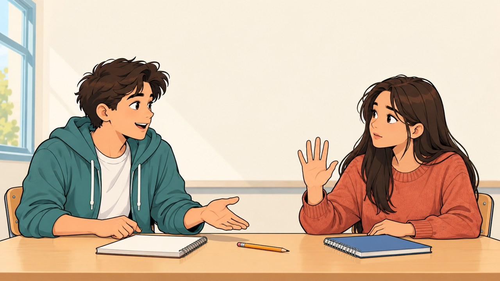
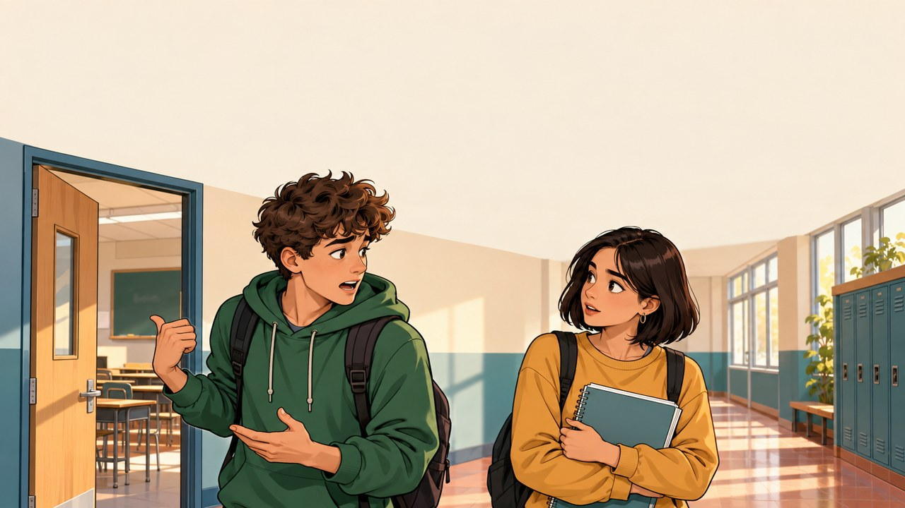
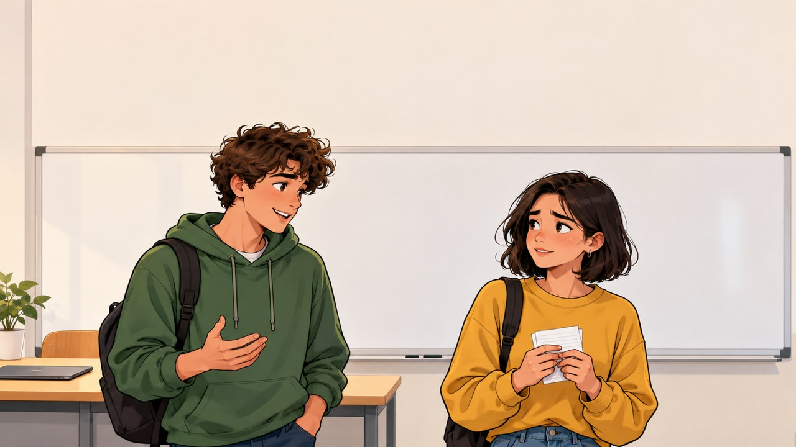
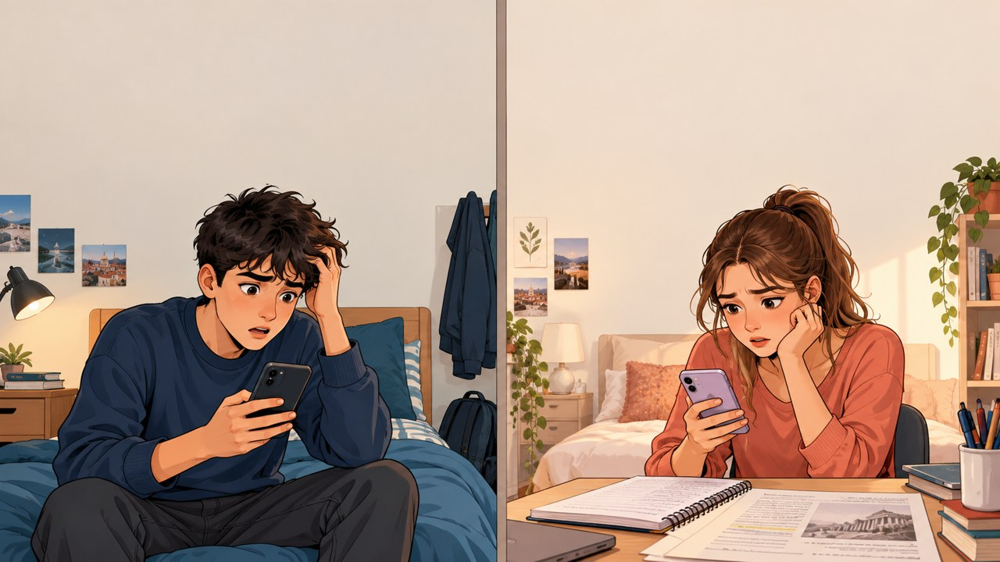
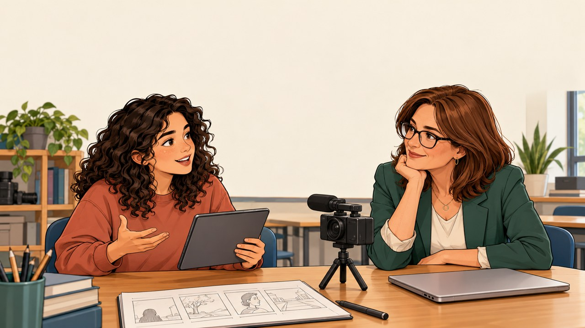
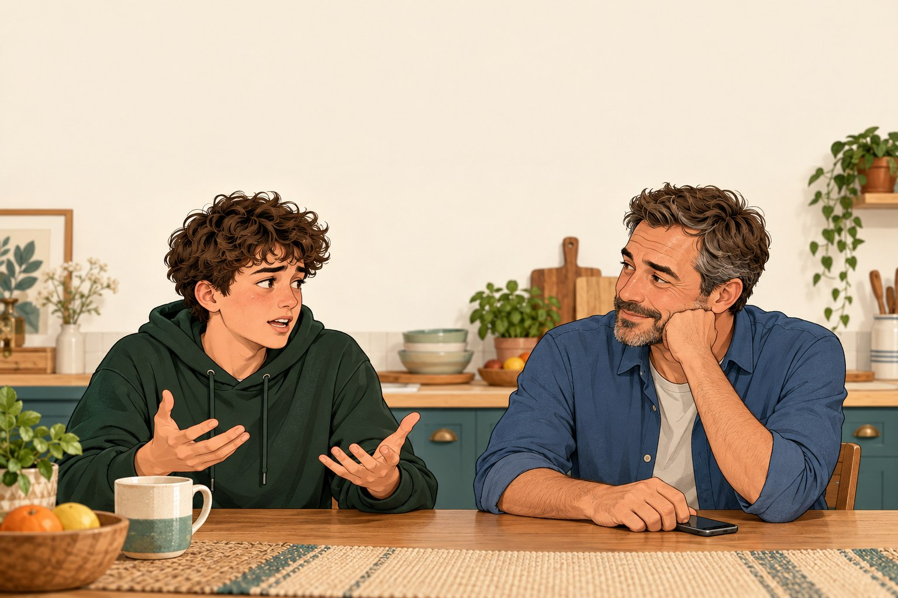

# Scienze Umane · Laboratori di comunicazione e pragmatica

66 scene originali per adolescenti di 15–16 anni. I nomi e i ruoli cambiano con la scena: il primo personaggio è a sinistra, il secondo a destra. Le prime 30 scene hanno Luca e Sara; le successive introducono altri interlocutori. Ogni scena offre un dialogo completo, un contesto visivo e attività di osservazione, interpretazione e trasformazione. Le scene digitali sono simulazioni locali: non inviano messaggi e non usano account WhatsApp.

I quattro livelli delle lingue restano nel percorso Lingue. In Scienze Umane si lavora sullo stesso episodio attraverso compiti progressivi, senza rendere artificialmente il lessico più difficile.

Riferimenti: manuale allegato, pp. 1–4; proposte concordate nella conversazione. Estensioni: richieste indirette, ironia, riparazione, comunicazione digitale, regole implicite. Le percentuali 7/38/55 non sono una regola generale della comunicazione. La mimica non prova intenzioni o stati interni. La frustrazione non implica inevitabilmente aggressività.

## 01 · L’allenamento di domani

**Percorso:** 1 · Gli elementi della comunicazione

**Obiettivo:** Riconoscere i sei elementi in un atto comunicativo e lo scambio dei ruoli nella risposta.

**Prima di osservare:** In uno scambio possiamo riconoscere chi invia il messaggio, chi lo riceve, che cosa comunica, il codice condiviso, il canale e ciò a cui si riferisce. Quando arriva una risposta, i ruoli possono invertirsi.

**Vignetta:** Nel corridoio, dopo le lezioni. L’orario dell’allenamento è cambiato.

**Illustrazione:** assets/hu-sports.jpg

> Nel corridoio, dopo le lezioni. L’orario dell’allenamento è cambiato.

1. **Luca:** Domani l’allenamento è alle tre, nella palestra della scuola.
2. **Sara:** Alle tre? Pensavo alle quattro.
3. **Luca:** Hanno cambiato l’orario. L’ho appena letto sull’avviso.
4. **Sara:** Va bene. Ci troviamo davanti alla palestra?
5. **Luca:** Sì, all’ingresso del cortile, poco prima delle tre.
6. **Sara:** Perfetto. Avviso anche mia madre, così mi organizzo.

**Osserva**

- Nella prima battuta, chi invia il messaggio e a chi è rivolto?
- Individua messaggio, codice, canale e referente.

**Interpreta e verifica**

- Che cosa cambia quando risponde Sara?
- Quale battuta permette di verificare la comprensione?

**Metti in scena e trasforma:** Rappresentate lo scambio e indicate i sei elementi prima nella battuta di Luca, poi nella risposta di Sara.

**Collegamento con Scienze Umane · Elementi della comunicazione · scambio dei ruoli:** Luca comunica luogo e orario; Sara risponde e diventa a sua volta emittente. La scena permette di applicare i sei elementi della comunicazione a un episodio concreto e di distinguere le persone dai ruoli che assumono nello scambio.

**Guida alla discussione:** Prima battuta: emittente Luca, destinataria Sara; messaggio sull’orario e sul luogo; codice italiano parlato; canale acustico attraverso l’aria; referente l’allenamento futuro. Non confondere la lingua utilizzata con il mezzo di trasmissione.

## 02 · Il corridoio è rumoroso

**Percorso:** 1 · Gli elementi della comunicazione

**Obiettivo:** Distinguere un ostacolo sul canale da un problema di codice.

**Prima di osservare:** Il rumore può ostacolare la ricezione anche quando le persone conoscono la stessa lingua. Chiedere di ripetere e cambiare posto sono modi per controllare ciò che si è sentito.

**Vignetta:** Vicino alla palestra arriva il rumore di una partita.

**Illustrazione:** assets/hu-noise.jpg

> Vicino alla palestra arriva il rumore di una partita.

1. **Luca:** L’allenamento è alle tre!
2. **Sara:** Alle sei? Non ho sentito bene.
3. **Luca:** Aspetta, qui c’è troppo rumore. Andiamo vicino alla porta.
4. **Sara:** Ecco, adesso ti sento. A che ora?
5. **Luca:** Alle tre del pomeriggio.
6. **Sara:** Ah, alle tre! Allora riesco a venire.

**Osserva**

- Quale parte dell’informazione viene fraintesa?
- I personaggi parlano una lingua condivisa?

**Interpreta e verifica**

- Il problema riguarda codice, canale o entrambi? Quali indizi hai?
- Perché spostarsi può essere più utile che ripetere allo stesso volume?

**Metti in scena e trasforma:** Recitate una versione con rumore simulato e una in un luogo tranquillo. Non urlate: osservate come cambia la comprensione.

**Collegamento con Scienze Umane · Canale · rumore · verifica della ricezione:** Sara sente un orario diverso perché il rumore copre la voce, pur condividendo la lingua di Luca. L’episodio distingue un ostacolo sul canale da un problema di codice e mostra la richiesta di ripetizione come strategia di verifica.

**Guida alla discussione:** Il rumore ostacola la ricezione. Sara segnala ciò che non ha capito, anziché fingere di aver compreso.

## 03 · Lo stesso avviso arriva in chat

**Percorso:** 1 · Gli elementi della comunicazione

**Obiettivo:** Confrontare un messaggio orale con lo stesso contenuto scritto.

**Prima di osservare:** Lo stesso contenuto può essere comunicato a voce o per iscritto. Cambiano il modo di riceverlo e gli indizi disponibili: un testo si può rileggere, ma non trasmette direttamente l’intonazione.

**Vignetta:** Più tardi, nelle rispettive case. Luca scrive a Sara.

**Illustrazione:** assets/hu-chat.jpg

> Più tardi, nelle rispettive case. Luca scrive a Sara.

1. **Luca:** Domani allenamento alle 15, nella palestra della scuola.
2. **Sara:** Da quale ingresso entriamo?
3. **Luca:** Dal cortile, vicino al campo.
4. **Sara:** Ci vediamo lì cinque minuti prima?
5. **Luca:** Sì, alle 14:55.
6. **Sara:** Perfetto, me lo segno.

**Osserva**

- Quali elementi sono uguali alla scena nel corridoio?
- Quali modalità del codice e del canale sono cambiate?

**Interpreta e verifica**

- Che cosa puoi rileggere in chat che nello scambio orale potrebbe sfuggire?
- Quali indizi espressivi mancano nel testo scritto?

**Metti in scena e trasforma:** Confrontate questa scena con “L’allenamento di domani”: riscrivete lo stesso avviso su carta.

**Collegamento con Scienze Umane · Comunicazione mediata · codice e canale:** Il contenuto dell’avviso passa dalla conversazione alla chat: diventa rileggibile, mentre mancano gli indizi dell’intonazione. Il confronto aiuta a distinguere il codice linguistico dal mezzo e a osservare come il canale condizioni l’interpretazione.

**Guida alla discussione:** Il codice è l’italiano scritto. Il canale è la comunicazione digitale tramite dispositivi e rete; l’app di chat è lo strumento, non il codice linguistico.

## 04 · Che cosa significa “*asp*”?

**Percorso:** 1 · Gli elementi della comunicazione

**Obiettivo:** Riconoscere la necessità di condividere il codice e chiarire le abbreviazioni.

**Prima di osservare:** Le abbreviazioni usate in chat devono avere un significato condiviso. Se una forma come “*asp*” non viene capita, si può chiedere di riscriverla per esteso.

**Vignetta:** Luca e Sara lavorano online alla presentazione. Luca si allontana dal computer.

**Illustrazione:** assets/hu-chat.jpg

> Luca e Sara lavorano online alla presentazione. Luca si allontana dal computer.

1. **Luca:** *asp*
2. **Sara:** Che significa? Hai finito?
3. **Luca:** No: “*asp*” vuol dire “aspetta”. Torno fra poco.
4. **Sara:** Ah, non avevo capito. Ti aspetto.
5. **Luca:** Dammi cinque minuti e riprendiamo.
6. **Sara:** Va bene, intanto cerco l’ultima immagine.

**Osserva**

- Quale segno non viene compreso?
- Sara riceve materialmente il messaggio?

**Interpreta e verifica**

- Perché ricevere un messaggio non basta per capirlo?
- Quale chiarimento rende il codice più accessibile?

**Metti in scena e trasforma:** Scegliete un’abbreviazione da chat, chiedete come viene interpretata e poi riscrivetela per esteso.

**Collegamento con Scienze Umane · Codice condiviso · metacomunicazione:** Sara riceve “*asp*” ma non ne conosce il significato. Chiedere che cosa vuol dire è una comunicazione sul codice stesso: la scena mostra perché la trasmissione materiale non garantisce la comprensione e come una spiegazione ripari l’equivoco.

**Guida alla discussione:** L’abbreviazione non è compresa da entrambi gli interlocutori. Chiedere il significato è una strategia comunicativa, non una colpa.

## 05 · “Lì”, ma dove?

**Percorso:** 1 · Gli elementi della comunicazione

**Obiettivo:** Ricostruire riferimenti di luogo e tempo attraverso informazioni condivise.

**Prima di osservare:** Parole come “lì” e “dopo” dipendono da informazioni condivise. Un riferimento poco preciso può essere chiarito indicando un luogo e un orario riconoscibili da entrambi.

**Vignetta:** La scuola ha due ingressi: quello principale e il cancello del cortile.

**Illustrazione:** assets/hu-sports.jpg

> La scuola ha due ingressi: quello principale e il cancello del cortile.

1. **Luca:** Ci vediamo lì dopo.
2. **Sara:** Dove? Davanti alla palestra?
3. **Luca:** No, al cancello del cortile.
4. **Sara:** Dopo le lezioni o prima dell’allenamento?
5. **Luca:** Prima dell’allenamento, alle due e cinquanta.
6. **Sara:** D’accordo, ti aspetto al cancello alle due e cinquanta.

**Osserva**

- Quali parole richiedono informazioni aggiuntive?
- Quali due luoghi vengono considerati?

**Interpreta e verifica**

- Quali conoscenze Luca presume di condividere con Sara?
- In quale contesto “lì dopo” potrebbe essere sufficiente?

**Metti in scena e trasforma:** Create un appuntamento con riferimenti vaghi. Il destinatario deve fare le domande necessarie per renderlo preciso.

**Collegamento con Scienze Umane · Contesto · deissi · conoscenze condivise:** “Lì” e “dopo” non individuano per entrambi lo stesso appuntamento. La pragmatica studia anche queste espressioni dipendenti dal contesto: specificare luogo e orario rende esplicite informazioni che Luca presumeva condivise.

**Guida alla discussione:** Le parole deittiche, come lì e dopo, dipendono dal contesto. Non sono sempre sbagliate: diventano problematiche quando i riferimenti non sono condivisi.

## 06 · Parlavi con me?

**Percorso:** 1 · Gli elementi della comunicazione

**Obiettivo:** Riconoscere il destinatario e gli indizi con cui viene individuato.

**Prima di osservare:** Chi sente un messaggio non è necessariamente il suo destinatario. Il nome, lo sguardo e il contesto possono aiutare a capire a chi è rivolta una richiesta.

**Vignetta:** Sara è vicina al banco. Matteo è poco più indietro.

**Illustrazione:** assets/hu-addressee.jpg

> Sara è vicina al banco. Matteo è poco più indietro.

1. **Luca:** Mi passi quel quaderno?
2. **Sara:** Dici a me o a Matteo?
3. **Luca:** A te, Sara. Scusa, stavo guardando lo zaino.
4. **Sara:** Questo qui sul banco?
5. **Luca:** Sì, quello vicino al tuo astuccio.
6. **Sara:** Tieni. Per un attimo non avevo capito.

**Osserva**

- Quante persone potrebbero sentirsi interpellate?
- Quali indizi identificano finalmente la destinataria?

**Interpreta e verifica**

- Essere presenti significa essere necessariamente destinatari del messaggio?
- Come possono collaborare sguardo e parole?

**Metti in scena e trasforma:** Recitate la richiesta con e senza nome e contatto visivo. Scambiate il ruolo del terzo compagno.

**Collegamento con Scienze Umane · Destinatario · indizi verbali e non verbali:** La richiesta può sembrare rivolta a più persone presenti. Nome e sguardo precisano la destinataria: la scena distingue chi sente il messaggio da chi è intenzionalmente interpellato e mostra la collaborazione fra parole e gesti.

**Guida alla discussione:** Matteo è presente ma non è il destinatario della richiesta iniziale. Evitare di equiparare chiunque senta un messaggio al destinatario intenzionale.

## 07 · Alle tre o alle quattro?

**Percorso:** 1 · Gli elementi della comunicazione

**Obiettivo:** Usare il feedback per controllare la comprensione e rendere visibile la circolarità.

**Prima di osservare:** Il feedback è la risposta che ritorna a chi ha comunicato. Riprendere con parole proprie un’informazione permette di controllare la comprensione; non significa necessariamente approvare una proposta.

**Vignetta:** Sara deve organizzare il rientro dopo l’allenamento.

**Illustrazione:** assets/hu-sports.jpg

> Sara deve organizzare il rientro dopo l’allenamento.

1. **Luca:** Domani ci alleniamo alle tre.
2. **Sara:** Alle tre del pomeriggio, giusto?
3. **Luca:** Sì, alle quindici.
4. **Sara:** Nella palestra della scuola o al campo del quartiere?
5. **Luca:** Nella palestra della scuola.
6. **Sara:** Bene, allora prendo l’autobus delle due e mezza.

**Osserva**

- Quali risposte di Sara contengono informazioni, oltre a un semplice sì?
- Chi è emittente nella seconda battuta?

**Interpreta e verifica**

- Il feedback conferma sempre l’accordo o può segnalare un dubbio?
- Che cosa potrebbe succedere senza le domande di Sara?

**Metti in scena e trasforma:** Uno dà tre indicazioni; l’altro le riformula. Chi le ha date conferma o corregge.

**Collegamento con Scienze Umane · Feedback · circolarità:** Sara riformula orario e luogo e Luca conferma. Le risposte ritornano all’emittente e orientano lo scambio: il caso rende osservabile la circolarità e la verifica della comprensione, che non coincide automaticamente con l’accordo.

**Guida alla discussione:** I ruoli cambiano a ogni turno. Capire e accettare una proposta sono due cose diverse: il feedback può anche esprimere dissenso.

## 08 · “Fai come vuoi”

**Percorso:** 2 · Chat, emoji e messaggi vocali

**Obiettivo:** Distinguere intenzione dell’emittente, interpretazione ed effetto del messaggio.

**Prima di osservare:** Nella chat mancano molti indizi vocali. Una risposta breve può essere interpretata diversamente dall’intenzione di chi la scrive: chiedere un chiarimento permette di confrontare le due letture.

**Vignetta:** Da case diverse, Sara e Luca si scambiano messaggi sulla presentazione.

**Illustrazione:** assets/hu-chat.jpg

> Da case diverse, Sara e Luca si scambiano messaggi sulla presentazione.

1. **Sara:** Ho cambiato la prima slide. Va bene?
2. **Luca:** Fai come vuoi.
3. **Sara:** Potevi dirmelo se non eri d’accordo.
4. **Luca:** Ma sono d’accordo! Intendevo che mi fido di te.
5. **Sara:** Ah, pensavo ti avesse dato fastidio.
6. **Luca:** No, mi piace. Teniamo la tua versione.

**Osserva**

- Quali parole di Luca vengono interpretate come dissenso?
- In quale battuta emerge l’equivoco?

**Interpreta e verifica**

- Quali altre letture della frase iniziale erano possibili?
- Come distingue Luca l’intenzione dall’effetto che ha prodotto?

**Metti in scena e trasforma:** Fermatevi dopo “Fai come vuoi”. Proponete due interpretazioni e una domanda per verificarle.

**Collegamento con Scienze Umane · Pragmatica · intenzione ed effetto:** Sara legge “Fai come vuoi” come fastidio, mentre Luca dichiara fiducia nella scelta. La scena confronta contenuto letterale, intenzione dichiarata ed effetto relazionale; il chiarimento evita di trattare la prima interpretazione come certezza.

**Guida alla discussione:** Il chiarimento offre un’interpretazione dichiarata dal personaggio; prima del chiarimento lo studente non deve conoscere con certezza la sua intenzione.

## 09 · “Va bene.” oppure “Va bene! 😊”

**Percorso:** 2 · Chat, emoji e messaggi vocali

**Obiettivo:** Osservare il contributo di punteggiatura ed emoji senza assegnare significati universali.

**Prima di osservare:** Punteggiatura ed emoji possono orientare la lettura insieme alle abitudini dei partecipanti. Non hanno però un significato emotivo certo e uguale per tutti.

**Vignetta:** Di solito Luca risponde con un punto esclamativo o una faccina. Questa volta scrive in fretta.

**Illustrazione:** assets/hu-chat.jpg

> Di solito Luca risponde con un punto esclamativo o una faccina. Questa volta scrive in fretta.

1. **Sara:** Usiamo questo titolo per la presentazione?
2. **Luca:** Va bene.
3. **Sara:** Sei arrabbiato? Di solito metti una faccina.
4. **Luca:** No, sto uscendo e ho scritto al volo. Il titolo mi piace.
5. **Sara:** Ah, quel punto mi sembrava un po’ secco.
6. **Luca:** Tranquilla 😊 Teniamolo!

**Osserva**

- Quale segno Sara considera importante?
- Luca dichiara di essere arrabbiato?

**Interpreta e verifica**

- Un punto indica sempre rabbia?
- Quali abitudini condivise influenzano la lettura di Sara?

**Metti in scena e trasforma:** Confrontate “Va bene.”, “Va bene!” e “Va bene! 😊”. Raccogliete interpretazioni diverse, poi scrivete una domanda di chiarimento.

**Collegamento con Scienze Umane · Comunicazione digitale · convenzioni del gruppo:** Sara dà peso al punto e all’assenza di un’emoji perché conosce le abitudini di Luca. L’episodio mostra come segni scritti e aspettative condivise orientino l’interpretazione, senza costituire un dizionario universale delle emozioni.

**Guida alla discussione:** Punteggiatura ed emoji orientano la lettura in relazione al contesto e alle abitudini; non costituiscono un dizionario certo delle intenzioni.

## 10 · Che cosa significa 👍?

**Percorso:** 2 · Chat, emoji e messaggi vocali

**Obiettivo:** Esplorare significati diversi dello stesso segno e chiedere una conferma esplicita.

**Prima di osservare:** Anche un’emoji richiede un significato sufficientemente condiviso. Lo stesso segno può essere usato come approvazione, conferma di lettura o assenso a una proposta.

**Vignetta:** Sara propone un orario per provare la presentazione.

**Illustrazione:** assets/hu-chat.jpg

> Sara propone un orario per provare la presentazione.

1. **Sara:** Vieni a provare la presentazione alle quattro?
2. **Luca:** 👍
3. **Sara:** Quindi vieni? O volevi solo dire che hai letto?
4. **Luca:** Vengo, sì!
5. **Sara:** Te lo chiedo perché io a volte lo uso per dire “ricevuto”.
6. **Luca:** Allora confermo: ci sono alle quattro.

**Osserva**

- Quale risposta non contiene parole?
- Quali due significati vengono attribuiti allo stesso segno?

**Interpreta e verifica**

- Perché due persone possono usare diversamente la stessa emoji?
- Quando è utile sostituire un segno con una frase esplicita?

**Metti in scena e trasforma:** Concordate un piccolo codice di tre simboli. Poi osservate che cosa accade quando lo usa una persona che non conosce l’accordo.

**Collegamento con Scienze Umane · Segni convenzionali · codice condiviso:** Per Luca il pollice in su conferma la presenza, per Sara può significare soltanto “ricevuto”. È un caso di interpretazione dei segni: la stessa forma non assicura lo stesso significato, che viene verificato con una risposta esplicita.

**Guida alla discussione:** Durante l’ascolto l’emoji viene descritta come “pollice in su”. La descrizione accessibile non sostituisce il simbolo visualizzato.

## 11 · Letto, ma senza risposta

**Percorso:** 2 · Chat, emoji e messaggi vocali

**Obiettivo:** Separare un indicatore tecnico dalle ipotesi sul comportamento e sulla relazione.

**Prima di osservare:** Un indicatore tecnico di lettura non rivela da solo disponibilità o intenzioni. Distinguere il dato osservato dalle ipotesi sulla persona aiuta a evitare conclusioni affrettate.

**Vignetta:** Il messaggio di Sara risulta letto, ma per un’ora non arriva risposta.

**Illustrazione:** assets/hu-chat.jpg

> Il messaggio di Sara risulta letto, ma per un’ora non arriva risposta.

1. **Sara:** Hai letto il messaggio sul lavoro? Non mi hai risposto.
2. **Luca:** Sì, l’ho aperto mentre uscivo. Poi non sono più riuscito a scriverti.
3. **Sara:** Pensavo che non volessi farlo con me.
4. **Luca:** No, certo che voglio! Mi serviva un momento per guardare il materiale.
5. **Sara:** Allora dimmi tu quando possiamo sentirci.
6. **Luca:** Dopo cena? Alle otto e mezza ci sono.

**Osserva**

- Che cosa permette di sapere l’indicatore “letto”?
- Che cosa non permette di sapere?

**Interpreta e verifica**

- Quali spiegazioni alternative erano possibili prima della risposta?
- Il chiarimento cancella automaticamente il disagio di Sara?

**Metti in scena e trasforma:** Scrivete tre spiegazioni compatibili con una mancata risposta e un messaggio che chieda chiarimenti senza accusare.

**Collegamento con Scienze Umane · Attribuzione di intenzioni · relazione:** L’indicatore “letto” è un dato tecnico; il disinteresse è invece un’ipotesi di Sara. La psicologia sociale aiuta a distinguere osservazione e attribuzione: il seguito offre informazioni alternative sul comportamento di Luca.

**Guida alla discussione:** L’indicatore non dimostra disponibilità, attenzione completa o intenzione di ignorare. Distinguere dato osservato e attribuzione.

## 12 · Nel vocale manca una parola

**Percorso:** 2 · Chat, emoji e messaggi vocali

**Obiettivo:** Riconoscere informazioni mancanti in un messaggio vocale e riparare l’equivoco.

**Prima di osservare:** Perdere una sola parola può cambiare molto il senso di un messaggio. Una richiesta di conferma è particolarmente utile prima di agire su un’informazione incompleta.

**Vignetta:** Luca ha inviato un vocale dalla fermata. Il traffico copriva una parte della frase.

**Illustrazione:** assets/hu-voice.jpg

> Luca ha inviato un vocale dalla fermata. Il traffico copriva una parte della frase.

1. **Luca:** Si sentiva il vocale che ti ho mandato?
2. **Sara:** Ho capito “stampare le slide”. Il resto no.
3. **Luca:** Dicevo di NON stamparle: devo ancora correggerle.
4. **Sara:** Ah, allora aspetto! Stavo per andare in copisteria.
5. **Luca:** Scusa, ti scrivo appena sono pronte.
6. **Sara:** Grazie. Per fortuna te l’ho chiesto.

**Osserva**

- Quale parola mancante cambia il significato?
- Quale differenza c’è fra sentire alcune parole e capire l’intera richiesta?

**Interpreta e verifica**

- Perché indovinare il contenuto può produrre un errore?
- Quando conviene cambiare canale?

**Metti in scena e trasforma:** Registrate un breve vocale e omettete una parola importante nella trascrizione. Il destinatario deve individuare che cosa chiedere.

**Collegamento con Scienze Umane · Rumore · significato · riparazione:** La perdita del “non” rovescia la richiesta di Luca. L’episodio collega il modello della comunicazione alla pragmatica: un ostacolo nella ricezione cambia l’azione attesa, e chiedere conferma permette di riparare l’equivoco prima di agire.

**Guida alla discussione:** La scena simula uno scambio di vocali; la voce dell’app resta pulita per accessibilità. Il rumore è descritto e rappresentato, non aggiunto a volume elevato.

## 13 · Lo stesso messaggio, due letture

**Percorso:** 2 · Chat, emoji e messaggi vocali

**Obiettivo:** Confrontare letture della stessa frase e il ruolo del contesto nei vocali.

**Prima di osservare:** Le stesse parole possono produrre impressioni diverse a seconda del tono e del momento. L’impressione di chi ascolta resta un’ipotesi da verificare nel seguito dello scambio.

**Vignetta:** Nel pomeriggio Sara chiede con un messaggio quando può chiamare. Luca risponde con un vocale.

**Illustrazione:** assets/hu-chat.jpg

> Nel pomeriggio Sara chiede con un messaggio quando può chiamare. Luca risponde con un vocale.

1. **Luca:** Quando vuoi. _Prima lettura: calma, disponibile._
2. **Sara:** Allora ti chiamo dopo cena, grazie.

> Più tardi, Sara non è ancora riuscita a chiamare. Luca è alla fermata e sta arrivando il suo autobus.

3. **Luca:** Quando vuoi. _Seconda lettura: più rapida. Luca deve salire sull’autobus._
4. **Sara:** Hai fretta? Se adesso non puoi, rimandiamo.

> Sara chiede se il momento è ancora adatto.

5. **Luca:** Sì, sto salendo sull’autobus. Scusa, facciamo fra mezz’ora?
6. **Sara:** Certo, chiamami tu quando arrivi.

**Osserva**

- Le parole delle due letture sono cambiate?
- Che cosa cambia nella recitazione proposta?

**Interpreta e verifica**

- Tutti i compagni percepiscono allo stesso modo le due letture?
- Quali informazioni del contesto aiuterebbero a interpretarle?

**Metti in scena e trasforma:** Registrate due letture di “Quando vuoi”, poi chiedete agli ascoltatori di descrivere gli indizi percepiti prima di conoscere l’intenzione.

**Collegamento con Scienze Umane · Paraverbale · interpretazione nel contesto:** Le parole restano uguali, mentre le letture proposte cambiano ritmo e tono. Il confronto mostra il contributo degli indizi vocali all’impressione del destinatario; l’intenzione resta da verificare e non si ricava con certezza dalla voce sintetica.

**Guida alla discussione:** Gli audio sintetici forniscono letture indicative con ritmo diverso. Per lavorare sulle sfumature emotive usare la recitazione o MP3 registrati dai partecipanti; non attribuire etichette emotive certe a una voce.

## 14 · Ti siedi con noi?

**Percorso:** 3 · Tono, silenzio e significati impliciti

**Obiettivo:** Osservare il valore comunicativo del silenzio senza attribuirgli un significato unico.

**Prima di osservare:** Un silenzio può avere effetti nella relazione senza esprimere un’intenzione unica o consapevole. La sua interpretazione va collegata alla situazione e alle informazioni successive.

**Vignetta:** Luca indica il posto libero accanto a sé. Sara guarda verso la porta.

**Illustrazione:** assets/hu-silence.jpg

> Luca indica il posto libero accanto a sé. Sara guarda verso la porta.

1. **Luca:** Ti siedi qui con me?
2. **Sara:** … _Sara resta in silenzio e cerca qualcuno con lo sguardo._
3. **Luca:** Preferisci stare da sola?
4. **Sara:** No, scusa. Cercavo Marta: dovevamo pranzare insieme.
5. **Luca:** C’è posto anche per lei. La aspettiamo?
6. **Sara:** Sì, grazie! Eccola, sta arrivando.

**Osserva**

- Che cosa fa Sara nella seconda vignetta?
- Quale significato Luca attribuisce al silenzio?

**Interpreta e verifica**

- Quali altre spiegazioni erano possibili?
- Come cambia lo scambio quando Luca fa una domanda?

**Metti in scena e trasforma:** Fermatevi sul silenzio. Ogni osservatore propone due ipotesi e indica quali informazioni mancano.

**Collegamento con Scienze Umane · Comunicazione non verbale · silenzio:** Luca interpreta la pausa di Sara come rifiuto, poi scopre che cercava un’amica. La scena rende visibili gli effetti del silenzio nella relazione e la pluralità delle sue possibili spiegazioni, senza assegnargli un significato fisso.

**Guida alla discussione:** Il silenzio produce effetti nell’interazione ma non comunica necessariamente un’intenzione consapevole o univoca. La pausa è riprodotta senza voce.

## 15 · Qui fa freddo

**Percorso:** 3 · Tono, silenzio e significati impliciti

**Obiettivo:** Distinguere contenuto letterale e possibile richiesta indiretta.

**Prima di osservare:** Una frase può descrivere una situazione e suggerire anche una richiesta. Il contesto aiuta, ma l’altra persona potrebbe cogliere soltanto il significato letterale.

**Vignetta:** La finestra è aperta. Sara è seduta vicino alla corrente d’aria.

**Illustrazione:** assets/hu-window.jpg

> La finestra è aperta. Sara è seduta vicino alla corrente d’aria.

1. **Sara:** Qui fa freddo.
2. **Luca:** Io con la felpa sto bene.
3. **Sara:** Puoi accostare la finestra? L’aria mi arriva proprio addosso.
4. **Luca:** Ah, certo. Pensavo fosse solo un commento.
5. **Sara:** Grazie. Già così va meglio.
6. **Luca:** Dimmi se vuoi chiuderla del tutto.

**Osserva**

- Che cosa dice Sara e verso che cosa guarda?
- Quale risposta mostra una lettura letterale?

**Interpreta e verifica**

- “Qui fa freddo” è sempre una richiesta di chiudere la finestra?
- Quali indizi rendono plausibile questa lettura nella scena?

**Metti in scena e trasforma:** Confrontate una richiesta diretta e una indiretta. Provate anche un contesto in cui la frase sia soltanto un’osservazione.

**Collegamento con Scienze Umane · Pragmatica · richiesta indiretta:** Sara descrive il freddo ma intende anche chiedere di accostare la finestra; Luca coglie inizialmente solo la descrizione. Il caso distingue significato letterale e azione comunicativa suggerita dal contesto, poi resa esplicita.

**Guida alla discussione:** Un’intenzione può essere suggerita dal contesto, ma deve restare verificabile attraverso lo scambio.

## 16 · Brava, davvero!

**Percorso:** 3 · Tono, silenzio e significati impliciti

**Obiettivo:** Confrontare apprezzamento e possibile ironia in relazione alla situazione.

**Prima di osservare:** Nell’ironia le parole possono essere in contrasto con la situazione e con l’intonazione. Non tutti riconoscono gli stessi indizi: è possibile chiedere chiarimenti o esprimere l’effetto ricevuto.

**Vignetta:** Sara ha appena sistemato tutte le slide. Luca guarda il lavoro completato.

**Illustrazione:** assets/hu-surprise.jpg

> Sara ha appena sistemato tutte le slide. Luca guarda il lavoro completato.

1. **Luca:** Brava, davvero!
2. **Sara:** Grazie! Finalmente le ho sistemate tutte.

> Un altro pomeriggio. Una parte delle slide non è pronta e l’invio è previsto tra pochi minuti.

3. **Luca:** Brava, davvero! _Secondo episodio: lettura ironica, di fronte al lavoro incompleto._
4. **Sara:** Se è una battuta, non mi fa ridere. Mi manca ancora una slide.

> Sara reagisce al commento di Luca.

5. **Luca:** Scusa. Ti aiuto a finirla?
6. **Sara:** Sì, scegli l’immagine mentre io sistemo il testo.

**Osserva**

- Quale fatto sostiene l’apprezzamento nella prima parte?
- Quale contesto alternativo viene proposto?

**Interpreta e verifica**

- Perché le stesse parole possono essere interpretate diversamente?
- Qual è la differenza fra ipotizzare ironia e averne la certezza?

**Metti in scena e trasforma:** Recitate “Brava, davvero!” come apprezzamento e come possibile ironia. Gli osservatori motivano la lettura con indizi concreti.

**Collegamento con Scienze Umane · Ironia · contesto · relazione:** La stessa espressione accompagna due momenti diversi: un lavoro completato e uno rimasto incompleto. La scena collega l’ironia al rapporto tra parole, situazione e tono, mostrando perché gli indizi vadano confrontati e il significato possa essere chiarito.

**Guida alla discussione:** Il dialogo non presuppone che ogni studente riconosca automaticamente l’ironia. Accogliere letture diverse e usare il chiarimento.

## 17 · Una penna: rifiuto o spiegazione?

**Percorso:** 3 · Tono, silenzio e significati impliciti

**Obiettivo:** Confrontare rifiuto, attribuzione di intenzioni, negoziazione e riparazione.

**Prima di osservare:** Un rifiuto breve può essere interpretato come rifiuto della persona. Chiarire il motivo e cercare alternative permette di distinguere il limite concreto dal giudizio sulla relazione.

**Vignetta:** Luca cerca una penna. Sara sta usando l’unica che ha portato.

**Illustrazione:** assets/pen-request.jpg

> Luca cerca una penna. Sara sta usando l’unica che ha portato.

1. **Luca:** Mi presti la penna?
2. **Sara:** No.
3. **Luca:** Va bene, non ti chiederò più niente.
4. **Sara:** Aspetta, ho solo questa e devo finire l’esercizio.
5. **Luca:** Ah, pensavo non volessi aiutarmi.
6. **Sara:** Chiediamo a Matteo se ne ha una di scorta?

**Osserva**

- Quale informazione manca nella risposta “No”?
- In quale battuta emerge l’interpretazione di Luca?

**Interpreta e verifica**

- La richiesta di Luca obbliga Sara a prestare l’unica penna?
- Come si può mantenere un rifiuto spiegandolo e rispettando l’altro?

**Metti in scena e trasforma:** Scrivete tre versioni: un rifiuto brusco, uno spiegato e uno che propone un’alternativa. Confrontate gli effetti senza imporre un unico esito.

**Collegamento con Scienze Umane · Contenuto e relazione · assertività:** Luca vive un “no” come rifiuto personale, mentre Sara sta usando l’unica penna. Il chiarimento distingue il limite concreto dal giudizio sul rapporto e permette una negoziazione: essere assertivi può includere il mantenimento di un rifiuto.

**Guida alla discussione:** Essere assertivi non significa dire sempre sì. L’immagine mostra la penna ancora sul lato di Sara, coerentemente con il mancato prestito.

## 18 · Due ingressi, un appuntamento

**Percorso:** 3 · Tono, silenzio e significati impliciti

**Obiettivo:** Rendere esplicite le informazioni che ciascuno presume condivise.

**Prima di osservare:** Un’espressione apparentemente chiara può nascondere presupposti diversi. Ricostruire che cosa ciascuno dava per scontato permette di individuare l’origine di un equivoco.

**Vignetta:** Dopo essersi cercati, Luca e Sara si ritrovano. Avevano aspettato davanti a ingressi diversi.

**Illustrazione:** assets/hu-sports.jpg

> Dopo essersi cercati, Luca e Sara si ritrovano. Avevano aspettato davanti a ingressi diversi.

1. **Luca:** Ti ho aspettata dieci minuti davanti all’ingresso principale.
2. **Sara:** Io ero al cancello del cortile!
3. **Luca:** Nel messaggio avevo scritto soltanto “all’ingresso”.
4. **Sara:** E io ho pensato al cortile, perché entro sempre da lì.
5. **Luca:** Domani facciamo al cancello del cortile, alle due?
6. **Sara:** Sì. Stavolta andiamo tutti e due nello stesso posto!

**Osserva**

- Quale espressione poteva indicare due luoghi diversi?
- Quali abitudini personali emergono?

**Interpreta e verifica**

- Una delle due interpretazioni era necessariamente irragionevole?
- Quale messaggio avrebbe ridotto l’ambiguità?

**Metti in scena e trasforma:** Disegnate due ingressi su una pianta semplice e scrivete un appuntamento comprensibile anche a un nuovo compagno.

**Collegamento con Scienze Umane · Presupposti · contesto condiviso:** I personaggi danno per scontati ingressi diversi per lo stesso incontro. L’episodio riguarda le conoscenze presunte comuni: ricostruirle permette di capire l’equivoco senza attribuirlo automaticamente a disattenzione o cattiva volontà.

**Guida alla discussione:** L’equivoco nasce da informazioni presunte condivise, non richiede un colpevole.

## 19 · Hai finito? · Ti offro aiuto

**Percorso:** 3 · Tono, silenzio e significati impliciti

**Obiettivo:** Osservare una lettura disponibile della stessa domanda.

**Prima di osservare:** La disponibilità suggerita da una domanda trova conferma nelle azioni e nelle parole successive. Un singolo indizio del volto non basta a conoscere l’intenzione.

**Vignetta:** Sara è ferma sull’ultimo passaggio dell’esercizio. Luca ha già chiuso il quaderno.

**Illustrazione:** assets/hu-warm.jpg

> Sara è ferma sull’ultimo passaggio dell’esercizio. Luca ha già chiuso il quaderno.

1. **Luca:** Hai finito? _Luca parla con calma e si rende disponibile._
2. **Sara:** Quasi. Non mi torna l’ultimo passaggio.
3. **Luca:** Vuoi che lo guardiamo insieme?
4. **Sara:** Sì, grazie. È questo qui.
5. **Luca:** Fammi vedere da dove sei partita.
6. **Sara:** Da questa formula. Poi mi blocco.

**Osserva**

- Quali parole successive chiariscono l’offerta d’aiuto?
- Quali gesti accompagnano la prima domanda?

**Interpreta e verifica**

- La sola frase “Hai finito?” basterebbe a sapere l’intenzione?
- Come potresti chiedere se l’altro vuole aiutarti?

**Metti in scena e trasforma:** Recitate la domanda con disponibilità, poi confrontatela con le altre due scene “Hai finito?”.

**Collegamento con Scienze Umane · Pragmatica · funzione della domanda:** “Hai finito?” introduce qui un’offerta di aiuto, confermata dalla continuazione. La scena mostra che una forma interrogativa può svolgere funzioni diverse: il significato dell’intervento si ricostruisce nel contesto e nel seguito dello scambio.

**Guida alla discussione:** La lettura vocale è indicativa. La disponibilità è confermata dalla continuazione del dialogo, non dedotta soltanto dal viso.

## 20 · Hai finito? · Ho fretta

**Percorso:** 3 · Tono, silenzio e significati impliciti

**Obiettivo:** Riconoscere l’effetto di ritmo, postura e aspettative nella richiesta.

**Prima di osservare:** Ritmo, postura e aspettative possono far percepire pressione. Esplicitare un vincolo concreto permette di negoziare i tempi senza dover attribuire intenzioni all’altro.

**Vignetta:** Luca guarda l’orologio. Il suo autobus partirà fra poco; Sara sta ancora scrivendo.

**Illustrazione:** assets/hu-impatient.jpg

> Luca guarda l’orologio. Il suo autobus partirà fra poco; Sara sta ancora scrivendo.

1. **Luca:** Hai finito? _Luca parla rapidamente e guarda l’orologio._
2. **Sara:** Mi stai mettendo fretta. Devi andare via?
3. **Luca:** Sì, fra poco parte il mio autobus.
4. **Sara:** Mi mancano due minuti. Se non fai in tempo, ci sentiamo domani.
5. **Luca:** Due minuti posso aspettare. Scusa, dovevo dirtelo prima.
6. **Sara:** Va bene, finisco questa riga e andiamo.

**Osserva**

- Quale gesto suggerisce fretta?
- Quando viene spiegata la ragione della fretta?

**Interpreta e verifica**

- Qual è la differenza fra avere fretta e voler svalutare qualcuno?
- Come formula Sara il proprio bisogno senza attribuire un’intenzione certa?

**Metti in scena e trasforma:** Recitate la domanda prima senza contesto, poi con la spiegazione dell’autobus. Confrontate le interpretazioni.

**Collegamento con Scienze Umane · Paraverbale · aspettative · negoziazione:** La domanda “Hai finito?” viene percepita come pressione in una situazione di fretta. Esplicitare tempi e vincoli permette di discutere l’effetto ricevuto e negoziare un accordo, anziché attribuire intenzioni certe a una postura.

**Guida alla discussione:** Non associare automaticamente braccia incrociate e ostilità. Gli indizi acquistano senso nel contesto e nel chiarimento.

## 21 · Hai finito? · Non me l’aspettavo

**Percorso:** 3 · Tono, silenzio e significati impliciti

**Obiettivo:** Riconoscere una possibile lettura di sorpresa della stessa domanda.

**Prima di osservare:** Sorpresa e sfiducia possono essere confuse da chi riceve un commento. Le domande di chiarimento consentono di confrontare l’impressione ricevuta con ciò che l’altro intendeva.

**Vignetta:** Sara chiude il quaderno prima del previsto. Luca alza lo sguardo dal proprio esercizio.

**Illustrazione:** assets/hu-surprise.jpg

> Sara chiude il quaderno prima del previsto. Luca alza lo sguardo dal proprio esercizio.

1. **Luca:** Hai finito? _Luca appare sorpreso e guarda il quaderno completato._
2. **Sara:** Sì. Perché, pensi che abbia saltato qualcosa?
3. **Luca:** No! Pensavo ci volesse molto più tempo.
4. **Sara:** Ne avevo già fatto uno simile ieri.
5. **Luca:** Ah, ecco. Mi fai vedere come hai iniziato?
6. **Sara:** Certo, guarda qui.

**Osserva**

- Quale fatto suscita la sorpresa dichiarata da Luca?
- Quale dubbio esprime Sara?

**Interpreta e verifica**

- Sorpresa e sfiducia sono necessariamente la stessa cosa?
- Quale domanda consente di verificare l’interpretazione?

**Metti in scena e trasforma:** Confrontate le tre scene “Hai finito?” mantenendo identiche le prime parole e cambiando contesto e recitazione.

**Collegamento con Scienze Umane · Interpretazione · sorpresa e attribuzione:** La stessa domanda viene letta come possibile sfiducia, mentre il personaggio dichiara sorpresa. La scena confronta esperienza del destinatario e intenzione dichiarata: una richiesta di chiarimento dà informazioni che il volto da solo non può garantire.

**Guida alla discussione:** La scena offre un’interpretazione plausibile, chiarita dai personaggi. Non insegna a leggere con certezza le intenzioni dalle sopracciglia.

## 22 · Mi interrompi sempre

**Percorso:** 4 · Relazioni, emozioni e contesti

**Obiettivo:** Osservare la circolarità di un conflitto e le diverse ricostruzioni della sua origine.

**Prima di osservare:** In un conflitto ciascuno può considerare il proprio comportamento una risposta a quello dell’altro. Cambiare una regola dello scambio può interrompere il circolo.

**Vignetta:** Durante il lavoro di gruppo, Luca e Sara parlano uno sopra l’altra.

**Illustrazione:** assets/hu-conflict.jpg

> Durante il lavoro di gruppo, Luca e Sara parlano uno sopra l’altra.

1. **Luca:** Ti interrompo perché non mi ascolti.
2. **Sara:** E io smetto di ascoltare perché mi interrompi!
3. **Luca:** Ma appena comincio guardi da un’altra parte.
4. **Sara:** Perché non riesco mai a finire una frase.
5. **Luca:** Aspetta. Finisci tu, poi parlo io.
6. **Sara:** Va bene. Ti spiego perché questa slide non funziona.

**Osserva**

- Dove colloca l’inizio del problema ciascun personaggio?
- Quale proposta modifica il modo di scambiare i turni?

**Interpreta e verifica**

- Le due ricostruzioni possono alimentarsi a vicenda?
- Come interrompere il circolo senza decidere subito chi ha iniziato?

**Metti in scena e trasforma:** Rappresentate il circolo, poi sostituite una sola battuta con una proposta concreta di ascolto.

**Collegamento con Scienze Umane · Pragmatica della relazione · circolarità del conflitto:** Ciascuno interpreta le proprie interruzioni come risposta all’altro. L’episodio mostra come le reazioni possano alimentarsi e come diverse ricostruzioni dell’inizio mantengano il conflitto; una regola concreta sui turni offre una possibilità di cambiamento.

**Guida alla discussione:** Le parole sempre e mai possono estendere una critica al rapporto intero. Analizzare episodi e comportamenti specifici.

## 23 · Il gruppo era già fatto

**Percorso:** 4 · Relazioni, emozioni e contesti

**Obiettivo:** Riconoscere il bisogno di appartenenza e distinguere intenzione ed esperienza dell’altro.

**Prima di osservare:** L’intenzione di una persona e l’esperienza dell’altra possono essere diverse. Chiedere che cosa è successo e riconoscere l’effetto prodotto apre possibilità di confronto.

**Vignetta:** Sara vede il gruppo già al lavoro e si avvicina a Luca.

**Illustrazione:** assets/hu-group.jpg

> Sara vede il gruppo già al lavoro e si avvicina a Luca.

1. **Sara:** Avete già fatto il gruppo? Non mi avete chiesto niente.
2. **Luca:** Pensavo lavorassi con Marta e gli altri.
3. **Sara:** No, aspettavo di parlarne con voi. Ci sono rimasta male.
4. **Luca:** Mi dispiace. Ho dato per scontato una cosa che non sapevo.
5. **Sara:** C’è ancora un posto per me?
6. **Luca:** Chiediamo agli altri. Non abbiamo ancora diviso tutte le parti.

**Osserva**

- Quale presupposto aveva Luca?
- Quale esperienza riferisce Sara?

**Interpreta e verifica**

- Non avere un’intenzione negativa elimina gli effetti sull’altro?
- Come si può riconoscere un’esperienza senza parlare al posto di chi la vive?

**Metti in scena e trasforma:** Proponete due continuazioni: una difensiva e una che verifica presupposti e possibilità concrete.

**Collegamento con Scienze Umane · Appartenenza · inclusione · intenzione ed effetto:** Un gruppo già formato viene vissuto come esclusione, anche se questa non era l’intenzione dichiarata. Il caso collega bisogno di appartenenza ed esperienza relazionale: ascoltare l’effetto sull’altro è parte della negoziazione, senza garantire un esito automatico.

**Guida alla discussione:** Evitare di garantire un lieto fine automatico: il coinvolgimento richiede anche l’accordo del gruppo e il rispetto delle regole dell’attività.

## 24 · Non ce l’ho con te

**Percorso:** 4 · Relazioni, emozioni e contesti

**Obiettivo:** Riconoscere frustrazione, destinatario della reazione e possibilità di riparazione.

**Prima di osservare:** La causa di un disagio può essere diversa dalla persona che riceve una risposta brusca. Il disagio può spiegare una reazione, senza giustificare il modo di trattare l’altro.

**Vignetta:** Luca ha appena ricevuto una verifica andata male. Sara gli si avvicina.

**Illustrazione:** assets/hu-conflict.jpg

> Luca ha appena ricevuto una verifica andata male. Sara gli si avvicina.

1. **Sara:** Oggi prepariamo insieme la presentazione?
2. **Luca:** Lasciami stare, ho altro per la testa.
3. **Sara:** Ehi, ti ho solo fatto una domanda. Che succede?
4. **Luca:** La verifica è andata male. Scusa, tu non c’entri.
5. **Sara:** Se vuoi ne parliamo, ma non prendertela con me.
6. **Luca:** Hai ragione. Dammi un momento, poi ti racconto.

**Osserva**

- Che cosa chiede Sara e che risposta riceve?
- La causa della delusione coincide con la destinataria della risposta?

**Interpreta e verifica**

- Quali risposte alla frustrazione erano possibili oltre a quella brusca?
- Che cosa riconosce Luca nella riparazione?

**Metti in scena e trasforma:** Riscrivete la seconda battuta come richiesta di una pausa. Sara può mantenere un confine e offrire ascolto.

**Collegamento con Scienze Umane · Emozioni · regolazione · responsabilità relazionale:** Il disagio nasce altrove ma una risposta brusca colpisce l’interlocutore presente. La scena aiuta a distinguere causa del vissuto e destinatario della reazione; riconoscerlo permette una riparazione senza giustificare il trattamento dell’altro.

**Guida alla discussione:** La frustrazione non produce inevitabilmente aggressività. Il disagio può spiegare una reazione senza giustificare il trattamento dell’altro.

## 25 · Consigli o ascolto?

**Percorso:** 4 · Relazioni, emozioni e contesti

**Obiettivo:** Chiarire il bisogno comunicativo e praticare la riformulazione.

**Prima di osservare:** Dare consigli e offrire ascolto rispondono a bisogni diversi. Una riformulazione proposta come domanda permette all’altro di confermare o correggere ciò che abbiamo capito.

**Vignetta:** Sara racconta a Luca che il gruppo ha cambiato la sua parte della presentazione.

**Illustrazione:** assets/hu-listen.jpg

> Sara racconta a Luca che il gruppo ha cambiato la sua parte della presentazione.

1. **Sara:** Ci sono rimasta male. Hanno cambiato tutto il mio pezzo.
2. **Luca:** Diglielo subito e fallo rimettere com’era.
3. **Sara:** Aspetta, adesso vorrei solo raccontartelo.
4. **Luca:** Scusa, ti ascolto. Che cosa ti ha dato più fastidio?
5. **Sara:** Che non mi abbiano neanche chiesto un parere.
6. **Luca:** Quindi non è solo la modifica: volevi essere coinvolta. Ho capito bene?

**Osserva**

- Che cosa offre subito Luca?
- Che cosa chiede invece Sara?

**Interpreta e verifica**

- Un consiglio utile può arrivare in un momento poco adatto?
- Che cosa distingue una riformulazione da un’interpretazione imposta?

**Metti in scena e trasforma:** Chi ascolta deve chiedere di che cosa l’altro ha bisogno e riformulare una frase, lasciando la possibilità di correggerla.

**Collegamento con Scienze Umane · Ascolto · bisogni comunicativi · riformulazione:** Uno offre soluzioni mentre l’altra cerca ascolto. Chiedere di che cosa abbia bisogno e riformulare come domanda rende verificabile la comprensione: l’empatia è praticata nello scambio, senza pretendere di conoscere dall’esterno i sentimenti altrui.

**Guida alla discussione:** La riformulazione si propone come verifica: “Se ho capito… È così?”. Non attribuire sentimenti o diagnosi dall’esterno.

## 26 · Come preferisci salutare?

**Percorso:** 4 · Relazioni, emozioni e contesti

**Obiettivo:** Esplorare regole implicite e preferenze senza stereotipi culturali.

**Prima di osservare:** Le abitudini di saluto variano tra persone e contesti. Una preferenza può essere chiesta e rispettata senza attribuire comportamenti fissi a un gruppo o a una cultura.

**Vignetta:** Luca incontra Sara e apre le braccia per salutarla.

**Illustrazione:** assets/hu-greeting.jpg

> Luca incontra Sara e apre le braccia per salutarla.

1. **Luca:** Ciao! Ti abbraccio?
2. **Sara:** Oggi preferisco di no, se non ti dispiace.
3. **Luca:** Certo, nessun problema.
4. **Sara:** Facciamo un saluto con la mano?
5. **Luca:** Va bene così! Come stai?
6. **Sara:** Meglio di ieri. Ti racconto mentre andiamo?

**Osserva**

- Quali due modalità di saluto compaiono?
- La preferenza di Sara viene espressa chiaramente?

**Interpreta e verifica**

- Le abitudini sono uguali in tutte le famiglie e in tutti i gruppi?
- Si può dedurre una preferenza dalla nazionalità?

**Metti in scena e trasforma:** Inventate tre contesti diversi di saluto. Spiegate come chiedere e rispettare le preferenze personali.

**Collegamento con Scienze Umane · Norme sociali · differenze personali e culturali:** I personaggi chiariscono come preferiscono salutarsi. Il caso permette di osservare regole apprese e abitudini variabili, un tema antropologico: conoscere una preferenza individuale evita di trasformare una differenza in uno stereotipo culturale.

**Guida alla discussione:** Le variazioni possono riguardare persone, famiglie, gruppi e contesti. Non assegnare comportamenti fissi a nazioni o culture.

## 27 · Quando posso prendere la parola?

**Percorso:** 4 · Relazioni, emozioni e contesti

**Obiettivo:** Rendere esplicite le diverse regole di partecipazione a una conversazione.

**Prima di osservare:** Il silenzio può dipendere dalle regole con cui una persona prende la parola, oltre che dal suo interesse. Rendere espliciti i turni può facilitare la partecipazione.

**Vignetta:** Luca espone un’idea senza fare pause. Sara aspetta per intervenire.

**Illustrazione:** assets/hu-warm.jpg

> Luca espone un’idea senza fare pause. Sara aspetta per intervenire.

1. **Luca:** Non dici niente. La proposta non ti piace?
2. **Sara:** Mi piace, ma aspettavo che finissi.
3. **Luca:** Pensavo mi avresti interrotto se avevi un’idea.
4. **Sara:** Ci ho provato, poi ho preferito aspettare.
5. **Luca:** Scusa, mi fermo. Tu che cosa cambieresti?
6. **Sara:** Metterei l’esempio prima della spiegazione.

**Osserva**

- Quale significato Luca attribuisce al silenzio?
- Quali regole di partecipazione stanno usando i due?

**Interpreta e verifica**

- Parlare meno significa necessariamente disinteresse?
- Quale accordo rende più accessibile il confronto?

**Metti in scena e trasforma:** Recitate una discussione con regole implicite diverse, poi concordate una modalità di turnazione.

**Collegamento con Scienze Umane · Regole implicite · partecipazione:** Un diverso modo di aspettare il turno può essere scambiato per disinteresse. Rendere esplicite le regole della conversazione mostra come il contesto sociale organizzi la partecipazione e come un accordo possa renderla più accessibile.

**Guida alla discussione:** Non trasformare una modalità comunicativa in un tratto personale fisso. Le regole possono essere negoziate.

## 28 · Un’emozione, un affetto, una giornata

**Percorso:** 4 · Relazioni, emozioni e contesti

**Obiettivo:** Distinguere reazione emotiva, sentimento duraturo e stato d’animo attraverso il racconto nel tempo.

**Prima di osservare:** Per distinguere una reazione emotiva, un affetto duraturo e un umore di fondo servono informazioni su evento, durata ed esperienza della persona. L’espressione del viso, da sola, non basta.

**Vignetta:** Un rumore improvviso ha fatto sobbalzare Luca. Poco dopo, i due riprendono a parlare.

**Illustrazione:** assets/hu-listen.jpg

> Un rumore improvviso ha fatto sobbalzare Luca. Poco dopo, i due riprendono a parlare.

1. **Luca:** Che colpo! Mi batte ancora forte il cuore.
2. **Sara:** È stata la porta. Adesso è tutto tranquillo.

> Il rumore è cessato. Luca si tranquillizza.

3. **Luca:** Sì, mi è passata. Grazie per essere rimasta qui.
4. **Sara:** Figurati. Lo sai che ti voglio bene.

> Sara torna a chiedere come sta Luca: le era sembrato giù già prima del rumore.

5. **Luca:** Anch’io. Oggi però mi sento un po’ giù da stamattina.
6. **Sara:** Ti va di fare due passi e raccontarmi?

**Osserva**

- Quale esperienza è legata a un evento improvviso?
- Quale viene raccontata come duratura e quale come sfondo della giornata?

**Interpreta e verifica**

- La sola espressione del viso permetterebbe di distinguere queste esperienze?
- Quali informazioni aggiunge il racconto della persona?

**Metti in scena e trasforma:** Create tre brevi racconti fittizi distinguendo evento, durata, sensazioni corporee e parole del personaggio.

**Collegamento con Scienze Umane · Psicologia degli affetti · durata e contesto:** I racconti distinguono una reazione a un evento, un affetto duraturo e un umore di fondo. L’attinenza riguarda la descrizione dell’esperienza nel tempo: servono parole e contesto della persona, non una classificazione ricavata da un’espressione facciale.

**Guida alla discussione:** Usare i racconti come esempi didattici, senza diagnosi o richieste di confessioni personali. I confini delle esperienze reali possono essere meno netti degli esempi.

## 29 · Ho bisogno di una pausa

**Percorso:** 4 · Relazioni, emozioni e contesti

**Obiettivo:** Riconoscere bisogni diversi e formularli senza svalutare quelli dell’altro.

**Prima di osservare:** Durante un’attività possono emergere bisogni e obiettivi diversi. Dichiararli e proporre un accordo concreto rende possibile cercare una soluzione condivisa.

**Vignetta:** La merenda di Luca è ancora nel contenitore. Il lavoro sul tavolo non è finito.

**Illustrazione:** assets/school-snacks.jpg

> La merenda di Luca è ancora nel contenitore. Il lavoro sul tavolo non è finito.

1. **Luca:** Ho fame, non riesco più a concentrarmi. Facciamo una pausa?
2. **Sara:** Possiamo prima finire questa parte?
3. **Luca:** Mi servono dieci minuti adesso, poi riparto.
4. **Sara:** Ho paura che dopo ci perdiamo e non finiamo più.
5. **Luca:** Mettiamo un timer e riprendiamo da questa slide.
6. **Sara:** Va bene. Segno il punto, tu prendi la merenda.

**Osserva**

- Quali bisogni o obiettivi dichiarano i personaggi?
- Quale proposta li prende entrambi in considerazione?

**Interpreta e verifica**

- I bisogni si presentano sempre in un ordine identico per tutti?
- Come cambia lo scambio quando i bisogni vengono formulati esplicitamente?

**Metti in scena e trasforma:** Inventate una negoziazione fra pausa, tempo e lavoro comune. Cercate un accordo concreto e verificabile.

**Collegamento con Scienze Umane · Bisogni · obiettivi · negoziazione:** Durante la stessa attività emergono esigenze differenti, fra cui una pausa. La scena applica il tema psicologico dei bisogni alla vita quotidiana: dichiararli consente un accordo concreto, senza stabilire una gerarchia rigida valida per ogni persona.

**Guida alla discussione:** I modelli dei bisogni sono strumenti di lettura, non una scala rigida da applicare a ogni persona. La scena non impone che un bisogno annulli tutti gli altri.

## 30 · Lo faccio per il voto o per interesse?

**Percorso:** 4 · Relazioni, emozioni e contesti

**Obiettivo:** Confrontare motivazioni intrinseche ed estrinseche e la loro possibile coesistenza.

**Prima di osservare:** Si può svolgere la stessa attività per interesse verso il contenuto, per un risultato esterno o per entrambe le ragioni. Le motivazioni vanno ascoltate, non dedotte dal solo comportamento.

**Vignetta:** Luca e Sara devono scegliere un esempio per la presentazione valutata.

**Illustrazione:** assets/project.jpg

> Luca e Sara devono scegliere un esempio per la presentazione valutata.

1. **Luca:** Questo esempio sulle chat mi incuriosisce. Lo mettiamo?
2. **Sara:** Se ci aiuta a prendere un buon voto, sì.
3. **Luca:** A me interessa anche capire perché ci fraintendiamo così spesso.
4. **Sara:** In effetti “Fai come vuoi” ha fatto litigare anche me con un’amica.
5. **Luca:** Allora partiamo da quello. Cerco due messaggi inventati.
6. **Sara:** Io controllo le consegne, così non dimentichiamo nessun punto.

**Osserva**

- Quali motivi per lavorare vengono dichiarati?
- Quali riguardano l’attività stessa e quali un risultato esterno?

**Interpreta e verifica**

- Le due forme di motivazione si escludono necessariamente?
- Il comportamento visibile basta per conoscere il motivo di una persona?

**Metti in scena e trasforma:** Attribuite a due personaggi fittizi motivazioni diverse per la stessa azione e scrivete le domande necessarie per conoscerle.

**Collegamento con Scienze Umane · Motivazione intrinseca ed estrinseca:** I personaggi raccontano interesse per il contenuto e desiderio di ottenere un voto. Il confronto rende concrete due fonti della motivazione che possono coesistere: le ragioni si ricostruiscono ascoltando, senza dividere gli studenti in tipi fissi.

**Guida alla discussione:** Non dividere gli studenti in tipi fissi o giudicare moralmente le motivazioni. La stessa attività può essere sostenuta da ragioni diverse.

## 31 · Papà scrive: dove ci vediamo?

**Percorso:** 5 · Famiglia, scuola e vita quotidiana

**Obiettivo:** Distinguere le persone dai ruoli comunicativi e verificare un riferimento spaziale.

**Prima di osservare:** Mittente e destinatario sono ruoli nello scambio, non identità fisse. La posizione grafica di un messaggio può cambiare da un telefono all’altro senza cambiarne l’autore.

**Vignetta:** Paolo aspetta nell’auto parcheggiata. Matteo esce dalla scuola guida e controlla il telefono.

**Illustrazione:** assets/hu-father-son.jpg

> Paolo aspetta nell’auto parcheggiata. Matteo esce dalla scuola guida e controlla il telefono.

1. **Papà Paolo:** Ci vediamo al parcheggio dietro l’incrocio dove ti ho lasciato.
2. **Matteo:** Quello vicino alla farmacia o quello davanti al parco?
3. **Papà Paolo:** Vicino alla farmacia. Sono all’ingresso pedonale.
4. **Matteo:** Va bene, arrivo dalla scuola guida.
5. **Papà Paolo:** Ti aspetto qui.
6. **Matteo:** Ti vedo! Sto arrivando.

**Osserva**

- Chi è il mittente del primo messaggio? Chi lo è della risposta?
- Quale indicazione iniziale può riferirsi a due luoghi diversi?

**Interpreta e verifica**

- Cambiare telefono cambia il mittente di un messaggio già inviato?
- La risposta “Ok” garantirebbe da sola di aver capito il luogo?

**Metti in scena e trasforma:** Disegnate la stessa chat vista dai due telefoni. Mantenete autori e ordine dei messaggi; spiegate perché i lati sullo schermo possono cambiare.

**Collegamento con Scienze Umane · Ruoli comunicativi · feedback · referente:** Papà e Matteo restano le stesse persone, ma nella risposta si scambiano i ruoli di mittente e destinatario. La domanda sul parcheggio verifica il riferimento spaziale; il lato delle bolle sul telefono non definisce chi sia l’autore del messaggio.

**Guida alla discussione:** Paolo e Matteo restano le stesse persone. Nel primo messaggio Paolo è mittente, nella risposta lo è Matteo. Il colore o il lato della bolla dipende dall’interfaccia e non definisce il ruolo. La richiesta di precisazione verifica il referente.

## 32 · Il vocale: una parola coperta dal rumore

**Percorso:** 5 · Famiglia, scuola e vita quotidiana

**Obiettivo:** Segnalare una ricezione incompleta e scegliere un mezzo più adatto.

**Prima di osservare:** Un vocale ricevuto solo in parte può richiedere una conferma scritta. Il passaggio dall’orale allo scritto modifica gli indizi e la possibilità di rileggere il contenuto.

**Vignetta:** Paolo invia un vocale dall’auto ferma. Fuori dalla scuola guida Matteo sente il traffico.

**Illustrazione:** assets/hu-father-son.jpg

> Paolo invia un vocale dall’auto ferma. Fuori dalla scuola guida Matteo sente il traffico.

1. **Papà Paolo:** Sono al parcheggio vicino alla farmacia. Ti aspetto all’ingresso pedonale. _Nella recitazione simulate un rumore breve sulla parola “farmacia”._
2. **Matteo:** Non ho sentito dove. Me lo scrivi?
3. **Papà Paolo:** Farmacia, ingresso pedonale. Ti mando anche il punto sulla mappa.
4. **Matteo:** Eccolo, ora l’ho trovato.
5. **Papà Paolo:** Riesci a raggiungermi da lì?
6. **Matteo:** Sì, sono a due minuti. Arrivo.

**Osserva**

- Quale parte del messaggio Matteo dice di non aver ricevuto bene?
- Come cambiano codice e modalità quando Paolo scrive?

**Interpreta e verifica**

- Il rumore è la stessa cosa che non conoscere una parola?
- Perché una conferma precisa è più utile di “Ho capito” se resta un dubbio?

**Metti in scena e trasforma:** Confrontate una versione solo vocale e una con conferma scritta. Il rumore si simula nella recitazione, non è aggiunto all’audio incluso.

**Collegamento con Scienze Umane · Canale · rumore · adattamento del messaggio:** Una parte del vocale non arriva chiaramente e il padre fornisce una conferma scritta. La scena distingue codice linguistico, modalità e mezzo, mostrando il feedback come risorsa per scegliere una forma più adatta alla situazione.

**Guida alla discussione:** Il codice linguistico rimane italiano; cambia la modalità orale/scritta e l’accesso al messaggio. Una mappa introduce anche segni grafici. Non dedurre la comprensione dal solo stato “ascoltato”.

## 33 · Un biglietto sul tavolo

**Percorso:** 5 · Famiglia, scuola e vita quotidiana

**Obiettivo:** Riconoscere il canale cartaceo e gli impliciti di un messaggio quotidiano.

**Prima di osservare:** Un’espressione quotidiana può riferirsi ad azioni diverse. Chiarire il verbo attraverso una domanda permette di evitare un equivoco senza attribuire intenzioni negative.

**Vignetta:** Sul tavolo della cucina c’è il biglietto di Teresa: «Prendi la merenda prima di uscire». Giulia sta preparando lo zaino.

**Illustrazione:** assets/hu-grandmother.jpg

> Sul tavolo della cucina c’è il biglietto di Teresa: «Prendi la merenda prima di uscire». Giulia sta preparando lo zaino.

1. **Nonna Teresa:** Hai visto il biglietto? Prendi la merenda prima di uscire.
2. **Giulia:** Devo mangiarla adesso? Ho appena finito di pranzare.
3. **Nonna Teresa:** No, intendevo portarla con te! È nel contenitore.
4. **Giulia:** Ah, allora la metto nello zaino e la mangio alla pausa.
5. **Nonna Teresa:** Sì, prendi anche la mela se ti va.
6. **Giulia:** Grazie, nonna. Così non devo tornare a prenderla.

**Osserva**

- Quali due azioni vengono associate al verbo “prendere”?
- Quale risposta chiarisce che cosa intendeva Teresa?

**Interpreta e verifica**

- Il biglietto era sufficiente per Giulia? Perché?
- Come si potrebbe riscriverlo per evitare questo equivoco?

**Metti in scena e trasforma:** Scrivete un biglietto informativo e uno con una richiesta esplicita. Scambiateli e confrontate le interpretazioni.

**Collegamento con Scienze Umane · Ambiguità · impliciti · supporto del messaggio:** “Prendi la merenda” può essere inteso come mangiarla oppure portarla con sé. Il chiarimento esplora la pragmatica di una frase quotidiana; il confronto tra biglietto e conversazione distingue inoltre codice scritto, carta e voce.

**Guida alla discussione:** Nel dialogo il canale è acustico; nel biglietto è visivo e cartaceo. Il supporto carta non è il codice, che qui è l’italiano scritto.

## 34 · Suona la campanella: che cosa significa?

**Percorso:** 5 · Famiglia, scuola e vita quotidiana

**Obiettivo:** Interpretare un segnale convenzionale in relazione al contesto.

**Prima di osservare:** Un segnale convenzionale acquista significato nel contesto. Lo stesso suono può richiamare passaggi diversi dell’orario scolastico.

**Vignetta:** Amir chiude il quaderno appena suona la campanella. La professoressa è ancora accanto al banco.

**Illustrazione:** assets/hu-teacher.jpg

> Amir chiude il quaderno appena suona la campanella. La professoressa è ancora accanto al banco.

1. **Amir:** Finalmente! Metto tutto nello zaino?
2. **Prof.ssa Rinaldi:** Aspetta, non usciamo: è il cambio di lezione.
3. **Amir:** Ah, pensavo fosse già l’ultima ora.
4. **Prof.ssa Rinaldi:** Abbiamo ancora il laboratorio. Porta anche il quaderno.
5. **Amir:** Giusto, l’avevo dimenticato. Andiamo in quello al piano di sopra?
6. **Prof.ssa Rinaldi:** Sì, ci aspetta il resto della classe.

**Osserva**

- Quale interpretazione propone Amir?
- Quale informazione aggiunge l’insegnante?

**Interpreta e verifica**

- Il suono da solo permette sempre di sapere quale attività inizia?
- In un’altra scuola le convenzioni potrebbero essere diverse?

**Metti in scena e trasforma:** Inventate due contesti con la stessa campanella e significati diversi. Indicate il destinatario collettivo.

**Collegamento con Scienze Umane · Codice convenzionale · istituzione e contesto:** Il suono della campanella richiama una regola dell’orario scolastico. Il caso mostra una comunicazione senza parole: significato del segnale, situazione e convenzione condivisa vanno collegati, distinguendo l’istituzione dal dispositivo materiale.

**Guida alla discussione:** Distinguere l’istituzione che organizza il segnale dal dispositivo che lo emette materialmente. La campanella non usa parole ma un codice convenzionale.

## 35 · L’email senza allegato

**Percorso:** 5 · Famiglia, scuola e vita quotidiana

**Obiettivo:** Confrontare mittente, destinatario, messaggio e supporto in un’email scolastica.

**Prima di osservare:** Il testo di un messaggio può annunciare un documento che non è stato effettivamente trasmesso. Il feedback permette di individuare la differenza tra intenzione e ricezione.

**Vignetta:** Al banco, Amir e la professoressa controllano l’email della consegna.

**Illustrazione:** assets/hu-teacher.jpg

> Al banco, Amir e la professoressa controllano l’email della consegna.

1. **Amir:** Professoressa, le è arrivata la mia presentazione?
2. **Prof.ssa Rinaldi:** È arrivata l’email, ma il file non c’è.
3. **Amir:** Davvero? Avevo scritto “in allegato”… Ah, non l’ho caricato!
4. **Prof.ssa Rinaldi:** Puoi inviarlo adesso?
5. **Amir:** Sì, eccolo. Questa volta controllo prima di premere invio.
6. **Prof.ssa Rinaldi:** Adesso c’è. Ti mando la conferma, grazie.

**Osserva**

- Che cosa è arrivato e che cosa manca?
- Quando risponde la professoressa, quale ruolo assume?

**Interpreta e verifica**

- Inviare un testo che nomina un file significa aver trasmesso anche il file?
- Quale feedback verifica la ricezione del documento?

**Metti in scena e trasforma:** Preparate una finta email con oggetto, destinatario, testo e allegato rappresentato su carta. Non usate indirizzi reali.

**Collegamento con Scienze Umane · Intenzione · ricezione · feedback:** L’email annuncia un allegato che non è stato inviato. La scena distingue ciò che il mittente intende trasmettere da ciò che il destinatario riceve effettivamente; la risposta segnala il problema e permette di completare la comunicazione.

**Guida alla discussione:** La conversazione mostrata è in presenza. Il laboratorio analizza separatamente l’email citata. La conferma di ricezione non coincide con una valutazione positiva del lavoro.

## 36 · L’annuncio al binario tre

**Percorso:** 5 · Famiglia, scuola e vita quotidiana

**Obiettivo:** Riconoscere un destinatario collettivo e integrare informazioni sonore e visive.

**Prima di osservare:** Un annuncio pubblico ha molti destinatari. Un’informazione incompleta può essere verificata confrontando numero, destinazione e indicazioni visibili.

**Vignetta:** Un annuncio si diffonde dagli altoparlanti. Davide e Rosa guardano verso i binari.

**Illustrazione:** assets/hu-station.jpg

> Un annuncio si diffonde dagli altoparlanti. Davide e Rosa guardano verso i binari.

1. **Davide:** Ha detto binario tre. Andiamo?
2. **Signora Rosa:** Aspetta, era il nostro treno?
3. **Davide:** Non ho sentito il numero. Guardiamo il tabellone.
4. **Signora Rosa:** Eccolo: stesso numero del biglietto, binario tre.
5. **Davide:** Anche la destinazione coincide. Siamo in tempo.
6. **Signora Rosa:** Bene, prendiamo il sottopassaggio.

**Osserva**

- A chi è rivolto l’annuncio, oltre ai due interlocutori?
- Quali dati verificano sul tabellone?

**Interpreta e verifica**

- La frase isolata basta a identificare un treno preciso?
- Come si completano canale sonoro e supporto visivo?

**Metti in scena e trasforma:** Simulate un annuncio completo e uno incompleto. Gli ascoltatori devono formulare una domanda utile.

**Collegamento con Scienze Umane · Destinatario collettivo · verifica delle informazioni:** L’annuncio è rivolto a molti viaggiatori e viene confrontato con le indicazioni visibili. Il caso applica gli elementi della comunicazione a un servizio pubblico: fonte organizzativa, strumento, contenuto e destinatari hanno funzioni differenti.

**Guida alla discussione:** L’altoparlante è lo strumento di diffusione; il mittente organizzativo è il servizio della stazione. La scena non riproduce annunci reali.

## 37 · Il fischio non è una parola

**Percorso:** 5 · Famiglia, scuola e vita quotidiana

**Obiettivo:** Distinguere codice non verbale, canale sonoro e regola condivisa.

**Prima di osservare:** Un segnale sonoro può comunicare senza essere una parola. Nel gioco, fischio e gesti si interpretano attraverso le regole condivise.

**Vignetta:** Durante la partita l’arbitro fischia e indica il punto della rimessa. Sofia si ferma con il pallone.

**Illustrazione:** assets/hu-referee.jpg

> Durante la partita l’arbitro fischia e indica il punto della rimessa. Sofia si ferma con il pallone.

1. **Arbitro Marco:** Fermi un momento! Palla fuori.
2. **Sofia:** Era uscita? Non me ne sono accorta.
3. **Arbitro Marco:** Sì, rimessa da qui.
4. **Sofia:** Tocca a noi o all’altra squadra?
5. **Arbitro Marco:** A voi. Aspetta che gli altri si sistemino.
6. **Sofia:** Va bene. Ragazze, ripartiamo da qui!

**Osserva**

- Quale informazione porta il fischio e quale aggiunge il gesto?
- Chi riceve il segnale oltre a Sofia?

**Interpreta e verifica**

- Un suono può comunicare anche senza una lingua parlata?
- Che cosa occorre condividere per capirlo?

**Metti in scena e trasforma:** Create un piccolo codice di tre segnali per un gioco. Spiegate le convenzioni prima della simulazione.

**Collegamento con Scienze Umane · Comunicazione non verbale · segnale sonoro:** Il fischio richiama una regola del gioco pur non essendo una parola. La scena distingue verbale/non verbale da sonoro/visivo: il canale è acustico e il significato dipende dalle convenzioni e dal contesto sportivo.

**Guida alla discussione:** Non confondere non verbale con non sonoro: un fischio è sonoro ma non è una parola. Gli audio inclusi leggono il dialogo; il fischio si può simulare durante la recitazione.

## 38 · Il rosso comunica anche senza parole

**Percorso:** 5 · Famiglia, scuola e vita quotidiana

**Obiettivo:** Individuare un codice visivo convenzionale e un destinatario collettivo.

**Prima di osservare:** I segnali visivi usano convenzioni condivise. Il codice è il sistema di segni; il canale è ciò che permette al segnale di essere percepito.

**Vignetta:** Nicolò e Amina si fermano sul marciapiede davanti alle strisce. Il semaforo è rosso.

**Illustrazione:** assets/hu-street.jpg

> Nicolò e Amina si fermano sul marciapiede davanti alle strisce. Il semaforo è rosso.

1. **Nicolò:** Aspetta, è rosso.
2. **Amina:** Hai ragione, stavo guardando il telefono.
3. **Nicolò:** Mettilo via, ti stavo quasi perdendo!
4. **Amina:** Fatto. Abbiamo ancora tempo per l’autobus?
5. **Nicolò:** Sì, passa fra dieci minuti.
6. **Amina:** Allora aspettiamo, senza correre.

**Osserva**

- Quale segnale vedono i personaggi?
- Qual è la differenza fra il colore convenzionale e il mezzo che lo rende percepibile?

**Interpreta e verifica**

- Il dispositivo è una persona che parla?
- Perché è utile distinguere l’ente che comunica dal dispositivo usato?

**Metti in scena e trasforma:** Rappresentate il segnale su carta e indicate codice, canale e destinatari. Confrontatelo con un messaggio vocale.

**Collegamento con Scienze Umane · Segni visivi · convenzioni sociali:** Il rosso viene interpretato secondo un sistema di segni condiviso da chi usa la strada. L’episodio permette di distinguere codice visivo, segnale luminoso e destinatari, mostrando una comunicazione predisposta da un’istituzione.

**Guida alla discussione:** La scena analizza il segnale e non sostituisce le regole della circolazione. Un dispositivo può trasmettere una comunicazione predisposta da un’istituzione.

## 39 · A chi parla questo cartello?

**Percorso:** 5 · Famiglia, scuola e vita quotidiana

**Obiettivo:** Leggere un simbolo pubblico e riconoscere il destinatario non nominato.

**Prima di osservare:** Un cartello può rivolgersi a chiunque si trovi in un luogo, senza nominare ogni destinatario. Il simbolo e la posizione aiutano a ricostruire il significato.

**Vignetta:** All’ingresso dell’edificio, Amina nota il cartello con la sigaretta barrata.

**Illustrazione:** assets/hu-street.jpg

> All’ingresso dell’edificio, Amina nota il cartello con la sigaretta barrata.

1. **Nicolò:** Guarda quel cartello. Non si può fumare qui.
2. **Amina:** Vale solo dentro o anche vicino all’ingresso?
3. **Nicolò:** Da qui non capisco dove finisce l’area.
4. **Amina:** C’è un altro avviso sulla porta. Andiamo a leggere?
5. **Nicolò:** Sì, così non restiamo nel dubbio.
6. **Amina:** Ecco, qui è indicato anche l’ingresso.

**Osserva**

- Quali elementi grafici permettono di riconoscere il divieto?
- Il destinatario è nominato oppure definito dalla situazione?

**Interpreta e verifica**

- Il simbolo e il cartello sono la stessa cosa di codice e canale?
- Perché la posizione del cartello contribuisce a interpretarlo?

**Metti in scena e trasforma:** Inventate un cartello per uno spazio scolastico e chiedete a un altro gruppo che cosa capisce.

**Collegamento con Scienze Umane · Simboli pubblici · destinatario implicito:** Il cartello non nomina i destinatari: si rivolge a chi si trova in quel luogo. Il caso collega interpretazione dei simboli e contesto sociale, distinguendo il significato convenzionale dal supporto su cui è rappresentato.

**Guida alla discussione:** Distinguere il significato convenzionale del simbolo dal supporto materiale su cui appare. Non occorre che il destinatario sia chiamato per nome.

## 40 · Nella nostra famiglia: chiedere prima

**Percorso:** 5 · Famiglia, scuola e vita quotidiana

**Obiettivo:** Negoziare ruoli e accordi nella vita di una famiglia ricostituita senza presupporli.

**Prima di osservare:** Gli accordi quotidiani richiedono informazioni condivise e ascolto. La forma della famiglia non determina la qualità della comunicazione: conta come le persone negoziano ruoli e bisogni.

**Vignetta:** Roberto e Chiara guardano il programma settimanale. Elena, la compagna di Roberto, si è offerta di accompagnarla.

**Illustrazione:** assets/hu-family.jpg

> Roberto e Chiara guardano il programma settimanale. Elena, la compagna di Roberto, si è offerta di accompagnarla.

1. **Roberto:** Domani viene Elena a prenderti dopo scuola.
2. **Chiara:** Ma io mi ero organizzata con Martina. Non lo sapevo.
3. **Roberto:** Scusa, ho cambiato il programma senza avvisarti.
4. **Chiara:** Posso prima sentire Martina? Dovevamo studiare insieme.
5. **Roberto:** Certo. Poi decidiamo con Elena dove e a che ora incontrarvi.
6. **Chiara:** Va bene, le scrivo adesso e ti faccio sapere.

**Osserva**

- Quale decisione Roberto presenta come già presa?
- Quale bisogno esprime Chiara senza giudicare Elena?

**Interpreta e verifica**

- Condividere una casa significa avere automaticamente gli stessi accordi?
- Quali persone devono essere coinvolte nella conferma?

**Metti in scena e trasforma:** Create una scena fittizia in cui nonno, zia o un altro adulto aiuta nell’organizzazione. Formulate l’accordo con chi, dove e quando.

**Collegamento con Scienze Umane · Ruoli familiari · norme · negoziazione:** L’accordo sul chiedere prima non è scontato per tutti i componenti della famiglia. La scena riguarda la costruzione di regole e ruoli nelle relazioni quotidiane; la forma familiare non determina di per sé la qualità dell’ascolto o della comunicazione.

**Guida alla discussione:** Le forme familiari non determinano la qualità della comunicazione. La scena mette a fuoco accordi e ascolto, senza classificare famiglie come migliori o peggiori e senza riprendere casi di cronaca.

## 41 · Il manifesto vuole convincerci

**Percorso:** 5 · Famiglia, scuola e vita quotidiana

**Obiettivo:** Confrontare scopo informativo e persuasivo, immagini e parole.

**Prima di osservare:** Un messaggio persuasivo può usare immagini ed emozioni per attirare l’attenzione. Per comprenderlo occorre riconoscere anche chi propone l’iniziativa e quale azione chiede.

**Vignetta:** In biblioteca è esposto un manifesto con un cane. Accanto, un avviso invita a portare coperte pulite venerdì per una raccolta scolastica.

**Illustrazione:** assets/hu-library-poster.jpg

> In biblioteca è esposto un manifesto con un cane. Accanto, un avviso invita a portare coperte pulite venerdì per una raccolta scolastica.

1. **Tommaso:** Guarda quel cane! Vorrei partecipare alla raccolta.
2. **Elena:** Che cosa dobbiamo portare?
3. **Tommaso:** Coperte pulite, venerdì qui a scuola.
4. **Elena:** Io ne ho una che non usiamo. Ma chi le raccoglie?
5. **Tommaso:** Non lo vedo. Chiediamo in biblioteca prima di dirlo agli altri.
6. **Elena:** Sì. Poi avviso anche mia sorella.

**Osserva**

- Quale effetto dell’immagine riferisce Tommaso?
- Quali informazioni rendono concreta la richiesta?

**Interpreta e verifica**

- Provare un’emozione dimostra da solo che una proposta è affidabile?
- Che cosa occorre verificare prima di condividerla?

**Metti in scena e trasforma:** Progettate un manifesto fittizio con mittente riconoscibile, scopo, destinatari e istruzioni chiare.

**Collegamento con Scienze Umane · Persuasione · immagini ed emozioni:** Il manifesto cerca di orientare un comportamento attraverso parole e immagini. L’analisi collega psicologia della persuasione e lettura critica dei media: occorre riconoscere chi propone il messaggio, quale azione chiede e quali effetti vengono soltanto ipotizzati.

**Guida alla discussione:** L’immagine proposta non riproduce una campagna reale. Distinguere l’effetto riferito da un personaggio da un effetto garantito su tutti i destinatari.

## 42 · “Aprito”: una regola da scoprire

**Percorso:** 5 · Famiglia, scuola e vita quotidiana

**Obiettivo:** Usare un esempio fittizio per distinguere osservazione e spiegazioni dello sviluppo linguistico.

**Prima di osservare:** Nello sviluppo linguistico l’iperregolarizzazione consiste nell’estendere una regola a un’eccezione. Forme come “aprito” possono suggerire una costruzione attiva di regole, oltre all’imitazione. Un singolo episodio non dimostra una teoria né permette diagnosi.

**Vignetta:** Durante la lezione, Amir racconta un esempio inventato: un bambino dice «ho aprito» invece di «ho aperto».

**Illustrazione:** assets/hu-teacher.jpg

> Durante la lezione, Amir racconta un esempio inventato: un bambino dice «ho aprito» invece di «ho aperto».

1. **Amir:** Il bambino del nostro esempio dice “ho aprito”. Ma nessuno gli ha insegnato quella parola.
2. **Prof.ssa Rinaldi:** Che cosa potrebbe avergli fatto scegliere proprio “aprito”?
3. **Amir:** Forse ha sentito “finito” e “dormito” e ha provato a fare lo stesso.
4. **Prof.ssa Rinaldi:** E se un adulto gli dice “ho aperto”, che cosa potrebbe succedere?
5. **Amir:** Magari la ripete giusta, poi la volta dopo dice ancora “aprito”.
6. **Prof.ssa Rinaldi:** Annotiamo entrambe le forme e osserviamo altri esempi.

**Osserva**

- Qual è la forma prodotta nel caso inventato?
- Quale regolarità potrebbe aver usato il bambino?

**Interpreta e verifica**

- Ripetere ciò che si sente e costruire una regola sono la stessa spiegazione?
- Un singolo episodio permette di valutare lo sviluppo di una persona?

**Metti in scena e trasforma:** Confrontate due ipotesi: apprendimento tramite modelli e rinforzi; predisposizione alla costruzione di regole. Cercate domande che ciascuna ipotesi suggerisce.

**Collegamento con Scienze Umane · Sviluppo linguistico · iperregolarizzazione:** La forma “aprito” estende una regola a un verbo che fa eccezione. Il caso introduce il confronto tra imitazione e costruzione attiva di regole nello sviluppo del linguaggio, senza usare un singolo episodio come prova conclusiva di una teoria.

**Guida alla discussione:** Il resoconto di lezione suggerisce il confronto Skinner–Chomsky. Presentarlo come confronto storico di spiegazioni, non come diagnosi o prova conclusiva. Non assegnare età rigide né interpretare la fluidità di parola come misura dell’intelligenza.

## 43 · Un avviso a senso unico · Lineare

**Percorso:** 6 · Percorsi del messaggio e relazioni

**Obiettivo:** Riconoscere una trasmissione in un solo verso e ciò che non consente di verificare.

**Prima di osservare:** Nel modello lineare osserviamo un invio da emittente a destinatario: A → B. In questa scena viene isolato soltanto l’avviso, senza una risposta osservata. I sei elementi di Jakobson aiutano ad analizzare l’atto; il modello lineare non esaurisce tutte le interazioni reali. Il silenzio di Amir non dimostra né comprensione né disaccordo. Confronta la scena successiva, con lo stesso avviso e il feedback.

**Modello e ambito:** Lineare · un invio osservato · Confronto del percorso di classe

**Vignetta:** La professoressa legge un avviso alla classe. Amir ascolta. In questo episodio non viene mostrata una risposta.

**Illustrazione:** assets/hu-teacher.jpg

> La professoressa legge un avviso alla classe. Amir ascolta. In questo episodio non viene mostrata una risposta.

1. **Prof.ssa Rinaldi:** Domani ci vediamo in laboratorio alle due.
2. **Prof.ssa Rinaldi:** Useremo i computer per preparare la presentazione.
3. **Prof.ssa Rinaldi:** Portate il quaderno e il materiale del gruppo.
4. **Prof.ssa Rinaldi:** L’attività durerà un’ora.

**Osserva**

- Chi invia tutte le battute? È mostrato un messaggio di ritorno?
- L’avviso specifica quale laboratorio usare?

**Interpreta e verifica**

- Possiamo sapere se Amir ha capito quale laboratorio?
- Che cosa cambierebbe se Amir potesse chiedere una precisazione?

**Metti in scena e trasforma:** Confrontate l’avviso con la scena circolare successiva. Disegnate una sola freccia e segnate l’informazione che rimane incerta.

**Collegamento con Scienze Umane · Modello lineare · limiti della verifica:** L’avviso procede dalla docente alla classe senza una risposta mostrata. Il confronto isola la trasmissione in un verso e chiarisce ciò che non possiamo verificare: ascolto osservabile e comprensione non sono la stessa cosa.

**Guida alla discussione:** Questa è una comunicazione unidirezionale rappresentata per confronto, non un dialogo a due voci. L’assenza di risposta osservata non equivale a passività psicologica. Non leggere il silenzio come un sì. A destra parla sempre la professoressa.

## 44 · Lo stesso avviso, con risposta · Circolare

**Percorso:** 6 · Percorsi del messaggio e relazioni

**Obiettivo:** Osservare una risposta che ritorna e cambia la formulazione del messaggio successivo.

**Prima di osservare:** Nel modello circolare/interattivo il destinatario risponde e diventa emittente; l’altro riceve il feedback e può modificare la comunicazione: A → B → A. Non basta contare due persone: in questa scena la domanda di Amir fa aggiungere alla professoressa un’informazione mancante. La successiva riformulazione verifica luogo e orario.

**Modello e ambito:** Circolare · risposta e adattamento · Confronto del percorso di classe

**Vignetta:** Ripartiamo dallo stesso avviso. Questa volta Amir può chiedere quale laboratorio.

**Illustrazione:** assets/hu-teacher.jpg

> Ripartiamo dallo stesso avviso. Questa volta Amir può chiedere quale laboratorio.

1. **Prof.ssa Rinaldi:** Domani ci vediamo in laboratorio alle due.
2. **Amir:** In quello di scienze, al piano terra?
3. **Prof.ssa Rinaldi:** No, in quello linguistico, al primo piano.
4. **Amir:** Quindi domani alle quattordici, al primo piano, nel laboratorio linguistico?
5. **Prof.ssa Rinaldi:** Esatto. Portate il quaderno e il materiale del gruppo.
6. **Amir:** Bene, ora so dove andare. Avviso anche Marta.

**Osserva**

- Quale battuta di Amir torna alla professoressa come domanda?
- Quale informazione la professoressa aggiunge in risposta?

**Interpreta e verifica**

- In che senso la risposta di Amir modifica lo scambio, invece di limitarsi ad ascoltare?
- La riformulazione di Amir permette di verificare qualcosa che mancava nella scena lineare?

**Metti in scena e trasforma:** Recitate prima l’avviso lineare, poi lo scambio circolare. Fermatevi dopo ogni battuta e invertite fisicamente la freccia fra i personaggi.

**Collegamento con Scienze Umane · Modello circolare · feedback e adattamento:** La domanda di Amir ritorna alla docente e le fa precisare il laboratorio. Non si tratta soltanto di alternare le voci: il feedback modifica il messaggio successivo e la riformulazione verifica un’informazione rimasta incerta nell’avviso lineare.

**Guida alla discussione:** Prima parla la professoressa, poi Amir; la domanda sul laboratorio è feedback e produce una precisazione. Il ritorno non è una copia del messaggio iniziale: è una risposta che orienta quello successivo. Confronto diretto con la scena precedente.

## 45 · Mentre parli, vedo il tuo gesto · Transazionale

**Percorso:** 6 · Percorsi del messaggio e relazioni

**Obiettivo:** Osservare segnali verbali e non verbali che si scambiano nello stesso momento.

**Prima di osservare:** Approfondimento: il modello transazionale di Barnlund considera i partecipanti contemporaneamente emittenti e riceventi, dentro un contesto condiviso. Mentre Luca parla, riceve il gesto di Sara e modifica la proposta. Il fumetto e l’audio dividono le parole in battute per leggibilità: la contemporaneità è mostrata dall’immagine e dalla didascalia, non da due tracce vocali sovrapposte.

**Modello e ambito:** Transazionale · segnali contemporanei · Approfondimento · Barnlund

**Vignetta:** Mentre Luca propone un orario, Sara alza una mano. Luca vede il gesto prima che lei inizi a parlare.

**Illustrazione:** assets/hu-models-gesture.jpg

> Mentre Luca propone un orario, Sara alza una mano. Luca vede il gesto prima che lei inizi a parlare.

1. **Luca:** Allora ci vediamo alle quattro… aspetta, volevi dirmi qualcosa?
2. **Sara:** Sì, alle quattro ho l’allenamento.
3. **Luca:** Ho visto la tua mano. Facciamo alle cinque e mezza?
4. **Sara:** A quell’ora arrivo. Per te va bene?
5. **Luca:** Sì. Possiamo cominciare dalla slide che manca.
6. **Sara:** Perfetto, porto anche gli appunti.

**Osserva**

- Che cosa fa Sara mentre Luca sta ancora parlando?
- Quale parte della prima battuta mostra che Luca ha già notato il gesto?

**Interpreta e verifica**

- Sara deve aspettare di parlare per inviare un segnale?
- In che cosa questa contemporaneità differisce dalla semplice alternanza A poi B?

**Metti in scena e trasforma:** Recitate la scena mantenendo il gesto durante la frase di Luca. Poi toglietelo e confrontate ciò che cambia.

**Collegamento con Scienze Umane · Modello transazionale · segnali simultanei:** Mentre Luca parla, il gesto di Sara gli fornisce un’informazione che modifica la proposta. La scena rende concreto il ruolo simultaneo dei partecipanti come emittenti e riceventi nel contesto; le battute separate servono alla leggibilità del fumetto.

**Guida alla discussione:** La mano alzata qui viene interpretata e poi chiarita, non è un codice emotivo universale. Il modello transazionale non coincide con la sola sovrapposizione di parole: include segnali simultanei e costruzione dello scambio nel contesto. È un approfondimento rispetto al manuale.

## 46 · Non ripartiamo da zero · Spirale

**Percorso:** 6 · Percorsi del messaggio e relazioni

**Obiettivo:** Riconoscere come la storia degli scambi costruisce riferimenti condivisi nel tempo.

**Prima di osservare:** Approfondimento: nel modello a spirale o elicoidale di Dance gli scambi procedono nel tempo e sono influenzati da quelli precedenti. Non si ritorna esattamente al punto di partenza. Qui un primo equivoco e un appuntamento riuscito diventano una memoria condivisa: “come martedì” può essere capito perché ha una storia. La spirale non garantisce che ogni relazione migliori.

**Modello e ambito:** Spirale · gli scambi hanno una storia · Approfondimento · Dance

**Vignetta:** Lunedì. Primo appuntamento da concordare: il luogo non è ancora condiviso.

**Illustrazione:** assets/hu-chat.jpg

> Lunedì. Primo appuntamento da concordare: il luogo non è ancora condiviso.

1. **Luca:** Ci vediamo lì domani?
2. **Sara:** Dove e a che ora?

> Martedì. Dopo la domanda del giorno prima, Luca indica luogo e orario.

3. **Luca:** Alle sedici alla biblioteca, ingresso sul cortile.
4. **Sara:** Perfetto, ti aspetto lì.

> Venerdì. I due ricordano l’appuntamento riuscito di martedì.

5. **Luca:** Per oggi facciamo come martedì?
6. **Sara:** Sì: alle sedici, all’ingresso sul cortile.

**Osserva**

- Quale informazione manca nel primo scambio?
- A quale esperienza condivisa si riferisce “come martedì”?

**Interpreta e verifica**

- Un nuovo scambio cancella quelli precedenti?
- Perché “lì” è incerto lunedì, mentre “come martedì” può essere compreso venerdì?

**Metti in scena e trasforma:** Aggiungete un quarto incontro: uno dei due cambia biblioteca. Mostrate perché anche un’abitudine condivisa può richiedere un nuovo chiarimento.

**Collegamento con Scienze Umane · Modello a spirale · storia della relazione:** L’appuntamento dei giorni precedenti rende comprensibile “come martedì”. La scena mostra come gli scambi costruiscano conoscenze comuni nel tempo: ogni incontro risente dei precedenti e non riparte da zero, senza implicare un miglioramento inevitabile.

**Guida alla discussione:** La spirale è una metafora del processo e della sua storia, non il percorso fisico del segnale. Non equivale a un miglioramento obbligatorio né a una successione universale di fasi. La didascalia segnala i giorni; le battute restano quotidiane.

## 47 · Più insisti, meno rispondo · Circolo del conflitto

**Percorso:** 6 · Percorsi del messaggio e relazioni

**Obiettivo:** Riconoscere una sequenza di reazioni che si alimentano reciprocamente.

**Prima di osservare:** Nella lettura circolare della pragmatica ogni reazione può diventare una condizione per quella successiva. I partecipanti possono collocare l’inizio del conflitto in punti diversi: è la punteggiatura della sequenza. Un circolo non è necessariamente positivo. Qui il problema è il reciproco rinforzo delle reazioni, non una nuova direzione geometrica del messaggio.

**Modello e ambito:** Circolarità · il ciclo può alimentare il conflitto · Pragmatica · sequenze di interazione

**Vignetta:** Luca ha inviato più messaggi a Sara durante l’allenamento. Quando si incontrano, discutono delle risposte mancate.

**Illustrazione:** assets/hu-conflict.jpg

> Luca ha inviato più messaggi a Sara durante l’allenamento. Quando si incontrano, discutono delle risposte mancate.

1. **Luca:** Ti scrivo di continuo perché non mi rispondi mai.
2. **Sara:** E io rimando la risposta perché poi mi fai un interrogatorio.
3. **Luca:** Ti chiedo che succede perché sparisci per ore!
4. **Sara:** E più insisti, meno mi va di aprire la chat.

> Luca interrompe la sequenza di accuse e propone un accordo concreto.

5. **Luca:** Aspetta. Quando ti viene comodo rispondere?
6. **Sara:** Dopo l’allenamento. Se leggo prima, posso dirti che ti scriverò più tardi.

**Osserva**

- Quale comportamento dell’altro ciascuno presenta come causa della propria reazione?
- In quale battuta cambia il modo di affrontare il problema?

**Interpreta e verifica**

- I due racconti sull’inizio del conflitto coincidono?
- Quale modifica concreta potrebbe interrompere la sequenza?

**Metti in scena e trasforma:** Disegnate le due reazioni con frecce di ritorno. Sostituite una battuta con una domanda specifica, senza decidere prima chi ha iniziato.

**Collegamento con Scienze Umane · Circolarità · punteggiatura della sequenza:** Insistenza e ritardo nelle risposte si alimentano reciprocamente. La pragmatica permette di confrontare dove ciascuno colloca l’inizio del conflitto e di cercare una modifica concreta; riconoscere un ciclo non significa attribuire responsabilità identiche.

**Guida alla discussione:** Non confondere circolarità con colpa identica o responsabilità sempre uguale. La scena fittizia mostra un ciclo reciproco modificabile e non normalizza pressioni o obblighi di reperibilità.

## 48 · Due compagni decidono insieme · Simmetrica

**Percorso:** 6 · Percorsi del messaggio e relazioni

**Obiettivo:** Riconoscere una relazione fra pari senza confonderla con l’assenza di differenze personali.

**Prima di osservare:** Nella pragmatica di Palo Alto, simmetria e complementarità descrivono configurazioni della relazione, non nuovi percorsi del segnale. In uno scambio simmetrico i partecipanti si rapportano su un piano di parità. Questo può sostenere cooperazione o competizione: la simmetria non garantisce armonia.

**Modello e ambito:** Simmetrica · relazione fra pari · Configurazione della relazione · non un nuovo percorso

**Vignetta:** Luca e Sara preparano una presentazione. Nessuno dei due ha il ruolo di dirigere l’altro.

**Illustrazione:** assets/project.jpg

> Luca e Sara preparano una presentazione. Nessuno dei due ha il ruolo di dirigere l’altro.

1. **Luca:** Io cercherei le immagini. Tu preferisci il testo?
2. **Sara:** Vorrei provare anch’io a scegliere qualche immagine.
3. **Luca:** Allora ne cerchiamo due a testa e poi decidiamo?
4. **Sara:** Sì. Dopo possiamo dividere le parti da presentare.
5. **Luca:** Io me la sento di fare l’inizio. A te andrebbe la conclusione?
6. **Sara:** Va bene. Poi ci ascoltiamo e ci diamo una mano.

**Osserva**

- Chi propone le scelte e chi può modificarle?
- Ci sono ordini accettati per un ruolo di autorità?

**Interpreta e verifica**

- Essere sullo stesso piano significa avere preferenze identiche?
- Questo rapporto potrebbe diventare competitivo? Inventate una possibilità.

**Metti in scena e trasforma:** Conservate il rapporto fra pari e recitate prima una negoziazione, poi una gara a chi decide. Confrontate gli effetti.

**Collegamento con Scienze Umane · Relazione simmetrica · cooperazione fra pari:** I compagni decidono insieme riconoscendosi una posizione di parità. La scena riguarda la configurazione della relazione, distinta dalla direzione del messaggio: uno scambio può essere sia simmetrico sia circolare, e la parità non garantisce assenza di conflitti.

**Guida alla discussione:** Il criterio è la definizione di parità nella relazione, non il numero uguale di battute. Questa categoria non sostituisce lineare/circolare: lo scambio qui è anche circolare.

## 49 · Una guida e una richiesta · Complementare

**Percorso:** 6 · Percorsi del messaggio e relazioni

**Obiettivo:** Riconoscere ruoli differenti con possibilità di risposta, domanda e adattamento.

**Prima di osservare:** In una relazione complementare i comportamenti si organizzano intorno a posizioni differenti, come insegnante e studente durante un’attività guidata. Ciò non implica inferiorità personale, assenza di feedback o obbedienza muta. Il dialogo può rimanere circolare: la richiesta dello studente modifica le indicazioni dell’insegnante.

**Modello e ambito:** Complementare · ruoli differenti e feedback · Configurazione della relazione · non un nuovo percorso

**Vignetta:** La professoressa assegna il lavoro. Amir chiede come adattarlo al materiale che ha già preparato.

**Illustrazione:** assets/hu-teacher.jpg

> La professoressa assegna il lavoro. Amir chiede come adattarlo al materiale che ha già preparato.

1. **Prof.ssa Rinaldi:** Per domani prepara una breve presentazione con tre esempi.
2. **Amir:** Posso usare la registrazione che ho già fatto?
3. **Prof.ssa Rinaldi:** Sì, se spieghi a quale esempio si riferisce.
4. **Amir:** Allora metto l’audio nella seconda slide. Vuole anche il testo?
5. **Prof.ssa Rinaldi:** Bastano le parole chiave. Tieni il resto per l’esposizione.
6. **Amir:** D’accordo. Le mostro una bozza prima di consegnare.

**Osserva**

- Quali responsabilità differenti hanno i due interlocutori?
- La domanda di Amir cambia le indicazioni ricevute?

**Interpreta e verifica**

- Ruoli diversi impediscono di chiedere chiarimenti?
- Perché “complementare” e “lineare” non sono sinonimi?

**Metti in scena e trasforma:** Rappresentate la stessa organizzazione prima fra docente e studente, poi fra due compagni. Spiegate che cosa cambia nella relazione e che cosa resta nel percorso del messaggio.

**Collegamento con Scienze Umane · Relazione complementare · differenza dei ruoli:** La docente guida il lavoro e Amir propone una modalità che modifica le indicazioni. Il caso mostra ruoli differenti con feedback: complementarità non equivale a inferiorità personale, obbedienza muta o comunicazione necessariamente lineare.

**Guida alla discussione:** Non presentare complementarità come dominio necessario o valore minore di una persona. È un pattern relazionale, qui flessibile e con feedback. Simmetria e complementarità possono variare fra situazioni.

## 50 · È *spawnato* in corridoio

**Percorso:** 7 · Gergo, *meme* e identità nel gruppo

**Obiettivo:** Riconoscere un uso figurato del gergo e riparare una mancata comprensione.

**Prima di osservare:** Un gruppo può trasferire parole dei videogiochi alla vita quotidiana. Conoscere l’italiano non garantisce di conoscere ogni uso del gergo: chiedere una spiegazione permette di ricostruire un codice condiviso.

**Vignetta:** Durante l’intervallo, Matteo racconta a Giulia un incontro inatteso nel corridoio.

**Illustrazione:** assets/hu-slang-spawn.jpg

> Durante l’intervallo, Matteo racconta a Giulia un incontro inatteso nel corridoio.

1. **Matteo:** Poi è *spawnato* il prof dietro di me.
2. **Giulia:** È… cosa?
3. **Matteo:** È arrivato all’improvviso. Non l’avevo visto uscire dall’aula.
4. **Giulia:** Ah! Pensavo stessi ancora parlando della partita di ieri.
5. **Matteo:** No, della scuola. Mi sono girato e me lo sono trovato davanti.
6. **Giulia:** Ora ho capito. Che cosa ti ha detto?

**Osserva**

- Quale parola Giulia non comprende?
- Quale battuta mostra che Giulia pensava a un contesto diverso?

**Interpreta e verifica**

- Il messaggio era stato sentito ma non compreso: che cosa mancava?
- Come cambia la comprensione quando Matteo racconta l’episodio con parole diverse?

**Metti in scena e trasforma:** Raccontate lo stesso imprevisto prima a un amico che conosce il termine, poi a chi non lo conosce. Il destinatario può chiedere chiarimenti.

**Collegamento con Scienze Umane · Sociolinguistica · gergo · codice condiviso:** Matteo trasferisce “*spawnare*” dal gioco a un incontro a scuola; Giulia lo interpreta inizialmente in un altro contesto. La scena mostra come il lessico di gruppo possa richiedere una spiegazione e come la riformulazione ricostruisca il significato condiviso.

**Guida alla discussione:** “*Spawnare*” viene usato qui in senso figurato per un’apparizione inattesa. Giulia non è meno competente: inizialmente non condivide questo uso della parola. Chiedere e riformulare ripara l’equivoco.

## 51 · Stai *farmando* *aura*?

**Percorso:** 7 · Gergo, *meme* e identità nel gruppo

**Obiettivo:** Confrontare intenzione, interpretazione ed effetto di un commento sull’immagine sociale.

**Prima di osservare:** Un commento sullo stile o sul prestigio di qualcuno può essere un apprezzamento o una presa in giro. La pragmatica studia come contesto, tono e relazione contribuiscano all’interpretazione. “*Farmare* *aura*” può richiamare la costruzione o l’esibizione di un’immagine carismatica; qui il senso del commento va chiarito nello scambio.

**Vignetta:** Giulia ha appena risposto a una domanda durante la presentazione. Matteo le si avvicina con un sorriso.

**Illustrazione:** assets/hu-slang-*aura*.jpg

> Giulia ha appena risposto a una domanda durante la presentazione. Matteo le si avvicina con un sorriso.

1. **Matteo:** Stai *farmando* *aura*?
2. **Giulia:** Mi stai prendendo in giro?
3. **Matteo:** No, quella risposta davanti a tutti è stata fortissima.
4. **Giulia:** Ah, dal tono mi sembrava il contrario.
5. **Matteo:** Volevo farti un complimento. Io su quella domanda mi ero bloccato.
6. **Giulia:** Grazie. Ero agitata, ma alla fine mi è venuto in mente l’esempio.

**Osserva**

- Quando emerge la differenza fra intenzione e interpretazione?
- Quale fatto concreto Matteo cita per spiegare il suo commento?

**Interpreta e verifica**

- Prima del chiarimento, quali letture del commento erano possibili?
- Possiamo sapere dalla sola risposta di Giulia se volesse mettersi in mostra?

**Metti in scena e trasforma:** Recitate la prima frase come apprezzamento e come ironia. Gli osservatori indicano gli indizi, poi formulano una domanda di verifica.

**Collegamento con Scienze Umane · Pragmatica · immagine sociale · intenzione ed effetto:** Giulia percepisce possibile ironia in un commento che Matteo chiarisce come complimento. Il caso collega presentazione di sé e interpretazione relazionale: l’etichetta “*aura*” non misura il valore della persona né prova la sua intenzione di mettersi in mostra.

**Guida alla discussione:** I “punti *aura*” non sono una misura oggettiva del valore di una persona. Il commento di Matteo non prova che Giulia abbia agito per apparire carismatica. Il chiarimento riguarda l’intenzione dichiarata e l’effetto ricevuto.

## 52 · Il *meme* non dice tutto

**Percorso:** 7 · Gergo, *meme* e identità nel gruppo

**Obiettivo:** Individuare un riferimento implicito e chiedere chiarimenti in una comunicazione multimodale.

**Prima di osservare:** Un *meme* richiama un’immagine o una situazione che non tutti conoscono allo stesso modo. Per interpretarlo servono riferimenti condivisi: il destinatario può attribuirgli un bersaglio o un’intenzione diversi da quelli previsti.

**Vignetta:** Davide e Sofia sono a casa. Nella chat del compito Sofia ha appena inviato un *meme* con una faccia esasperata, senza altre parole.

**Illustrazione:** assets/hu-slang-*meme*.jpg

> Davide e Sofia sono a casa. Nella chat del compito Sofia ha appena inviato un *meme* con una faccia esasperata, senza altre parole.

1. **Davide:** Quel *meme* era per il grafico che ho fatto?
2. **Sofia:** No! Era per la consegna: dobbiamo rifarlo per la terza volta.
3. **Davide:** L’hai mandato subito dopo la mia foto. Sembrava una presa in giro.
4. **Sofia:** Hai ragione, senza una frase non si capiva.
5. **Davide:** Pensavo che il mio lavoro ti facesse ridere.
6. **Sofia:** Mi spiace. Il grafico va bene: dobbiamo solo usare i dati nuovi.

**Osserva**

- Il *meme* viene interpretato come riferito alla stessa cosa da entrambi?
- Quale successione di messaggi influenza Davide?

**Interpreta e verifica**

- Perché riconoscere l’immagine non basta per capire a chi o a che cosa si riferisce?
- Quale frase Sofia avrebbe potuto aggiungere al *meme*?

**Metti in scena e trasforma:** Inventate su carta un *meme* semplice, senza usare persone reali. Accompagnatelo con due didascalie che cambino il riferimento e confrontate le interpretazioni.

**Collegamento con Scienze Umane · Comunicazione multimodale · impliciti · referente:** Davide attribuisce il *meme* al proprio lavoro, Sofia alla consegna. La scena mostra come immagini, successione dei messaggi e conoscenze condivise concorrano al significato; esplicitare il referente ripara un equivoco con effetti sulla relazione.

**Guida alla discussione:** Il *meme* è descritto dalla didascalia, così l’attività non richiede di conoscere un contenuto virale. L’immagine e il testo contribuiscono insieme al significato. Il chiarimento specifica il referente e riconosce l’effetto sul destinatario.

## 53 · Non chiamarmi *NPC*

**Percorso:** 7 · Gergo, *meme* e identità nel gruppo

**Obiettivo:** Riconoscere gli effetti di un’etichetta e distinguere lo scherzo dichiarato dall’esperienza del destinatario.

**Prima di osservare:** Nel videogioco un *NPC* è un personaggio non controllato dal giocatore. Applicare questa etichetta a una persona può svalutarne iniziativa e individualità. La scena permette di osservare l’effetto relazionale di una battuta e la possibilità di esprimere un limite.

**Vignetta:** Nel cortile Amir sta controllando l’orario del bus su un foglietto. Riccardo lo vede fermo vicino alla panchina.

**Illustrazione:** assets/hu-slang-*npc*.jpg

> Nel cortile Amir sta controllando l’orario del bus su un foglietto. Riccardo lo vede fermo vicino alla panchina.

1. **Riccardo:** Sei fermo lì da un sacco. Sembri un *NPC*.
2. **Amir:** Non chiamarmi così. Sto cercando il bus per tornare a casa.
3. **Riccardo:** Era una battuta.
4. **Amir:** A me non fa ridere. Sembra che tu mi consideri uno senza idee.
5. **Riccardo:** Scusa, non ci avevo pensato. Vuoi una mano con gli orari?
6. **Amir:** Sì, guarda: questo passa dopo l’allenamento?

**Osserva**

- Quale informazione Riccardo non aveva quando ha fatto la battuta?
- In che modo Amir esprime un limite?

**Interpreta e verifica**

- Dire “era una battuta” basta a cancellare l’effetto sull’altro?
- Che cosa cambia quando Riccardo si scusa e propone un aiuto concreto?

**Metti in scena e trasforma:** Riscrivete il primo commento descrivendo ciò che si vede senza etichettare la persona. Provate anche un finale in cui Amir preferisce cercare da solo.

**Collegamento con Scienze Umane · Psicologia sociale · etichettamento · riconoscimento:** Riccardo riduce un comportamento osservato a un’etichetta, mentre Amir ne spiega il motivo e pone un limite. Il caso permette di osservare come le parole influenzino riconoscimento e appartenenza e perché l’intenzione di scherzare non annulli l’effetto ricevuto.

**Guida alla discussione:** L’episodio illustra etichettamento e riconoscimento dell’altro; non autorizza a classificare i compagni come *NPC*. La riconciliazione mostrata è una possibilità, non un obbligo di accettare lo scherzo o l’aiuto.

## 54 · Dal gruppo alla professoressa

**Percorso:** 7 · Gergo, *meme* e identità nel gruppo

**Obiettivo:** Adattare il registro all’interlocutore e spiegare un giudizio attraverso osservazioni concrete.

**Prima di osservare:** La sociolinguistica osserva come il linguaggio vari con interlocutori, scopi e situazioni. Cambiare registro non significa rinnegare il linguaggio del gruppo: serve a rendere comprensibile il messaggio anche a chi non condivide gli stessi riferimenti.

**Vignetta:** Nel laboratorio video, Elena mostra alla professoressa una bozza realizzata dal gruppo. Poco prima l’aveva commentata nella chat con i compagni.

**Illustrazione:** assets/hu-slang-register.jpg

> Nel laboratorio video, Elena mostra alla professoressa una bozza realizzata dal gruppo. Poco prima l’aveva commentata nella chat con i compagni.

1. **Elena:** Nel gruppo ho scritto che questa apertura è un po’ *cringe*.
2. **Prof.ssa Rinaldi:** Quale parte cambieresti? Me la mostri?
3. **Elena:** Qui recitiamo lo slogan tutti insieme. Sembra molto finto.
4. **Prof.ssa Rinaldi:** Capisco. Come vorreste iniziare?
5. **Elena:** Con una domanda fatta a un compagno, senza farlo recitare.
6. **Prof.ssa Rinaldi:** Proviamo. Registrate le due versioni e confrontiamole.

**Osserva**

- Come Elena rende più preciso il giudizio iniziale?
- La professoressa rifiuta la parola o chiede un esempio?

**Interpreta e verifica**

- Quali riferimenti potevano essere condivisi nella chat ma non nel laboratorio?
- Perché descrivere una parte del video aiuta a discutere anche senza condividere il gergo?

**Metti in scena e trasforma:** Esprimete lo stesso parere sul video in una chat fra amici e in una proposta al docente. Conservate il contenuto e confrontate le scelte linguistiche.

**Collegamento con Scienze Umane · Sociolinguistica · registro · contesto e ruoli:** Elena passa dal giudizio sintetico della chat alla descrizione di una parte del video. La scena mostra l’adattamento del registro a destinatario e scopo: formulare osservazioni concrete facilita il confronto fra persone che non condividono tutto il lessico.

**Guida alla discussione:** La scena riguarda variazione del registro e adeguatezza al contesto, senza classificare un gruppo come linguisticamente inferiore. La richiesta di un esempio trasforma un giudizio generico in una proposta discutibile e verificabile.

## 55 · Non rispondi: devo andare via?

**Percorso:** 8 · Pragmatica, feedback e prossemica

**Obiettivo:** Osservare l’effetto di una pausa senza scambiarla per un rifiuto certo.

**Prima di osservare:** Primo assioma della pragmatica: «È impossibile non comunicare». In una situazione di interazione anche il silenzio può influenzare l’altro e assumere valore di messaggio. Questo non significa che ogni comportamento sia intenzionale o abbia un significato univoco. Luca interpreta la pausa e agisce; una domanda gli permette di verificare la propria lettura.

**Vignetta:** Durante l’intervallo Luca invita Sara a sedersi. Sara resta in silenzio e guarda verso l’ingresso.

**Illustrazione:** assets/hu-silence.jpg

> Durante l’intervallo Luca invita Sara a sedersi. Sara resta in silenzio e guarda verso l’ingresso.

1. **Luca:** Ti va di sederti qui con noi?
2. **Sara:** … _Pausa senza voce. Sara resta rivolta verso l’ingresso._
3. **Luca:** Va bene, forse preferisci stare da sola. Mi sposto.
4. **Sara:** Aspetta, cercavo Elena. Le ho tenuto un posto.
5. **Luca:** Quando non hai risposto ho pensato che non mi volessi qui.
6. **Sara:** Puoi restare. La prossima volta ti dico subito che sto aspettando lei.

**Osserva**

- Che cosa fa Sara durante la pausa?
- Quale azione Luca decide in seguito alla propria interpretazione?

**Interpreta e verifica**

- Sara deve voler comunicare un rifiuto perché la pausa produca un effetto?
- Quale domanda poteva fare Luca prima di spostarsi?

**Metti in scena e trasforma:** Recitate la pausa con due contesti diversi. Chi osserva descrive il comportamento, propone due ipotesi e formula una domanda.

**Collegamento con Scienze Umane · Primo assioma · silenzio · interpretazione:** Luca si prepara ad andare via dopo una pausa: anche l’assenza di parole ha orientato lo scambio. Sara chiarisce che aspettava Elena. La pragmatica studia questi effetti nel contesto; distingue il comportamento osservabile dall’intenzione che Luca gli attribuisce.

**Guida alla discussione:** Il silenzio ha conseguenze nello scambio, ma non prova rifiuto. L’assioma riguarda il valore comunicativo del comportamento in interazione, non la capacità di leggere la mente.

## 56 · Sei rimasto impassibile

**Percorso:** 8 · Pragmatica, feedback e prossemica

**Obiettivo:** Distinguere un’espressione osservata da un giudizio sull’interesse dell’altro.

**Prima di osservare:** Il primo assioma include anche immobilità e impassibilità: chi è presente in un’interazione può essere interpretato dagli altri anche senza parlare o cambiare espressione. Un volto fermo non è una prova di indifferenza. L’immagine richiama il contesto di ascolto; la didascalia descrive il comportamento da mettere in scena.

**Vignetta:** Luca racconta a Sara come è andata la prova. Durante il racconto Sara mantiene un’espressione ferma; il gesto va ricreato nella recitazione.

**Illustrazione:** assets/hu-listen.jpg

> Luca racconta a Sara come è andata la prova. Durante il racconto Sara mantiene un’espressione ferma; il gesto va ricreato nella recitazione.

1. **Luca:** Alla fine sono riuscito a presentare senza leggere tutto.
2. **Sara:** Ti ascolto. Vai avanti.
3. **Luca:** Non cambi espressione… ti sto annoiando?
4. **Sara:** No, sto seguendo. Aspettavo che finissi per chiederti una cosa.
5. **Luca:** Avevo preso il tuo silenzio per disinteresse.
6. **Sara:** Mi interessa sapere come hai fatto a superare il blocco iniziale.

**Osserva**

- Quale comportamento Luca usa per ipotizzare disinteresse?
- Quale domanda finale di Sara aggiunge un’informazione?

**Interpreta e verifica**

- Un volto fermo ha lo stesso significato per tutti?
- Come verificare l’ascolto senza imporre a tutti lo stesso modo di mostrarlo?

**Metti in scena e trasforma:** Raccontate un piccolo successo inventato. Provate diversi modi di ascoltare e chiedete al narratore che cosa ha percepito.

**Collegamento con Scienze Umane · Primo assioma · corpo · impassibilità:** Sara resta presente mentre Luca interpreta il volto fermo come noia. Il successivo chiarimento mostra che l’impassibilità non annulla la comunicazione: entra nelle aspettative reciproche. La scena collega comportamento, attribuzione e verifica senza fissare una lettura universale della mimica.

**Guida alla discussione:** Non prescrivere contatto visivo, sorriso o gestualità come prove necessarie dell’attenzione. Anche l’immobilità può essere interpretata, senza rivelare automaticamente uno stato interno.

## 57 · Mi passi il quaderno? · Un favore

**Percorso:** 8 · Pragmatica, feedback e prossemica

**Obiettivo:** Distinguere la richiesta del quaderno dalla relazione proposta nel formularla.

**Prima di osservare:** Il secondo assioma distingue contenuto e relazione: il modo di rivolgersi all’altro qualifica come interpretare le parole. Il 93%/7% non misura tutta la comunicazione: il 7/38/55 di Mehrabian riguarda esperimenti su sentimenti e atteggiamenti con indizi incongruenti (parole, voce e volto). Non assegna percentuali universali al significato né dimostra il secondo assioma.

**Vignetta:** Sara sta finendo un esercizio. Luca aspetta e chiede il quaderno con voce calma e mano aperta: indicazioni da provare nella recitazione.

**Illustrazione:** assets/hu-warm.jpg

> Sara sta finendo un esercizio. Luca aspetta e chiede il quaderno con voce calma e mano aperta: indicazioni da provare nella recitazione.

1. **Luca:** Mi passi il quaderno?
2. **Sara:** Un momento, finisco questa riga.
3. **Luca:** Certo, aspetto. Devo controllare un passaggio.
4. **Sara:** Ecco. Avevo paura di dover cancellare subito quello che stavo scrivendo.
5. **Luca:** No, mi serve solo per confrontare il risultato.
6. **Sara:** Va bene. Poi guardiamo insieme dove i conti cambiano.

**Osserva**

- Qual è la richiesta concreta nella prima frase?
- Come reagisce Luca alla richiesta di aspettare?

**Interpreta e verifica**

- Quale relazione suggerisce la disponibilità ad aspettare?
- Che cosa cambia confrontando questa scena con “Mi passi il quaderno? · Un ordine”?

**Metti in scena e trasforma:** Confrontate le due scene con la stessa prima frase. Tenete ferme le parole iniziali e cambiate ritmo, gesto e risposta al rinvio.

**Collegamento con Scienze Umane · Secondo assioma · contenuto e relazione · metacomunicazione:** La richiesta riguarda un oggetto, ma Luca accetta di aspettare e propone un confronto insieme. Contenuto e relazione si intrecciano: le risposte aiutano Sara a capire come viene trattata. Il confronto con la scena successiva mantiene la stessa domanda iniziale e rende osservabile il diverso clima relazionale.

**Guida alla discussione:** Contenuto: richiesta del quaderno. Relazione: qui il favore viene negoziato con disponibilità. Non attribuire una percentuale al peso del gesto. La voce sintetica è indicativa; verificate gli effetti attraverso la recitazione.

## 58 · Mi passi il quaderno? · Un ordine

**Percorso:** 8 · Pragmatica, feedback e prossemica

**Obiettivo:** Riconoscere un problema relazionale anche quando il contenuto della richiesta è chiaro.

**Prima di osservare:** Il secondo assioma distingue contenuto e relazione: il modo di rivolgersi all’altro qualifica come interpretare le parole. Il 93%/7% non misura tutta la comunicazione: il 7/38/55 di Mehrabian riguarda esperimenti su sentimenti e atteggiamenti con indizi incongruenti (parole, voce e volto). Non assegna percentuali universali al significato né dimostra il secondo assioma.

**Vignetta:** Stesso esercizio, stessa richiesta iniziale. Questa volta Luca parla in modo brusco e tende subito la mano. La lettura espressiva va provata dal vivo.

**Illustrazione:** assets/hu-impatient.jpg

> Stesso esercizio, stessa richiesta iniziale. Questa volta Luca parla in modo brusco e tende subito la mano. La lettura espressiva va provata dal vivo.

1. **Luca:** Mi passi il quaderno?
2. **Sara:** Ho capito cosa ti serve, ma mi sembra che tu mi stia dando un ordine.
3. **Luca:** Mi serve adesso, stiamo perdendo tempo.
4. **Sara:** Posso passartelo. Vorrei però finire la riga ed essere trattata con calma.
5. **Luca:** Hai ragione, sto scaricando su di te la fretta. Puoi darmelo quando hai finito?
6. **Sara:** Sì, manca un attimo. Poi lo guardiamo.

**Osserva**

- Sara non capisce la richiesta oppure contesta come viene trattata?
- Quale battuta parla del modo in cui i due stanno comunicando?

**Interpreta e verifica**

- Una frase grammaticalmente interrogativa è sempre percepita come un favore?
- Come Luca cambia la relazione pur chiedendo ancora lo stesso oggetto?

**Metti in scena e trasforma:** Recitate la riparazione e discutete quali indizi l’hanno resa credibile. Confrontate il contenuto prima e dopo.

**Collegamento con Scienze Umane · Secondo assioma · relazione · riparazione · limiti del 93%/7%:** Sara sa quale oggetto Luca vuole, ma contesta l’imposizione percepita: la difficoltà riguarda la relazione. Luca riformula riconoscendo il tempo dell’altra. Questo rende concreto il secondo assioma senza usare il 93%/7% come formula universale: quelle proporzioni derivano da specifici esperimenti di Mehrabian.

**Guida alla discussione:** La risposta di Sara esplicita la propria esperienza, non una lettura infallibile del tono. Parlare di come ci si rivolge all’altro è metacomunicazione. Il dato 93%/7% non è una legge generale né una misura del valore delle parole.

## 59 · Non entra nello zaino

**Percorso:** 8 · Pragmatica, feedback e prossemica

**Obiettivo:** Seguire il ritorno del messaggio e una modifica concreta prodotta dalla risposta.

**Prima di osservare:** Nel modello circolare il feedback ritorna a chi ha parlato e può modificare il messaggio successivo. Qui Sara segnala un ostacolo, Luca cambia la consegna e Sara verifica il nuovo accordo. Gli elementi di Jakobson aiutano ad analizzare ciascun atto; descrivere soltanto l’invio iniziale non basta a seguire l’intero scambio.

**Modello e ambito:** Circolare · un ostacolo cambia il piano · Applicazione nella vita scolastica

**Vignetta:** Nel corridoio Luca e Sara organizzano i materiali per il laboratorio. Una risposta di Sara fa cambiare il piano.

**Illustrazione:** assets/hu-sports.jpg

> Nel corridoio Luca e Sara organizzano i materiali per il laboratorio. Una risposta di Sara fa cambiare il piano.

1. **Luca:** Porta tu il cartellone domani.
2. **Sara:** È troppo grande per il mio zaino e vengo in autobus.
3. **Luca:** Allora lascialo a scuola. Porto io un tubo per arrotolarlo.
4. **Sara:** Quindi lo lasciamo in aula oggi e domani lo prendiamo insieme?
5. **Luca:** Sì, ci vediamo qui dieci minuti prima del laboratorio.
6. **Sara:** Va bene. Metto un promemoria per arrivare prima.

**Osserva**

- Quale ostacolo Sara segnala a Luca?
- Quale parte del piano Luca cambia dopo il feedback?

**Interpreta e verifica**

- Perché non basta dire che due persone si alternano?
- Il feedback di Sara esprime disaccordo con il progetto o informazioni per adattarlo?

**Metti in scena e trasforma:** Disegnate A → B → A. Evidenziate ostacolo, adattamento e verifica. Recitate poi una versione in cui il feedback non viene considerato.

**Collegamento con Scienze Umane · Modello circolare · feedback · adattamento:** La difficoltà dello zaino non compare nel primo messaggio: emerge nella risposta. Luca usa questa informazione per cambiare l’organizzazione. La circolarità è quindi osservabile nell’effetto del ritorno sul seguito dello scambio, oltre che nell’alternanza fra chi parla e chi ascolta.

**Guida alla discussione:** Il feedback è la risposta che torna e orienta il seguito, non soltanto una conferma positiva. Il modello lineare può isolare il primo invio; quello circolare rappresenta il ritorno e l’adattamento.

## 60 · Un passo indietro, per favore

**Percorso:** 8 · Pragmatica, feedback e prossemica

**Obiettivo:** Osservare una distanza ravvicinata e negoziare lo spazio senza giudicare la persona.

**Prima di osservare:** Hall distingue indicativamente zona intima (0–45 cm), personale (45 cm–1,2 m), sociale (1,2–3,6 m) e pubblica (oltre 3,6 m). Sono riferimenti descrittivi, non confini universali o prescrizioni: cultura, situazione, accessibilità e preferenze individuali contano. La distanza da sola non rivela la qualità di una relazione.

**Vignetta:** Situazione da recitare: Luca si avvicina a circa 30 cm per guardare un foglio; Sara chiede spazio. L’illustrazione evoca l’incontro e non è una misura in scala.

**Illustrazione:** assets/hu-greeting.jpg

> Situazione da recitare: Luca si avvicina a circa 30 cm per guardare un foglio; Sara chiede spazio. L’illustrazione evoca l’incontro e non è una misura in scala.

1. **Luca:** Fammi vedere il disegno. Mi avvicino un attimo.
2. **Sara:** Puoi fare un passo indietro? Così sei troppo vicino per me.
3. **Luca:** Certo. Volevo leggere la scritta piccola.
4. **Sara:** Metto il foglio sul banco, così lo vediamo entrambi.

> Luca arretra. Il foglio è appoggiato sul banco: la distanza viene concordata, senza bisogno di attribuire cattive intenzioni.

5. **Luca:** Da qui va bene?
6. **Sara:** Sì, grazie. Adesso posso indicarti il pezzo che volevo cambiare.

**Osserva**

- Quale richiesta sullo spazio formula Sara?
- Quale alternativa permette di leggere senza avvicinarsi ancora?

**Interpreta e verifica**

- La zona intima implica automaticamente intimità affettiva?
- Perché la preferenza dichiarata conta più di una distanza decisa dall’esterno?

**Metti in scena e trasforma:** Usate sagome o segni sul pavimento per confrontare 30 cm e circa un metro. La partecipazione a distanza ravvicinata è facoltativa: si possono muovere soltanto gli oggetti.

**Collegamento con Scienze Umane · Prossemica · zona intima e personale · preferenze:** Luca cerca di leggere; Sara chiede più spazio e propone il banco come supporto comune. La gestione della distanza modifica il modo di collaborare. La fascia intima di Hall descrive una prossimità indicativa: non autorizza il contatto e non dimostra da sola affetto, rifiuto o intenzione invadente.

**Guida alla discussione:** 30 cm ricade nella fascia intima indicativa di Hall, ma vicinanza materiale e relazione intima non sono sinonimi. Rispettare la richiesta di spazio; non usare la recitazione per forzare il contatto.

## 61 · Al banco informazioni

**Percorso:** 8 · Pragmatica, feedback e prossemica

**Obiettivo:** Confrontare distanza personale e sociale in rapporto a compito e riservatezza.

**Prima di osservare:** Hall distingue indicativamente zona intima (0–45 cm), personale (45 cm–1,2 m), sociale (1,2–3,6 m) e pubblica (oltre 3,6 m). Sono riferimenti descrittivi, non confini universali o prescrizioni: cultura, situazione, accessibilità e preferenze individuali contano. La distanza da sola non rivela la qualità di una relazione.

**Vignetta:** All’orientamento la docente risponde ad Amir da un banco. Per la recitazione si parte da circa due metri: l’immagine non è in scala.

**Illustrazione:** assets/hu-teacher.jpg

> All’orientamento la docente risponde ad Amir da un banco. Per la recitazione si parte da circa due metri: l’immagine non è in scala.

1. **Amir:** È qui che si chiede l’aula per il laboratorio?
2. **Prof.ssa Rinaldi:** Sì, è al primo piano. Da qui riesci a leggere il cartello?
3. **Amir:** Sì. Vorrei anche chiederle una cosa che riguarda la mia iscrizione.
4. **Prof.ssa Rinaldi:** Per quella possiamo parlare al banco laterale, senza altre persone in attesa.

> La docente propone uno spazio laterale. La riservatezza dipende anche da chi può ascoltare, non soltanto dai centimetri fra i parlanti.

5. **Amir:** Grazie. Preferirei non dirla davanti a tutti.
6. **Prof.ssa Rinaldi:** Va bene. Ci spostiamo e troviamo una posizione comoda per parlare.

**Osserva**

- Quale domanda può essere gestita dal banco pubblico?
- Quale esigenza spinge a cambiare posizione?

**Interpreta e verifica**

- Due metri suggeriscono una relazione ostile oppure un’organizzazione del servizio?
- Basta avvicinarsi per garantire riservatezza?

**Metti in scena e trasforma:** Con sagome confrontate circa un metro e due metri: zona personale e sociale. Aggiungete un osservatore in attesa e riprogettate lo spazio per una domanda riservata.

**Collegamento con Scienze Umane · Prossemica · zona personale e sociale · contesto:** Il banco organizza una richiesta di informazioni a distanza sociale. Quando cambia il contenuto della domanda, i personaggi cercano uno spazio più riservato. La prossemica studia proprio come spazio, attività e relazione interagiscono: la qualità dell’ascolto non si deduce dai soli centimetri.

**Guida alla discussione:** Circa due metri rientrano nella zona sociale indicativa; un metro nella personale. Non confondere distanza fisica e distanza emotiva. Nessun obbligo di avvicinarsi per ricevere aiuto.

## 62 · Dal palco alla domanda

**Percorso:** 8 · Pragmatica, feedback e prossemica

**Obiettivo:** Osservare come distanza pubblica e personale richiedano modi diversi di prendere la parola.

**Prima di osservare:** Hall distingue indicativamente zona intima (0–45 cm), personale (45 cm–1,2 m), sociale (1,2–3,6 m) e pubblica (oltre 3,6 m). Sono riferimenti descrittivi, non confini universali o prescrizioni: cultura, situazione, accessibilità e preferenze individuali contano. La distanza da sola non rivela la qualità di una relazione.

**Vignetta:** In aula magna la docente presenta il laboratorio a oltre quattro metri dalla prima fila. La scena si ricrea con sagome; l’immagine è un richiamo al contesto scolastico.

**Illustrazione:** assets/hu-teacher.jpg

> In aula magna la docente presenta il laboratorio a oltre quattro metri dalla prima fila. La scena si ricrea con sagome; l’immagine è un richiamo al contesto scolastico.

1. **Prof.ssa Rinaldi:** Il laboratorio comincia lunedì. Le iscrizioni aprono domani.
2. **Amir:** Da qui in fondo non ho sentito l’orario.
3. **Prof.ssa Rinaldi:** Grazie di averlo segnalato. Alle quattordici; lo mostro anche sullo schermo.
4. **Amir:** Dopo posso chiederle se posso arrivare qualche minuto più tardi?

> La docente distingue la risposta rivolta alla sala dal successivo colloquio individuale. Cambiano spazio, destinatari e gestione del turno.

5. **Prof.ssa Rinaldi:** Sì, a fine incontro vieni al tavolo laterale e ne parliamo.
6. **Amir:** D’accordo, aspetto che finisca la presentazione.

**Osserva**

- A chi è rivolto l’avviso iniziale?
- Quale feedback modifica il modo di presentare l’orario?

**Interpreta e verifica**

- Perché distanza pubblica e tono di voce sono collegati alla situazione?
- Passare a un colloquio individuale cambia necessariamente il ruolo della docente?

**Metti in scena e trasforma:** Disponete sagome a 30 cm, un metro, due metri e quattro metri. Associate le quattro fasce indicative di Hall e inventate contesti diversi per ciascuna.

**Collegamento con Scienze Umane · Prossemica · zona pubblica · feedback:** La docente parla alla sala, poi risponde alla difficoltà di ascolto di Amir aggiungendo l’orario sullo schermo. La distanza pubblica richiede una gestione della voce e del turno. Il successivo colloquio cambia la situazione comunicativa senza cancellare i ruoli e mostra che prossemica e feedback possono essere studiati insieme.

**Guida alla discussione:** Oltre 3,6 m si parla indicativamente di zona pubblica. Il feedback rimane possibile anche a questa distanza. Non richiedere agli studenti di urlare né di esporre dati personali nella simulazione.

## 63 · Papà, è un po’ *cringe*

**Percorso:** 7 · Gergo, *meme* e identità nel gruppo

**Obiettivo:** Distinguere un’etichetta rivolta a un adulto dalla descrizione del comportamento che ha creato imbarazzo.

**Prima di osservare:** “*Cringe*” può esprimere imbarazzo per il comportamento altrui, anche quando riguarda un adulto. Il giudizio dipende da situazione, destinatari e relazione: non descrive una proprietà oggettiva della persona. La scena distingue la battuta sull’adulto dall’effetto vissuto e porta a una richiesta concreta.

**Vignetta:** A casa, dopo un incontro a scuola, Matteo parla con suo padre. Stefano ha imitato un ballo visto online davanti agli amici del figlio.

**Illustrazione:** assets/hu-slang-adult.jpg

> A casa, dopo un incontro a scuola, Matteo parla con suo padre. Stefano ha imitato un ballo visto online davanti agli amici del figlio.

1. **Matteo:** Papà, quando hai fatto quel ballo davanti ai miei amici eri un po’ *cringe*.
2. **Stefano · papà:** *Cringe*? Stai dicendo che ti vergogni di me?
3. **Matteo:** Mi ha messo a disagio quel momento. Non sto dicendo che mi vergogno di te.
4. **Stefano · papà:** Volevo scherzare con voi, ma forse non ho capito il momento.
5. **Matteo:** La prossima volta chiedimi prima di coinvolgermi davanti a tutti.
6. **Stefano · papà:** Va bene. E tu dimmi che cosa ti dà fastidio: così capisco meglio di una sola etichetta.

**Osserva**

- Che cosa giudica Matteo nella prima frase?
- Quale interpretazione del padre viene poi precisata?

**Interpreta e verifica**

- La stessa battuta potrebbe avere effetti diversi in casa e davanti agli amici?
- Che differenza c’è fra dire “sei *cringe*” e descrivere il momento che ha creato disagio?

**Metti in scena e trasforma:** Recitate un adulto che usa un gergo non condiviso e un ragazzo che prova imbarazzo. Riscrivete il giudizio come osservazione e richiesta, senza imitare persone reali.

**Collegamento con Scienze Umane · *Cringe* · generazioni · contenuto e relazione:** Matteo usa un termine del gruppo per commentare il padre; Stefano lo interpreta come rifiuto personale. Il chiarimento precisa il comportamento e formula un limite per le situazioni pubbliche. La scena collega gergo, identità generazionale e secondo assioma: una valutazione di un episodio può essere recepita come giudizio sulla relazione.

**Guida alla discussione:** Non assumere che gli adulti siano per definizione imbarazzanti o incapaci di capire. Matteo distingue l’episodio dal valore del padre; Stefano riconosce l’effetto senza dover rinunciare al proprio modo di essere.

## 64 · *Chill*: pausa o “non mi importa”?

**Percorso:** 7 · Gergo, *meme* e identità nel gruppo

**Obiettivo:** Confrontare un’intenzione rassicurante con l’effetto di sentirsi poco ascoltati.

**Prima di osservare:** “*Chill*” può richiamare calma, rilassamento o un’atmosfera tranquilla. Nel dialogo può essere un invito a prendersi una pausa, ma può essere recepito come minimizzazione di un problema. Il significato condiviso si costruisce anche attraverso le risposte, non si ricava dal solo dizionario.

**Vignetta:** Luca e Sara sono in aula dopo una prova della presentazione. Sara è preoccupata per una slide ancora incompleta.

**Illustrazione:** assets/hu-warm.jpg

> Luca e Sara sono in aula dopo una prova della presentazione. Sara è preoccupata per una slide ancora incompleta.

1. **Luca:** Dai, *chill*. Facciamo una pausa di cinque minuti.
2. **Sara:** Per te è facile: la tua parte è finita, la mia slide no.
3. **Luca:** Non volevo dire che non mi importa. Ti vedo stanca e pensavo a una pausa.
4. **Sara:** Detto così mi sembrava che stessi esagerando io.
5. **Luca:** Capisco. Vuoi che ti aiuti prima con l’ultima immagine?
6. **Sara:** Sì, grazie. Poi mi fermo volentieri anch’io.

**Osserva**

- Quale proposta concreta accompagna “*chill*”?
- Come Sara interpreta inizialmente quella proposta?

**Interpreta e verifica**

- Rassicurare qualcuno significa sempre che si sentirà rassicurato?
- Quale risposta di Luca mostra che il feedback ha cambiato la proposta?

**Metti in scena e trasforma:** Recitate “*chill*” come invito amichevole e come liquidazione frettolosa. Chi ascolta descrive l’effetto e chiede ciò di cui ha bisogno.

**Collegamento con Scienze Umane · *Chill* · intenzione ed effetto · feedback:** Luca propone una pausa per rassicurare Sara, ma lei sente sminuita la propria preoccupazione. La sua risposta torna a Luca come feedback e porta a un aiuto concreto. La pragmatica osserva questo passaggio fra significato previsto, interpretazione e adattamento dello scambio.

**Guida alla discussione:** Il termine non ha un effetto automatico. La risposta di Sara rende visibile la distanza fra intenzione ed effetto; l’offerta di aiuto trasforma una rassicurazione generica in collaborazione.

## 65 · “Mi hai *killato*”: chi, nel gioco?

**Percorso:** 7 · Gergo, *meme* e identità nel gruppo

**Obiettivo:** Precisare il referente di un’espressione gergale e confrontare un messaggio dentro e fuori contesto.

**Prima di osservare:** “*Killare*”, dall’inglese “to kill”, è usato nel gergo dei videogiochi per eliminare un avversario o il suo personaggio. Il contesto e il referente aiutano a capire il messaggio: fuori dal gioco la stessa frase può essere interpretata diversamente. Qui non si rappresentano minacce reali né immagini violente.

**Vignetta:** Luca e Sara giocano sullo stesso divano a un videogioco di fantasia. Dopo una mossa di Sara, il personaggio di Luca esce dal turno.

**Illustrazione:** assets/gaming-playing.jpg

> Luca e Sara giocano sullo stesso divano a un videogioco di fantasia. Dopo una mossa di Sara, il personaggio di Luca esce dal turno.

1. **Luca:** Mi hai *killato* proprio alla fine!
2. **Sara:** Intendi il tuo personaggio? Non pensavo di averti colpito.
3. **Luca:** Sì, il mio personaggio è uscito dal turno. Posso rientrare al prossimo.
4. **Sara:** Ah, guardavo il mio schermo e non avevo visto il tuo.
5. **Luca:** Se scrivessi solo quella frase in chat, chi non gioca capirebbe che cosa è successo?
6. **Sara:** Forse no. Meglio aggiungere: nel gioco hai eliminato il mio personaggio.

**Osserva**

- A chi si riferisce il pronome “mi” nella prima battuta?
- Quali informazioni rendono esplicito il contesto nell’ultima frase?

**Interpreta e verifica**

- Perché conoscere le parole non basta se manca il referente?
- La stessa frase inviata senza contesto può produrre un effetto diverso?

**Metti in scena e trasforma:** Trasformate lo scambio in un messaggio per una persona che non conosce il videogioco. Mantenete il fatto e rendete esplicito il referente.

**Collegamento con Scienze Umane · *Killare* · gergo del gaming · contesto e referente:** Luca usa “mi” per il proprio personaggio e Sara verifica a chi si riferisce. L’esempio mostra che il gergo del gaming presuppone un’attività e riferimenti condivisi. Spiegare che l’azione avviene nel gioco rende il messaggio interpretabile anche da chi non partecipa alla partita.

**Guida alla discussione:** “*Killato*” riguarda il personaggio di fantasia e una regola del gioco. Non equiparare l’uso del termine a un’intenzione aggressiva reale; osservare invece codice condiviso, referente e possibile ambiguità.

## 66 · *Friendzonato*: come racconto un rifiuto?

**Percorso:** 7 · Gergo, *meme* e identità nel gruppo

**Obiettivo:** Confrontare un’etichetta relazionale con i fatti dichiarati e riconoscere limiti e scelte personali.

**Prima di osservare:** “*Friendzonare*” viene usato per raccontare una situazione in cui un interesse romantico non è ricambiato. La parola può presentare il rifiuto come una colpa dell’altro: occorre distinguere il dispiacere di chi racconta dalla libertà di chi non ricambia. Un’amicizia non promette una relazione sentimentale.

**Vignetta:** Nel cortile Luca racconta a Sara un invito rivolto a Elena, che non è presente. Elena ha detto che desidera soltanto un’amicizia.

**Illustrazione:** assets/hu-listen.jpg

> Nel cortile Luca racconta a Sara un invito rivolto a Elena, che non è presente. Elena ha detto che desidera soltanto un’amicizia.

1. **Luca:** Elena mi ha *friendzonato*. Pensavo che le piacessi.
2. **Sara:** Che cosa ti ha detto, precisamente?
3. **Luca:** Che sta bene con me come amico, ma non vuole uscire con me come coppia.
4. **Sara:** Capisco che tu sia deluso. Però ti ha detto con chiarezza che cosa desidera.
5. **Luca:** Sì. Non devo convincerla. Forse mi serve un po’ di tempo prima di rivederla.
6. **Sara:** Puoi dirle che ti serve una pausa, rispettando la sua risposta e senza darle la colpa.

**Osserva**

- Quali sono le parole riferite di Elena e quale l’etichetta scelta da Luca?
- Quale bisogno personale riconosce Luca alla fine?

**Interpreta e verifica**

- “Mi ha *friendzonato*” e “non ricambia il mio interesse” mettono in primo piano la stessa cosa?
- Come si può riconoscere la delusione senza trasformarla in un diritto alla relazione?

**Metti in scena e trasforma:** Inventate uno scambio in cui una persona non ricambia un interesse. Formulate una risposta chiara e un modo rispettoso per chiedere tempo, senza usare esperienze personali.

**Collegamento con Scienze Umane · *Friendzonare* · cornice del racconto · limiti e reciprocità:** L’etichetta iniziale concentra l’attenzione su ciò che Luca sente di aver subito; la domanda di Sara riporta alle parole di Elena. La psicologia sociale e la pragmatica aiutano a distinguere fatti, vissuti e cornici del racconto, rispettando il bisogno di tempo di Luca e la scelta affettiva di Elena.

**Guida alla discussione:** L’interesse romantico non è dovuto. Nessuno deve accettare un corteggiamento, promettere amicizia o continuare subito a frequentarsi. La scena riconosce il dispiacere e il bisogno di spazio, senza colpevolizzare Elena o proporre tecniche per farle cambiare idea.

## Estensione dai materiali di classe

Dodici nuovi episodi fittizi ispirati alle schede sulla comunicazione, al percorso padre–figlio, al tema delle forme familiari e al resoconto sul linguaggio. Nessun dato personale degli studenti o caso di cronaca è riportato. Otto illustrazioni originali aggiuntive. Per ogni segnale citato nel dialogo il laboratorio distingue i sei elementi del segnale da quelli della conversazione corrente. Le schede originali restano materiali di riferimento, senza essere pubblicate integralmente.

## Fonti per i modelli della comunicazione

Il confronto lineare/circolare riprende il percorso di classe. Transazionale e spirale sono approfondimenti; simmetria e complementarità sono configurazioni della relazione, non ulteriori percorsi del segnale. Le scene sono originali.

- [Il processo della comunicazione · testo universitario](https://opened.tesu.edu/umncommunication/chapter/1-2-the-communication-process/)
- [Watzlawick e Beavin · Some Formal Aspects of Communication (1967)](https://journals.sagepub.com/doi/10.1177/0002764201000802)
- [Dean C. Barnlund · A Transactional Model of Communication (1970)](https://www.degruyterbrill.com/document/doi/10.1515/9783110878752.43/html)
- [Frank E. X. Dance · A Helical Model of Communication, ristampa in Foundations of Communication Theory](https://www.worldradiohistory.com/BOOKSHELF-ARH/Commentary/Foundations-of-Communications-Theory-Sereno-Mortensen-1970.pdf)

## Pragmatica, feedback e prossemica · scene 55–62

Otto situazioni originali con illustrazioni del catalogo riutilizzate come richiamo al contesto. Posture e distanze specificate nelle didascalie sono indicazioni da recitare; le immagini non sono misure in scala.

Fonti e approfondimenti:

- [Watzlawick e Beavin, Some Formal Aspects of Communication (1967)](https://journals.sagepub.com/doi/10.1177/0002764201000802)
- [Mehrabian: ambito e limiti delle proporzioni 7/38/55](https://www.kaaj.com/psych/smorder.html)
- Edward T. Hall, The Hidden Dimension (1966): fasce indicative della distanza interpersonale. [Prossemica e variabilità culturale · MIT Press](https://thereader.mitpress.mit.edu/understanding-personal-space-proxemics/)

## Gergo e registri · nuove scene 63–66

Cringe verso un adulto, chill, killare e friendzonare. Fonti lessicali: [cringe · Treccani](https://www.treccani.it/vocabolario/cringe_%28Neologismi%29/), [chill · Treccani](https://www.treccani.it/vocabolario/neo-chill_%28Neologismi%29/), [killare · Accademia della Crusca](https://accademiadellacrusca.it/it/contenuti/titolo/83), [friendzonare · Treccani](https://www.treccani.it/vocabolario/friendzonare_res-5585096e-89c3-11e8-a7cb-00271042e8d9_%28Neologismi%29/). I termini in corsivo sono esempi d’uso contestualizzati, non etichette da attribuire ai compagni.
