# Scienze Umane · Laboratori di comunicazione e pragmatica

42 scene originali per adolescenti di 15–16 anni. I nomi e i ruoli cambiano con la scena: il primo personaggio è a sinistra, il secondo a destra. Le prime 30 scene hanno Luca e Sara; le successive introducono altri interlocutori. Ogni scena offre un dialogo completo, un contesto visivo e attività di osservazione, interpretazione e trasformazione. Le scene digitali sono simulazioni locali: non inviano messaggi e non usano account WhatsApp.

I quattro livelli delle lingue restano nel percorso Lingue. In Scienze Umane si lavora sullo stesso episodio attraverso compiti progressivi, senza rendere artificialmente il lessico più difficile.

Riferimenti: manuale allegato, pp. 1–4; proposte concordate nella conversazione. Estensioni: richieste indirette, ironia, riparazione, comunicazione digitale, regole implicite. Le percentuali 7/38/55 non sono una regola generale della comunicazione. La mimica non prova intenzioni o stati interni. La frustrazione non implica inevitabilmente aggressività.

## 01 · L’allenamento di domani

**Percorso:** 1 · Gli elementi della comunicazione

**Obiettivo:** Riconoscere i sei elementi in un atto comunicativo e lo scambio dei ruoli nella risposta.

**Prima di osservare:** In uno scambio possiamo riconoscere chi invia il messaggio, chi lo riceve, che cosa comunica, il codice condiviso, il canale e ciò a cui si riferisce. Quando arriva una risposta, i ruoli possono invertirsi.

**Vignetta:** Nel corridoio, dopo le lezioni. L’orario dell’allenamento è cambiato.

**Illustrazione:** assets/hu-sports.jpg

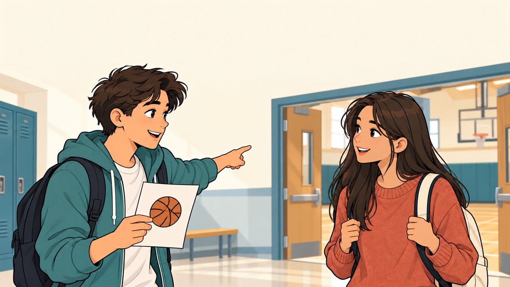

> Nel corridoio, dopo le lezioni. L’orario dell’allenamento è cambiato.

1. **Luca:** Domani l’allenamento è alle tre, nella palestra della scuola.
2. **Sara:** Alle tre? Pensavo alle quattro.
3. **Luca:** Hanno cambiato l’orario. L’ho appena letto sull’avviso.
4. **Sara:** Va bene. Ci troviamo davanti alla palestra?
5. **Luca:** Sì, all’ingresso del cortile, poco prima delle tre.
6. **Sara:** Perfetto. Avviso anche mia madre, così mi organizzo.

**Osserva**

- Nella prima battuta, chi invia il messaggio e a chi è rivolto?
- Individua messaggio, codice, canale e referente.

**Interpreta e verifica**

- Che cosa cambia quando risponde Sara?
- Quale battuta permette di verificare la comprensione?

**Metti in scena e trasforma:** Rappresentate lo scambio e indicate i sei elementi prima nella battuta di Luca, poi nella risposta di Sara.

**Guida alla discussione:** Prima battuta: emittente Luca, destinataria Sara; messaggio sull’orario e sul luogo; codice italiano parlato; canale acustico attraverso l’aria; referente l’allenamento futuro. Non confondere la lingua utilizzata con il mezzo di trasmissione.

## 02 · Il corridoio è rumoroso

**Percorso:** 1 · Gli elementi della comunicazione

**Obiettivo:** Distinguere un ostacolo sul canale da un problema di codice.

**Prima di osservare:** Il rumore può ostacolare la ricezione anche quando le persone conoscono la stessa lingua. Chiedere di ripetere e cambiare posto sono modi per controllare ciò che si è sentito.

**Vignetta:** Vicino alla palestra arriva il rumore di una partita.

**Illustrazione:** assets/hu-noise.jpg

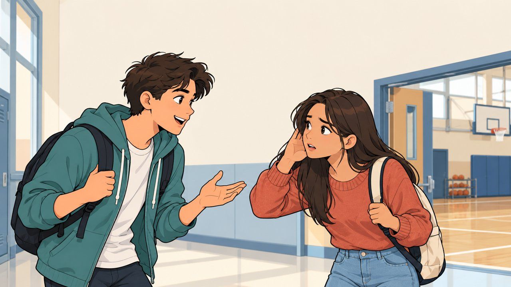

> Vicino alla palestra arriva il rumore di una partita.

1. **Luca:** L’allenamento è alle tre!
2. **Sara:** Alle sei? Non ho sentito bene.
3. **Luca:** Aspetta, qui c’è troppo rumore. Andiamo vicino alla porta.
4. **Sara:** Ecco, adesso ti sento. A che ora?
5. **Luca:** Alle tre del pomeriggio.
6. **Sara:** Ah, alle tre! Allora riesco a venire.

**Osserva**

- Quale parte dell’informazione viene fraintesa?
- I personaggi parlano una lingua condivisa?

**Interpreta e verifica**

- Il problema riguarda codice, canale o entrambi? Quali indizi hai?
- Perché spostarsi può essere più utile che ripetere allo stesso volume?

**Metti in scena e trasforma:** Recitate una versione con rumore simulato e una in un luogo tranquillo. Non urlate: osservate come cambia la comprensione.

**Guida alla discussione:** Il rumore ostacola la ricezione. Sara segnala ciò che non ha capito, anziché fingere di aver compreso.

## 03 · Lo stesso avviso arriva in chat

**Percorso:** 1 · Gli elementi della comunicazione

**Obiettivo:** Confrontare un messaggio orale con lo stesso contenuto scritto.

**Prima di osservare:** Lo stesso contenuto può essere comunicato a voce o per iscritto. Cambiano il modo di riceverlo e gli indizi disponibili: un testo si può rileggere, ma non trasmette direttamente l’intonazione.

**Vignetta:** Più tardi, nelle rispettive case. Luca scrive a Sara.

**Illustrazione:** assets/hu-chat.jpg

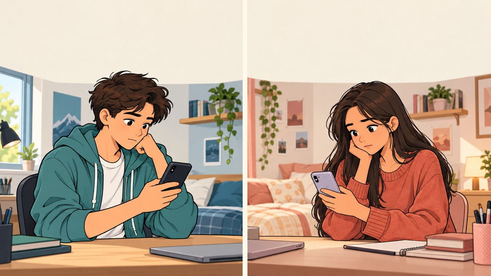

> Più tardi, nelle rispettive case. Luca scrive a Sara.

1. **Luca:** Domani allenamento alle 15, nella palestra della scuola.
2. **Sara:** Da quale ingresso entriamo?
3. **Luca:** Dal cortile, vicino al campo.
4. **Sara:** Ci vediamo lì cinque minuti prima?
5. **Luca:** Sì, alle 14:55.
6. **Sara:** Perfetto, me lo segno.

**Osserva**

- Quali elementi sono uguali alla scena nel corridoio?
- Quali modalità del codice e del canale sono cambiate?

**Interpreta e verifica**

- Che cosa puoi rileggere in chat che nello scambio orale potrebbe sfuggire?
- Quali indizi espressivi mancano nel testo scritto?

**Metti in scena e trasforma:** Confrontate questa scena con “L’allenamento di domani”: riscrivete lo stesso avviso su carta.

**Guida alla discussione:** Il codice è l’italiano scritto. Il canale è la comunicazione digitale tramite dispositivi e rete; l’app di chat è lo strumento, non il codice linguistico.

## 04 · Che cosa significa “BRB”?

**Percorso:** 1 · Gli elementi della comunicazione

**Obiettivo:** Riconoscere la necessità di condividere il codice e chiarire le abbreviazioni.

**Prima di osservare:** Per capire una sigla occorre conoscerne il significato convenzionale. Se una parte del codice non è condivisa, si può chiedere una spiegazione.

**Vignetta:** Luca e Sara lavorano online alla presentazione. Luca si allontana dal computer.

**Illustrazione:** assets/hu-chat.jpg

> Luca e Sara lavorano online alla presentazione. Luca si allontana dal computer.

1. **Luca:** BRB.
2. **Sara:** Aspetta, che vuol dire? Hai finito?
3. **Luca:** No, torno subito. Mi hanno chiamato dalla cucina.
4. **Sara:** Ah! Pensavo stessi chiudendo tutto.
5. **Luca:** Dammi cinque minuti e riprendiamo.
6. **Sara:** Va bene, intanto cerco l’ultima immagine.

**Osserva**

- Quale segno non viene compreso?
- Sara riceve materialmente il messaggio?

**Interpreta e verifica**

- Perché ricevere un messaggio non basta per capirlo?
- Quale chiarimento rende il codice più accessibile?

**Metti in scena e trasforma:** Inventate una sigla, provate a comunicarla senza spiegarla, poi concordatene il significato.

**Guida alla discussione:** La sigla è un codice convenzionale non condiviso dai due interlocutori. Chiedere il significato è una strategia comunicativa, non una colpa.

## 05 · “Lì”, ma dove?

**Percorso:** 1 · Gli elementi della comunicazione

**Obiettivo:** Ricostruire riferimenti di luogo e tempo attraverso informazioni condivise.

**Prima di osservare:** Parole come “lì” e “dopo” dipendono da informazioni condivise. Un riferimento poco preciso può essere chiarito indicando un luogo e un orario riconoscibili da entrambi.

**Vignetta:** La scuola ha due ingressi: quello principale e il cancello del cortile.

**Illustrazione:** assets/hu-sports.jpg

> La scuola ha due ingressi: quello principale e il cancello del cortile.

1. **Luca:** Ci vediamo lì dopo.
2. **Sara:** Dove? Davanti alla palestra?
3. **Luca:** No, al cancello del cortile.
4. **Sara:** Dopo le lezioni o prima dell’allenamento?
5. **Luca:** Prima dell’allenamento, alle due e cinquanta.
6. **Sara:** D’accordo, ti aspetto al cancello alle due e cinquanta.

**Osserva**

- Quali parole richiedono informazioni aggiuntive?
- Quali due luoghi vengono considerati?

**Interpreta e verifica**

- Quali conoscenze Luca presume di condividere con Sara?
- In quale contesto “lì dopo” potrebbe essere sufficiente?

**Metti in scena e trasforma:** Create un appuntamento con riferimenti vaghi. Il destinatario deve fare le domande necessarie per renderlo preciso.

**Guida alla discussione:** Le parole deittiche, come lì e dopo, dipendono dal contesto. Non sono sempre sbagliate: diventano problematiche quando i riferimenti non sono condivisi.

## 06 · Parlavi con me?

**Percorso:** 1 · Gli elementi della comunicazione

**Obiettivo:** Riconoscere il destinatario e gli indizi con cui viene individuato.

**Prima di osservare:** Chi sente un messaggio non è necessariamente il suo destinatario. Il nome, lo sguardo e il contesto possono aiutare a capire a chi è rivolta una richiesta.

**Vignetta:** Sara è vicina al banco. Matteo è poco più indietro.

**Illustrazione:** assets/hu-addressee.jpg

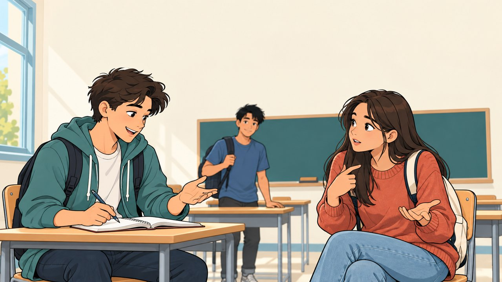

> Sara è vicina al banco. Matteo è poco più indietro.

1. **Luca:** Mi passi quel quaderno?
2. **Sara:** Dici a me o a Matteo?
3. **Luca:** A te, Sara. Scusa, stavo guardando lo zaino.
4. **Sara:** Questo qui sul banco?
5. **Luca:** Sì, quello vicino al tuo astuccio.
6. **Sara:** Tieni. Per un attimo non avevo capito.

**Osserva**

- Quante persone potrebbero sentirsi interpellate?
- Quali indizi identificano finalmente la destinataria?

**Interpreta e verifica**

- Essere presenti significa essere necessariamente destinatari del messaggio?
- Come possono collaborare sguardo e parole?

**Metti in scena e trasforma:** Recitate la richiesta con e senza nome e contatto visivo. Scambiate il ruolo del terzo compagno.

**Guida alla discussione:** Matteo è presente ma non è il destinatario della richiesta iniziale. Evitare di equiparare chiunque senta un messaggio al destinatario intenzionale.

## 07 · Alle tre o alle quattro?

**Percorso:** 1 · Gli elementi della comunicazione

**Obiettivo:** Usare il feedback per controllare la comprensione e rendere visibile la circolarità.

**Prima di osservare:** Il feedback è la risposta che ritorna a chi ha comunicato. Riprendere con parole proprie un’informazione permette di controllare la comprensione; non significa necessariamente approvare una proposta.

**Vignetta:** Sara deve organizzare il rientro dopo l’allenamento.

**Illustrazione:** assets/hu-sports.jpg

> Sara deve organizzare il rientro dopo l’allenamento.

1. **Luca:** Domani ci alleniamo alle tre.
2. **Sara:** Alle tre del pomeriggio, giusto?
3. **Luca:** Sì, alle quindici.
4. **Sara:** Nella palestra della scuola o al campo del quartiere?
5. **Luca:** Nella palestra della scuola.
6. **Sara:** Bene, allora prendo l’autobus delle due e mezza.

**Osserva**

- Quali risposte di Sara contengono informazioni, oltre a un semplice sì?
- Chi è emittente nella seconda battuta?

**Interpreta e verifica**

- Il feedback conferma sempre l’accordo o può segnalare un dubbio?
- Che cosa potrebbe succedere senza le domande di Sara?

**Metti in scena e trasforma:** Uno dà tre indicazioni; l’altro le riformula. Chi le ha date conferma o corregge.

**Guida alla discussione:** I ruoli cambiano a ogni turno. Capire e accettare una proposta sono due cose diverse: il feedback può anche esprimere dissenso.

## 08 · “Fai come vuoi”

**Percorso:** 2 · Chat, emoji e messaggi vocali

**Obiettivo:** Distinguere intenzione dell’emittente, interpretazione ed effetto del messaggio.

**Prima di osservare:** Nella chat mancano molti indizi vocali. Una risposta breve può essere interpretata diversamente dall’intenzione di chi la scrive: chiedere un chiarimento permette di confrontare le due letture.

**Vignetta:** Da case diverse, Sara e Luca si scambiano messaggi sulla presentazione.

**Illustrazione:** assets/hu-chat.jpg

> Da case diverse, Sara e Luca si scambiano messaggi sulla presentazione.

1. **Sara:** Ho cambiato la prima slide. Va bene?
2. **Luca:** Fai come vuoi.
3. **Sara:** Potevi dirmelo se non eri d’accordo.
4. **Luca:** Ma sono d’accordo! Intendevo che mi fido di te.
5. **Sara:** Ah, pensavo ti avesse dato fastidio.
6. **Luca:** No, mi piace. Teniamo la tua versione.

**Osserva**

- Quali parole di Luca vengono interpretate come dissenso?
- In quale battuta emerge l’equivoco?

**Interpreta e verifica**

- Quali altre letture della frase iniziale erano possibili?
- Come distingue Luca l’intenzione dall’effetto che ha prodotto?

**Metti in scena e trasforma:** Fermatevi dopo “Fai come vuoi”. Proponete due interpretazioni e una domanda per verificarle.

**Guida alla discussione:** Il chiarimento offre un’interpretazione dichiarata dal personaggio; prima del chiarimento lo studente non deve conoscere con certezza la sua intenzione.

## 09 · “Va bene.” oppure “Va bene! 😊”

**Percorso:** 2 · Chat, emoji e messaggi vocali

**Obiettivo:** Osservare il contributo di punteggiatura ed emoji senza assegnare significati universali.

**Prima di osservare:** Punteggiatura ed emoji possono orientare la lettura insieme alle abitudini dei partecipanti. Non hanno però un significato emotivo certo e uguale per tutti.

**Vignetta:** Di solito Luca risponde con un punto esclamativo o una faccina. Questa volta scrive in fretta.

**Illustrazione:** assets/hu-chat.jpg

> Di solito Luca risponde con un punto esclamativo o una faccina. Questa volta scrive in fretta.

1. **Sara:** Usiamo questo titolo per la presentazione?
2. **Luca:** Va bene.
3. **Sara:** Sei arrabbiato? Di solito metti una faccina.
4. **Luca:** No, sto uscendo e ho scritto al volo. Il titolo mi piace.
5. **Sara:** Ah, quel punto mi sembrava un po’ secco.
6. **Luca:** Tranquilla 😊 Teniamolo!

**Osserva**

- Quale segno Sara considera importante?
- Luca dichiara di essere arrabbiato?

**Interpreta e verifica**

- Un punto indica sempre rabbia?
- Quali abitudini condivise influenzano la lettura di Sara?

**Metti in scena e trasforma:** Confrontate “Va bene.”, “Va bene!” e “Va bene! 😊”. Raccogliete interpretazioni diverse, poi scrivete una domanda di chiarimento.

**Guida alla discussione:** Punteggiatura ed emoji orientano la lettura in relazione al contesto e alle abitudini; non costituiscono un dizionario certo delle intenzioni.

## 10 · Che cosa significa 👍?

**Percorso:** 2 · Chat, emoji e messaggi vocali

**Obiettivo:** Esplorare significati diversi dello stesso segno e chiedere una conferma esplicita.

**Prima di osservare:** Anche un’emoji richiede un significato sufficientemente condiviso. Lo stesso segno può essere usato come approvazione, conferma di lettura o assenso a una proposta.

**Vignetta:** Sara propone un orario per provare la presentazione.

**Illustrazione:** assets/hu-chat.jpg

> Sara propone un orario per provare la presentazione.

1. **Sara:** Vieni a provare la presentazione alle quattro?
2. **Luca:** 👍
3. **Sara:** Quindi vieni? O volevi solo dire che hai letto?
4. **Luca:** Vengo, sì!
5. **Sara:** Te lo chiedo perché io a volte lo uso per dire “ricevuto”.
6. **Luca:** Allora confermo: ci sono alle quattro.

**Osserva**

- Quale risposta non contiene parole?
- Quali due significati vengono attribuiti allo stesso segno?

**Interpreta e verifica**

- Perché due persone possono usare diversamente la stessa emoji?
- Quando è utile sostituire un segno con una frase esplicita?

**Metti in scena e trasforma:** Concordate un piccolo codice di tre simboli. Poi osservate che cosa accade quando lo usa una persona che non conosce l’accordo.

**Guida alla discussione:** Durante l’ascolto l’emoji viene descritta come “pollice in su”. La descrizione accessibile non sostituisce il simbolo visualizzato.

## 11 · Letto, ma senza risposta

**Percorso:** 2 · Chat, emoji e messaggi vocali

**Obiettivo:** Separare un indicatore tecnico dalle ipotesi sul comportamento e sulla relazione.

**Prima di osservare:** Un indicatore tecnico di lettura non rivela da solo disponibilità o intenzioni. Distinguere il dato osservato dalle ipotesi sulla persona aiuta a evitare conclusioni affrettate.

**Vignetta:** Il messaggio di Sara risulta letto, ma per un’ora non arriva risposta.

**Illustrazione:** assets/hu-chat.jpg

> Il messaggio di Sara risulta letto, ma per un’ora non arriva risposta.

1. **Sara:** Hai letto il messaggio sul lavoro? Non mi hai risposto.
2. **Luca:** Sì, l’ho aperto mentre uscivo. Poi non sono più riuscito a scriverti.
3. **Sara:** Pensavo che non volessi farlo con me.
4. **Luca:** No, certo che voglio! Mi serviva un momento per guardare il materiale.
5. **Sara:** Allora dimmi tu quando possiamo sentirci.
6. **Luca:** Dopo cena? Alle otto e mezza ci sono.

**Osserva**

- Che cosa permette di sapere l’indicatore “letto”?
- Che cosa non permette di sapere?

**Interpreta e verifica**

- Quali spiegazioni alternative erano possibili prima della risposta?
- Il chiarimento cancella automaticamente il disagio di Sara?

**Metti in scena e trasforma:** Scrivete tre spiegazioni compatibili con una mancata risposta e un messaggio che chieda chiarimenti senza accusare.

**Guida alla discussione:** L’indicatore non dimostra disponibilità, attenzione completa o intenzione di ignorare. Distinguere dato osservato e attribuzione.

## 12 · Nel vocale manca una parola

**Percorso:** 2 · Chat, emoji e messaggi vocali

**Obiettivo:** Riconoscere informazioni mancanti in un messaggio vocale e riparare l’equivoco.

**Prima di osservare:** Perdere una sola parola può cambiare molto il senso di un messaggio. Una richiesta di conferma è particolarmente utile prima di agire su un’informazione incompleta.

**Vignetta:** Luca ha inviato un vocale dalla fermata. Il traffico copriva una parte della frase.

**Illustrazione:** assets/hu-voice.jpg

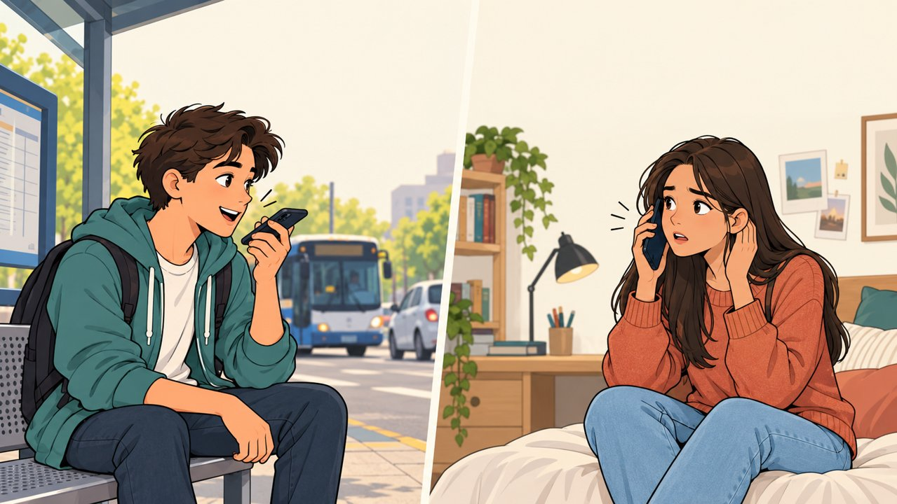

> Luca ha inviato un vocale dalla fermata. Il traffico copriva una parte della frase.

1. **Luca:** Si sentiva il vocale che ti ho mandato?
2. **Sara:** Ho capito “stampare le slide”. Il resto no.
3. **Luca:** Dicevo di NON stamparle: devo ancora correggerle.
4. **Sara:** Ah, allora aspetto! Stavo per andare in copisteria.
5. **Luca:** Scusa, ti scrivo appena sono pronte.
6. **Sara:** Grazie. Per fortuna te l’ho chiesto.

**Osserva**

- Quale parola mancante cambia il significato?
- Quale differenza c’è fra sentire alcune parole e capire l’intera richiesta?

**Interpreta e verifica**

- Perché indovinare il contenuto può produrre un errore?
- Quando conviene cambiare canale?

**Metti in scena e trasforma:** Registrate un breve vocale e omettete una parola importante nella trascrizione. Il destinatario deve individuare che cosa chiedere.

**Guida alla discussione:** La scena simula uno scambio di vocali; la voce dell’app resta pulita per accessibilità. Il rumore è descritto e rappresentato, non aggiunto a volume elevato.

## 13 · Lo stesso messaggio, due letture

**Percorso:** 2 · Chat, emoji e messaggi vocali

**Obiettivo:** Confrontare letture della stessa frase e il ruolo del contesto nei vocali.

**Prima di osservare:** Le stesse parole possono produrre impressioni diverse a seconda del tono e del momento. L’impressione di chi ascolta resta un’ipotesi da verificare nel seguito dello scambio.

**Vignetta:** Nel pomeriggio Sara chiede con un messaggio quando può chiamare. Luca risponde con un vocale.

**Illustrazione:** assets/hu-chat.jpg

> Nel pomeriggio Sara chiede con un messaggio quando può chiamare. Luca risponde con un vocale.

1. **Luca:** Quando vuoi. _Prima lettura: calma, disponibile._
2. **Sara:** Allora ti chiamo dopo cena, grazie.

> Più tardi, Sara non è ancora riuscita a chiamare. Luca è alla fermata e sta arrivando il suo autobus.

3. **Luca:** Quando vuoi. _Seconda lettura: più rapida. Luca deve salire sull’autobus._
4. **Sara:** Hai fretta? Se adesso non puoi, rimandiamo.

> Sara chiede se il momento è ancora adatto.

5. **Luca:** Sì, sto salendo sull’autobus. Scusa, facciamo fra mezz’ora?
6. **Sara:** Certo, chiamami tu quando arrivi.

**Osserva**

- Le parole delle due letture sono cambiate?
- Che cosa cambia nella recitazione proposta?

**Interpreta e verifica**

- Tutti i compagni percepiscono allo stesso modo le due letture?
- Quali informazioni del contesto aiuterebbero a interpretarle?

**Metti in scena e trasforma:** Registrate due letture di “Quando vuoi”, poi chiedete agli ascoltatori di descrivere gli indizi percepiti prima di conoscere l’intenzione.

**Guida alla discussione:** Gli audio sintetici forniscono letture indicative con ritmo diverso. Per lavorare sulle sfumature emotive usare la recitazione o MP3 registrati dai partecipanti; non attribuire etichette emotive certe a una voce.

## 14 · Ti siedi con noi?

**Percorso:** 3 · Tono, silenzio e significati impliciti

**Obiettivo:** Osservare il valore comunicativo del silenzio senza attribuirgli un significato unico.

**Prima di osservare:** Un silenzio può avere effetti nella relazione senza esprimere un’intenzione unica o consapevole. La sua interpretazione va collegata alla situazione e alle informazioni successive.

**Vignetta:** Luca indica il posto libero accanto a sé. Sara guarda verso la porta.

**Illustrazione:** assets/hu-silence.jpg

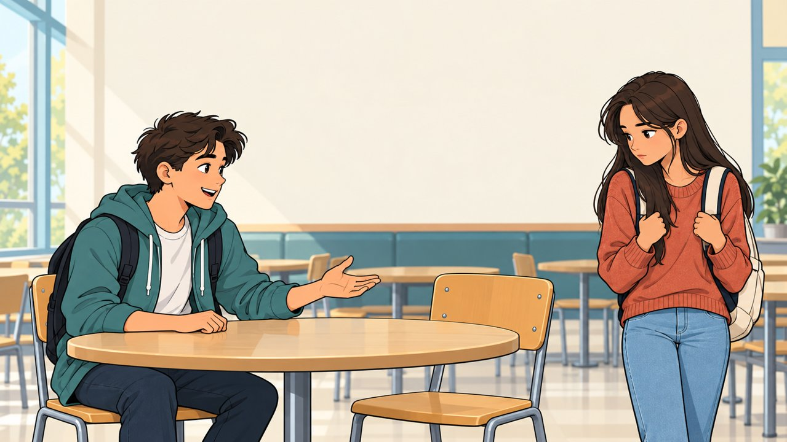

> Luca indica il posto libero accanto a sé. Sara guarda verso la porta.

1. **Luca:** Ti siedi qui con me?
2. **Sara:** … _Sara resta in silenzio e cerca qualcuno con lo sguardo._
3. **Luca:** Preferisci stare da sola?
4. **Sara:** No, scusa. Cercavo Marta: dovevamo pranzare insieme.
5. **Luca:** C’è posto anche per lei. La aspettiamo?
6. **Sara:** Sì, grazie! Eccola, sta arrivando.

**Osserva**

- Che cosa fa Sara nella seconda vignetta?
- Quale significato Luca attribuisce al silenzio?

**Interpreta e verifica**

- Quali altre spiegazioni erano possibili?
- Come cambia lo scambio quando Luca fa una domanda?

**Metti in scena e trasforma:** Fermatevi sul silenzio. Ogni osservatore propone due ipotesi e indica quali informazioni mancano.

**Guida alla discussione:** Il silenzio produce effetti nell’interazione ma non comunica necessariamente un’intenzione consapevole o univoca. La pausa è riprodotta senza voce.

## 15 · Qui fa freddo

**Percorso:** 3 · Tono, silenzio e significati impliciti

**Obiettivo:** Distinguere contenuto letterale e possibile richiesta indiretta.

**Prima di osservare:** Una frase può descrivere una situazione e suggerire anche una richiesta. Il contesto aiuta, ma l’altra persona potrebbe cogliere soltanto il significato letterale.

**Vignetta:** La finestra è aperta. Sara è seduta vicino alla corrente d’aria.

**Illustrazione:** assets/hu-window.jpg

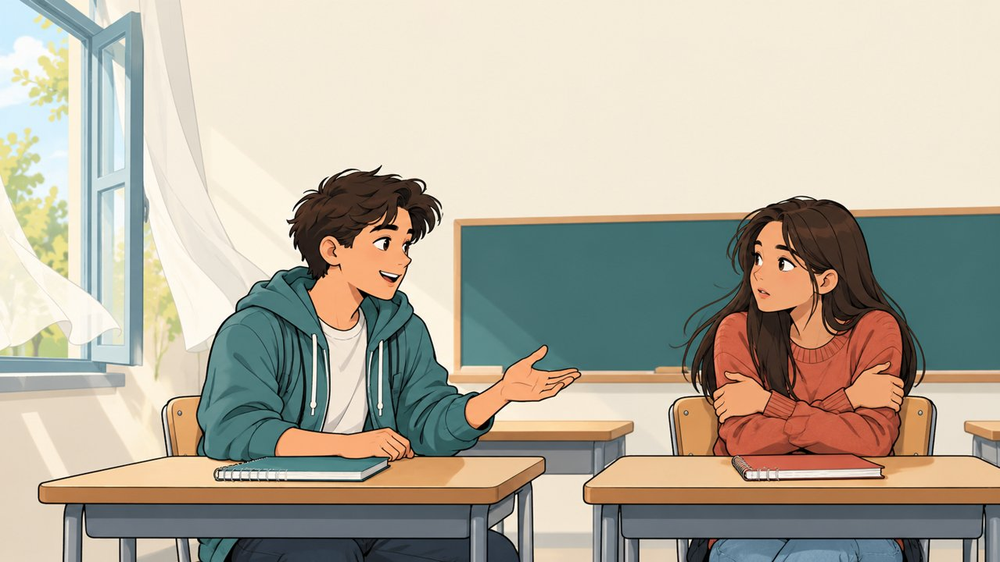

> La finestra è aperta. Sara è seduta vicino alla corrente d’aria.

1. **Sara:** Qui fa freddo.
2. **Luca:** Io con la felpa sto bene.
3. **Sara:** Puoi accostare la finestra? L’aria mi arriva proprio addosso.
4. **Luca:** Ah, certo. Pensavo fosse solo un commento.
5. **Sara:** Grazie. Già così va meglio.
6. **Luca:** Dimmi se vuoi chiuderla del tutto.

**Osserva**

- Che cosa dice Sara e verso che cosa guarda?
- Quale risposta mostra una lettura letterale?

**Interpreta e verifica**

- “Qui fa freddo” è sempre una richiesta di chiudere la finestra?
- Quali indizi rendono plausibile questa lettura nella scena?

**Metti in scena e trasforma:** Confrontate una richiesta diretta e una indiretta. Provate anche un contesto in cui la frase sia soltanto un’osservazione.

**Guida alla discussione:** Un’intenzione può essere suggerita dal contesto, ma deve restare verificabile attraverso lo scambio.

## 16 · Brava, davvero!

**Percorso:** 3 · Tono, silenzio e significati impliciti

**Obiettivo:** Confrontare apprezzamento e possibile ironia in relazione alla situazione.

**Prima di osservare:** Nell’ironia le parole possono essere in contrasto con la situazione e con l’intonazione. Non tutti riconoscono gli stessi indizi: è possibile chiedere chiarimenti o esprimere l’effetto ricevuto.

**Vignetta:** Sara ha appena sistemato tutte le slide. Luca guarda il lavoro completato.

**Illustrazione:** assets/hu-surprise.jpg

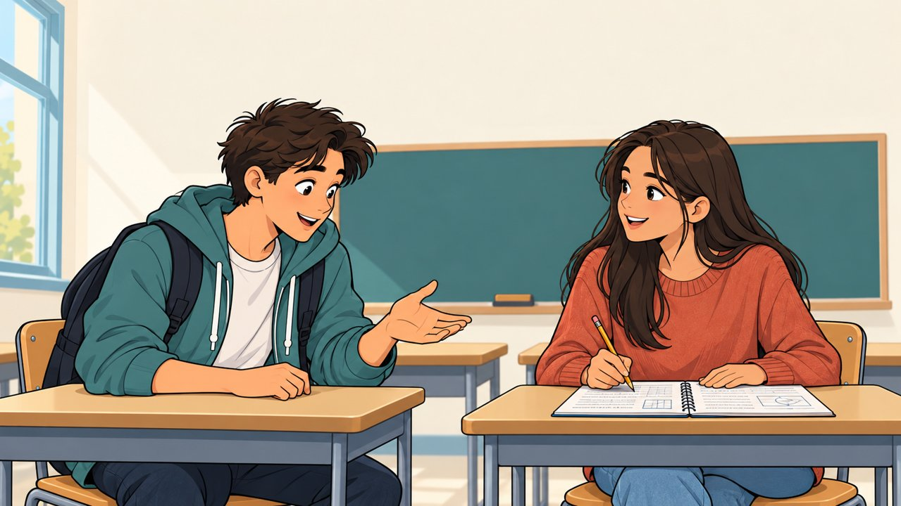

> Sara ha appena sistemato tutte le slide. Luca guarda il lavoro completato.

1. **Luca:** Brava, davvero!
2. **Sara:** Grazie! Finalmente le ho sistemate tutte.

> Un altro pomeriggio. Una parte delle slide non è pronta e l’invio è previsto tra pochi minuti.

3. **Luca:** Brava, davvero! _Secondo episodio: lettura ironica, di fronte al lavoro incompleto._
4. **Sara:** Se è una battuta, non mi fa ridere. Mi manca ancora una slide.

> Sara reagisce al commento di Luca.

5. **Luca:** Scusa. Ti aiuto a finirla?
6. **Sara:** Sì, scegli l’immagine mentre io sistemo il testo.

**Osserva**

- Quale fatto sostiene l’apprezzamento nella prima parte?
- Quale contesto alternativo viene proposto?

**Interpreta e verifica**

- Perché le stesse parole possono essere interpretate diversamente?
- Qual è la differenza fra ipotizzare ironia e averne la certezza?

**Metti in scena e trasforma:** Recitate “Brava, davvero!” come apprezzamento e come possibile ironia. Gli osservatori motivano la lettura con indizi concreti.

**Guida alla discussione:** Il dialogo non presuppone che ogni studente riconosca automaticamente l’ironia. Accogliere letture diverse e usare il chiarimento.

## 17 · Una penna: rifiuto o spiegazione?

**Percorso:** 3 · Tono, silenzio e significati impliciti

**Obiettivo:** Confrontare rifiuto, attribuzione di intenzioni, negoziazione e riparazione.

**Prima di osservare:** Un rifiuto breve può essere interpretato come rifiuto della persona. Chiarire il motivo e cercare alternative permette di distinguere il limite concreto dal giudizio sulla relazione.

**Vignetta:** Luca cerca una penna. Sara sta usando l’unica che ha portato.

**Illustrazione:** assets/pen-request.jpg

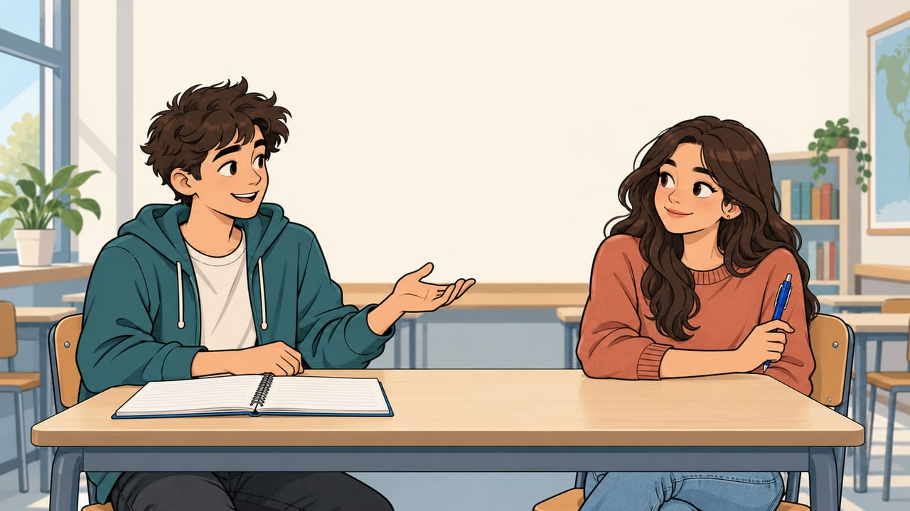

> Luca cerca una penna. Sara sta usando l’unica che ha portato.

1. **Luca:** Mi presti la penna?
2. **Sara:** No.
3. **Luca:** Va bene, non ti chiederò più niente.
4. **Sara:** Aspetta, ho solo questa e devo finire l’esercizio.
5. **Luca:** Ah, pensavo non volessi aiutarmi.
6. **Sara:** Chiediamo a Matteo se ne ha una di scorta?

**Osserva**

- Quale informazione manca nella risposta “No”?
- In quale battuta emerge l’interpretazione di Luca?

**Interpreta e verifica**

- La richiesta di Luca obbliga Sara a prestare l’unica penna?
- Come si può mantenere un rifiuto spiegandolo e rispettando l’altro?

**Metti in scena e trasforma:** Scrivete tre versioni: un rifiuto brusco, uno spiegato e uno che propone un’alternativa. Confrontate gli effetti senza imporre un unico esito.

**Guida alla discussione:** Essere assertivi non significa dire sempre sì. L’immagine mostra la penna ancora sul lato di Sara, coerentemente con il mancato prestito.

## 18 · Due ingressi, un appuntamento

**Percorso:** 3 · Tono, silenzio e significati impliciti

**Obiettivo:** Rendere esplicite le informazioni che ciascuno presume condivise.

**Prima di osservare:** Un’espressione apparentemente chiara può nascondere presupposti diversi. Ricostruire che cosa ciascuno dava per scontato permette di individuare l’origine di un equivoco.

**Vignetta:** Dopo essersi cercati, Luca e Sara si ritrovano. Avevano aspettato davanti a ingressi diversi.

**Illustrazione:** assets/hu-sports.jpg

> Dopo essersi cercati, Luca e Sara si ritrovano. Avevano aspettato davanti a ingressi diversi.

1. **Luca:** Ti ho aspettata dieci minuti davanti all’ingresso principale.
2. **Sara:** Io ero al cancello del cortile!
3. **Luca:** Nel messaggio avevo scritto soltanto “all’ingresso”.
4. **Sara:** E io ho pensato al cortile, perché entro sempre da lì.
5. **Luca:** Domani facciamo al cancello del cortile, alle due?
6. **Sara:** Sì. Stavolta andiamo tutti e due nello stesso posto!

**Osserva**

- Quale espressione poteva indicare due luoghi diversi?
- Quali abitudini personali emergono?

**Interpreta e verifica**

- Una delle due interpretazioni era necessariamente irragionevole?
- Quale messaggio avrebbe ridotto l’ambiguità?

**Metti in scena e trasforma:** Disegnate due ingressi su una pianta semplice e scrivete un appuntamento comprensibile anche a un nuovo compagno.

**Guida alla discussione:** L’equivoco nasce da informazioni presunte condivise, non richiede un colpevole.

## 19 · Hai finito? · Ti offro aiuto

**Percorso:** 3 · Tono, silenzio e significati impliciti

**Obiettivo:** Osservare una lettura disponibile della stessa domanda.

**Prima di osservare:** La disponibilità suggerita da una domanda trova conferma nelle azioni e nelle parole successive. Un singolo indizio del volto non basta a conoscere l’intenzione.

**Vignetta:** Sara è ferma sull’ultimo passaggio dell’esercizio. Luca ha già chiuso il quaderno.

**Illustrazione:** assets/hu-warm.jpg

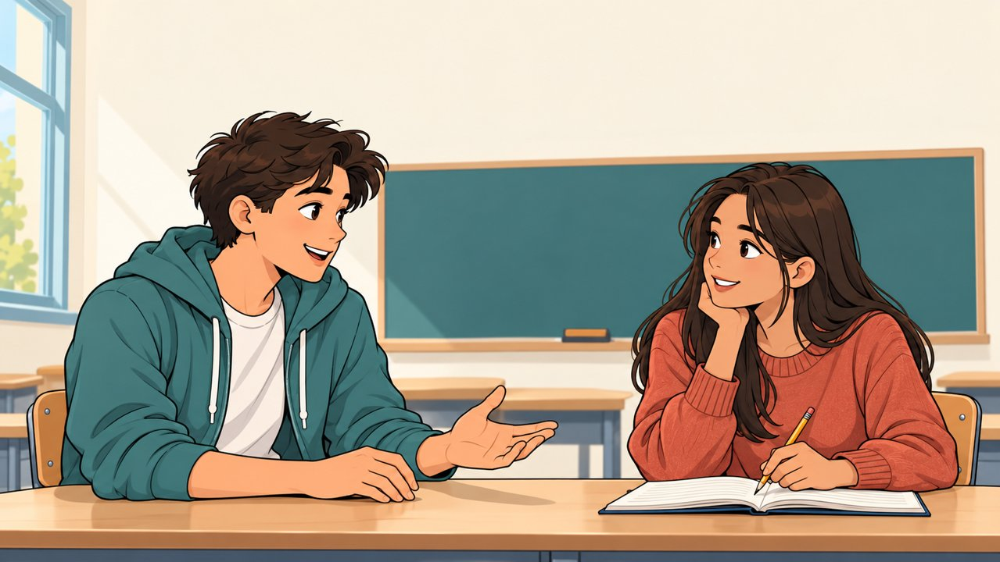

> Sara è ferma sull’ultimo passaggio dell’esercizio. Luca ha già chiuso il quaderno.

1. **Luca:** Hai finito? _Luca parla con calma e si rende disponibile._
2. **Sara:** Quasi. Non mi torna l’ultimo passaggio.
3. **Luca:** Vuoi che lo guardiamo insieme?
4. **Sara:** Sì, grazie. È questo qui.
5. **Luca:** Fammi vedere da dove sei partita.
6. **Sara:** Da questa formula. Poi mi blocco.

**Osserva**

- Quali parole successive chiariscono l’offerta d’aiuto?
- Quali gesti accompagnano la prima domanda?

**Interpreta e verifica**

- La sola frase “Hai finito?” basterebbe a sapere l’intenzione?
- Come potresti chiedere se l’altro vuole aiutarti?

**Metti in scena e trasforma:** Recitate la domanda con disponibilità, poi confrontatela con le altre due scene “Hai finito?”.

**Guida alla discussione:** La lettura vocale è indicativa. La disponibilità è confermata dalla continuazione del dialogo, non dedotta soltanto dal viso.

## 20 · Hai finito? · Ho fretta

**Percorso:** 3 · Tono, silenzio e significati impliciti

**Obiettivo:** Riconoscere l’effetto di ritmo, postura e aspettative nella richiesta.

**Prima di osservare:** Ritmo, postura e aspettative possono far percepire pressione. Esplicitare un vincolo concreto permette di negoziare i tempi senza dover attribuire intenzioni all’altro.

**Vignetta:** Luca guarda l’orologio. Il suo autobus partirà fra poco; Sara sta ancora scrivendo.

**Illustrazione:** assets/hu-impatient.jpg

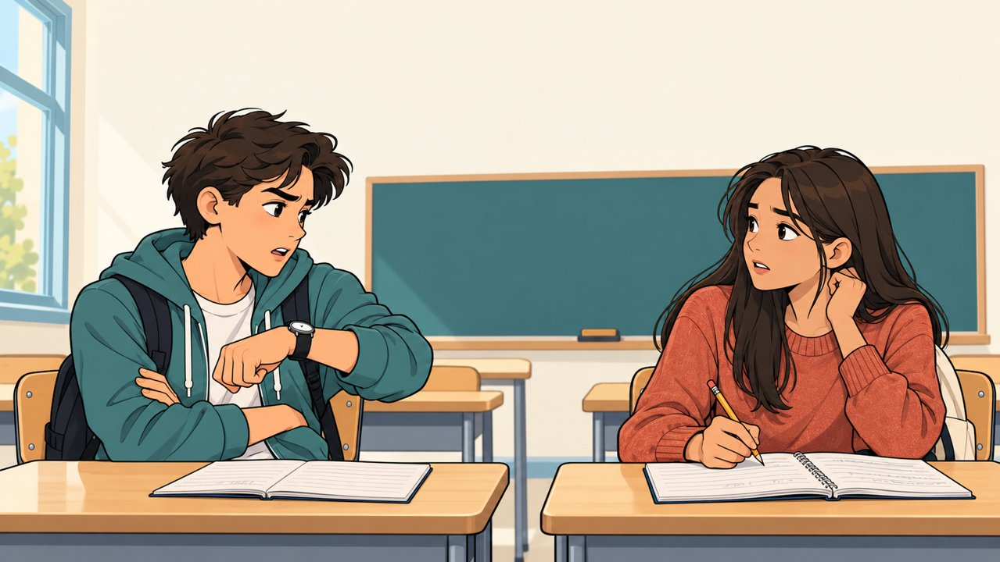

> Luca guarda l’orologio. Il suo autobus partirà fra poco; Sara sta ancora scrivendo.

1. **Luca:** Hai finito? _Luca parla rapidamente e guarda l’orologio._
2. **Sara:** Mi stai mettendo fretta. Devi andare via?
3. **Luca:** Sì, fra poco parte il mio autobus.
4. **Sara:** Mi mancano due minuti. Se non fai in tempo, ci sentiamo domani.
5. **Luca:** Due minuti posso aspettare. Scusa, dovevo dirtelo prima.
6. **Sara:** Va bene, finisco questa riga e andiamo.

**Osserva**

- Quale gesto suggerisce fretta?
- Quando viene spiegata la ragione della fretta?

**Interpreta e verifica**

- Qual è la differenza fra avere fretta e voler svalutare qualcuno?
- Come formula Sara il proprio bisogno senza attribuire un’intenzione certa?

**Metti in scena e trasforma:** Recitate la domanda prima senza contesto, poi con la spiegazione dell’autobus. Confrontate le interpretazioni.

**Guida alla discussione:** Non associare automaticamente braccia incrociate e ostilità. Gli indizi acquistano senso nel contesto e nel chiarimento.

## 21 · Hai finito? · Non me l’aspettavo

**Percorso:** 3 · Tono, silenzio e significati impliciti

**Obiettivo:** Riconoscere una possibile lettura di sorpresa della stessa domanda.

**Prima di osservare:** Sorpresa e sfiducia possono essere confuse da chi riceve un commento. Le domande di chiarimento consentono di confrontare l’impressione ricevuta con ciò che l’altro intendeva.

**Vignetta:** Sara chiude il quaderno prima del previsto. Luca alza lo sguardo dal proprio esercizio.

**Illustrazione:** assets/hu-surprise.jpg

> Sara chiude il quaderno prima del previsto. Luca alza lo sguardo dal proprio esercizio.

1. **Luca:** Hai finito? _Luca appare sorpreso e guarda il quaderno completato._
2. **Sara:** Sì. Perché, pensi che abbia saltato qualcosa?
3. **Luca:** No! Pensavo ci volesse molto più tempo.
4. **Sara:** Ne avevo già fatto uno simile ieri.
5. **Luca:** Ah, ecco. Mi fai vedere come hai iniziato?
6. **Sara:** Certo, guarda qui.

**Osserva**

- Quale fatto suscita la sorpresa dichiarata da Luca?
- Quale dubbio esprime Sara?

**Interpreta e verifica**

- Sorpresa e sfiducia sono necessariamente la stessa cosa?
- Quale domanda consente di verificare l’interpretazione?

**Metti in scena e trasforma:** Confrontate le tre scene “Hai finito?” mantenendo identiche le prime parole e cambiando contesto e recitazione.

**Guida alla discussione:** La scena offre un’interpretazione plausibile, chiarita dai personaggi. Non insegna a leggere con certezza le intenzioni dalle sopracciglia.

## 22 · Mi interrompi sempre

**Percorso:** 4 · Relazioni, emozioni e contesti

**Obiettivo:** Osservare la circolarità di un conflitto e le diverse ricostruzioni della sua origine.

**Prima di osservare:** In un conflitto ciascuno può considerare il proprio comportamento una risposta a quello dell’altro. Cambiare una regola dello scambio può interrompere il circolo.

**Vignetta:** Durante il lavoro di gruppo, Luca e Sara parlano uno sopra l’altra.

**Illustrazione:** assets/hu-conflict.jpg

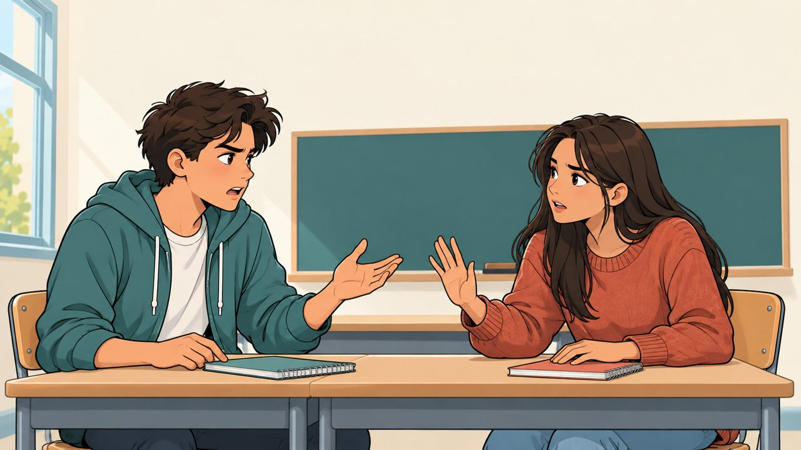

> Durante il lavoro di gruppo, Luca e Sara parlano uno sopra l’altra.

1. **Luca:** Ti interrompo perché non mi ascolti.
2. **Sara:** E io smetto di ascoltare perché mi interrompi!
3. **Luca:** Ma appena comincio guardi da un’altra parte.
4. **Sara:** Perché non riesco mai a finire una frase.
5. **Luca:** Aspetta. Finisci tu, poi parlo io.
6. **Sara:** Va bene. Ti spiego perché questa slide non funziona.

**Osserva**

- Dove colloca l’inizio del problema ciascun personaggio?
- Quale proposta modifica il modo di scambiare i turni?

**Interpreta e verifica**

- Le due ricostruzioni possono alimentarsi a vicenda?
- Come interrompere il circolo senza decidere subito chi ha iniziato?

**Metti in scena e trasforma:** Rappresentate il circolo, poi sostituite una sola battuta con una proposta concreta di ascolto.

**Guida alla discussione:** Le parole sempre e mai possono estendere una critica al rapporto intero. Analizzare episodi e comportamenti specifici.

## 23 · Il gruppo era già fatto

**Percorso:** 4 · Relazioni, emozioni e contesti

**Obiettivo:** Riconoscere il bisogno di appartenenza e distinguere intenzione ed esperienza dell’altro.

**Prima di osservare:** L’intenzione di una persona e l’esperienza dell’altra possono essere diverse. Chiedere che cosa è successo e riconoscere l’effetto prodotto apre possibilità di confronto.

**Vignetta:** Sara vede il gruppo già al lavoro e si avvicina a Luca.

**Illustrazione:** assets/hu-group.jpg

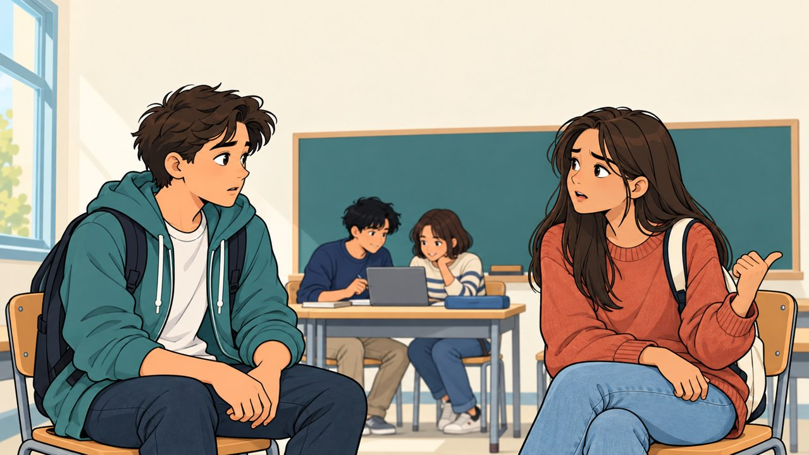

> Sara vede il gruppo già al lavoro e si avvicina a Luca.

1. **Sara:** Avete già fatto il gruppo? Non mi avete chiesto niente.
2. **Luca:** Pensavo lavorassi con Marta e gli altri.
3. **Sara:** No, aspettavo di parlarne con voi. Ci sono rimasta male.
4. **Luca:** Mi dispiace. Ho dato per scontato una cosa che non sapevo.
5. **Sara:** C’è ancora un posto per me?
6. **Luca:** Chiediamo agli altri. Non abbiamo ancora diviso tutte le parti.

**Osserva**

- Quale presupposto aveva Luca?
- Quale esperienza riferisce Sara?

**Interpreta e verifica**

- Non avere un’intenzione negativa elimina gli effetti sull’altro?
- Come si può riconoscere un’esperienza senza parlare al posto di chi la vive?

**Metti in scena e trasforma:** Proponete due continuazioni: una difensiva e una che verifica presupposti e possibilità concrete.

**Guida alla discussione:** Evitare di garantire un lieto fine automatico: il coinvolgimento richiede anche l’accordo del gruppo e il rispetto delle regole dell’attività.

## 24 · Non ce l’ho con te

**Percorso:** 4 · Relazioni, emozioni e contesti

**Obiettivo:** Riconoscere frustrazione, destinatario della reazione e possibilità di riparazione.

**Prima di osservare:** La causa di un disagio può essere diversa dalla persona che riceve una risposta brusca. Il disagio può spiegare una reazione, senza giustificare il modo di trattare l’altro.

**Vignetta:** Luca ha appena ricevuto una verifica andata male. Sara gli si avvicina.

**Illustrazione:** assets/hu-conflict.jpg

> Luca ha appena ricevuto una verifica andata male. Sara gli si avvicina.

1. **Sara:** Oggi prepariamo insieme la presentazione?
2. **Luca:** Lasciami stare, ho altro per la testa.
3. **Sara:** Ehi, ti ho solo fatto una domanda. Che succede?
4. **Luca:** La verifica è andata male. Scusa, tu non c’entri.
5. **Sara:** Se vuoi ne parliamo, ma non prendertela con me.
6. **Luca:** Hai ragione. Dammi un momento, poi ti racconto.

**Osserva**

- Che cosa chiede Sara e che risposta riceve?
- La causa della delusione coincide con la destinataria della risposta?

**Interpreta e verifica**

- Quali risposte alla frustrazione erano possibili oltre a quella brusca?
- Che cosa riconosce Luca nella riparazione?

**Metti in scena e trasforma:** Riscrivete la seconda battuta come richiesta di una pausa. Sara può mantenere un confine e offrire ascolto.

**Guida alla discussione:** La frustrazione non produce inevitabilmente aggressività. Il disagio può spiegare una reazione senza giustificare il trattamento dell’altro.

## 25 · Consigli o ascolto?

**Percorso:** 4 · Relazioni, emozioni e contesti

**Obiettivo:** Chiarire il bisogno comunicativo e praticare la riformulazione.

**Prima di osservare:** Dare consigli e offrire ascolto rispondono a bisogni diversi. Una riformulazione proposta come domanda permette all’altro di confermare o correggere ciò che abbiamo capito.

**Vignetta:** Sara racconta a Luca che il gruppo ha cambiato la sua parte della presentazione.

**Illustrazione:** assets/hu-listen.jpg

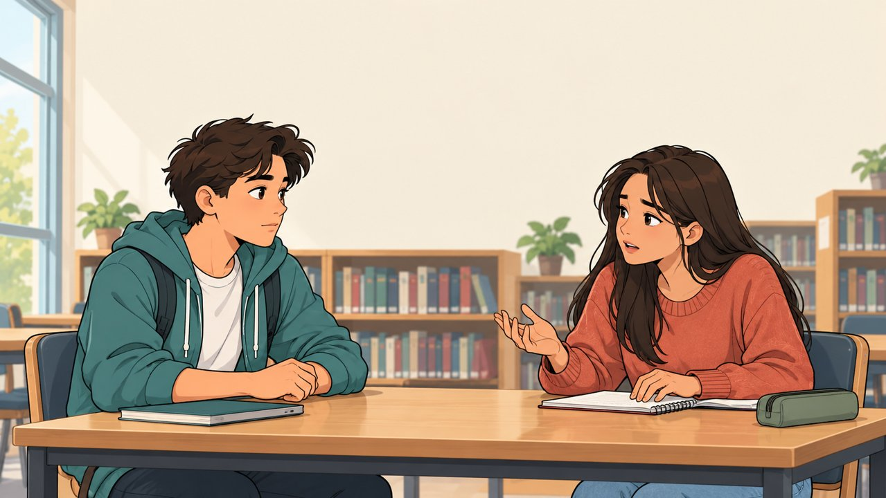

> Sara racconta a Luca che il gruppo ha cambiato la sua parte della presentazione.

1. **Sara:** Ci sono rimasta male. Hanno cambiato tutto il mio pezzo.
2. **Luca:** Diglielo subito e fallo rimettere com’era.
3. **Sara:** Aspetta, adesso vorrei solo raccontartelo.
4. **Luca:** Scusa, ti ascolto. Che cosa ti ha dato più fastidio?
5. **Sara:** Che non mi abbiano neanche chiesto un parere.
6. **Luca:** Quindi non è solo la modifica: volevi essere coinvolta. Ho capito bene?

**Osserva**

- Che cosa offre subito Luca?
- Che cosa chiede invece Sara?

**Interpreta e verifica**

- Un consiglio utile può arrivare in un momento poco adatto?
- Che cosa distingue una riformulazione da un’interpretazione imposta?

**Metti in scena e trasforma:** Chi ascolta deve chiedere di che cosa l’altro ha bisogno e riformulare una frase, lasciando la possibilità di correggerla.

**Guida alla discussione:** La riformulazione si propone come verifica: “Se ho capito… È così?”. Non attribuire sentimenti o diagnosi dall’esterno.

## 26 · Come preferisci salutare?

**Percorso:** 4 · Relazioni, emozioni e contesti

**Obiettivo:** Esplorare regole implicite e preferenze senza stereotipi culturali.

**Prima di osservare:** Le abitudini di saluto variano tra persone e contesti. Una preferenza può essere chiesta e rispettata senza attribuire comportamenti fissi a un gruppo o a una cultura.

**Vignetta:** Luca incontra Sara e apre le braccia per salutarla.

**Illustrazione:** assets/hu-greeting.jpg

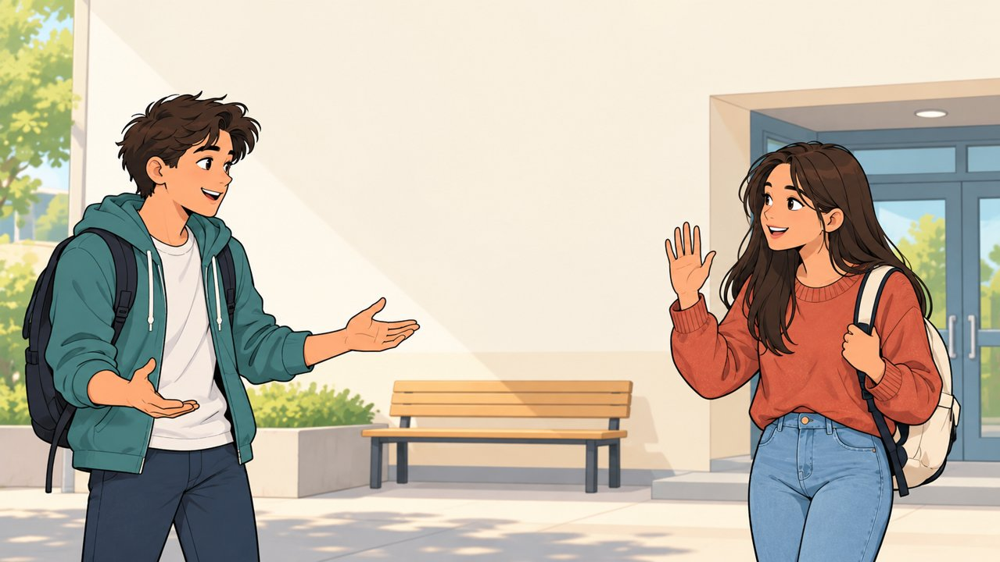

> Luca incontra Sara e apre le braccia per salutarla.

1. **Luca:** Ciao! Ti abbraccio?
2. **Sara:** Oggi preferisco di no, se non ti dispiace.
3. **Luca:** Certo, nessun problema.
4. **Sara:** Facciamo un saluto con la mano?
5. **Luca:** Va bene così! Come stai?
6. **Sara:** Meglio di ieri. Ti racconto mentre andiamo?

**Osserva**

- Quali due modalità di saluto compaiono?
- La preferenza di Sara viene espressa chiaramente?

**Interpreta e verifica**

- Le abitudini sono uguali in tutte le famiglie e in tutti i gruppi?
- Si può dedurre una preferenza dalla nazionalità?

**Metti in scena e trasforma:** Inventate tre contesti diversi di saluto. Spiegate come chiedere e rispettare le preferenze personali.

**Guida alla discussione:** Le variazioni possono riguardare persone, famiglie, gruppi e contesti. Non assegnare comportamenti fissi a nazioni o culture.

## 27 · Quando posso prendere la parola?

**Percorso:** 4 · Relazioni, emozioni e contesti

**Obiettivo:** Rendere esplicite le diverse regole di partecipazione a una conversazione.

**Prima di osservare:** Il silenzio può dipendere dalle regole con cui una persona prende la parola, oltre che dal suo interesse. Rendere espliciti i turni può facilitare la partecipazione.

**Vignetta:** Luca espone un’idea senza fare pause. Sara aspetta per intervenire.

**Illustrazione:** assets/hu-warm.jpg

> Luca espone un’idea senza fare pause. Sara aspetta per intervenire.

1. **Luca:** Non dici niente. La proposta non ti piace?
2. **Sara:** Mi piace, ma aspettavo che finissi.
3. **Luca:** Pensavo mi avresti interrotto se avevi un’idea.
4. **Sara:** Ci ho provato, poi ho preferito aspettare.
5. **Luca:** Scusa, mi fermo. Tu che cosa cambieresti?
6. **Sara:** Metterei l’esempio prima della spiegazione.

**Osserva**

- Quale significato Luca attribuisce al silenzio?
- Quali regole di partecipazione stanno usando i due?

**Interpreta e verifica**

- Parlare meno significa necessariamente disinteresse?
- Quale accordo rende più accessibile il confronto?

**Metti in scena e trasforma:** Recitate una discussione con regole implicite diverse, poi concordate una modalità di turnazione.

**Guida alla discussione:** Non trasformare una modalità comunicativa in un tratto personale fisso. Le regole possono essere negoziate.

## 28 · Un’emozione, un affetto, una giornata

**Percorso:** 4 · Relazioni, emozioni e contesti

**Obiettivo:** Distinguere reazione emotiva, sentimento duraturo e stato d’animo attraverso il racconto nel tempo.

**Prima di osservare:** Per distinguere una reazione emotiva, un affetto duraturo e un umore di fondo servono informazioni su evento, durata ed esperienza della persona. L’espressione del viso, da sola, non basta.

**Vignetta:** Un rumore improvviso ha fatto sobbalzare Luca. Poco dopo, i due riprendono a parlare.

**Illustrazione:** assets/hu-listen.jpg

> Un rumore improvviso ha fatto sobbalzare Luca. Poco dopo, i due riprendono a parlare.

1. **Luca:** Che colpo! Mi batte ancora forte il cuore.
2. **Sara:** È stata la porta. Adesso è tutto tranquillo.

> Il rumore è cessato. Luca si tranquillizza.

3. **Luca:** Sì, mi è passata. Grazie per essere rimasta qui.
4. **Sara:** Figurati. Lo sai che ti voglio bene.

> Sara torna a chiedere come sta Luca: le era sembrato giù già prima del rumore.

5. **Luca:** Anch’io. Oggi però mi sento un po’ giù da stamattina.
6. **Sara:** Ti va di fare due passi e raccontarmi?

**Osserva**

- Quale esperienza è legata a un evento improvviso?
- Quale viene raccontata come duratura e quale come sfondo della giornata?

**Interpreta e verifica**

- La sola espressione del viso permetterebbe di distinguere queste esperienze?
- Quali informazioni aggiunge il racconto della persona?

**Metti in scena e trasforma:** Create tre brevi racconti fittizi distinguendo evento, durata, sensazioni corporee e parole del personaggio.

**Guida alla discussione:** Usare i racconti come esempi didattici, senza diagnosi o richieste di confessioni personali. I confini delle esperienze reali possono essere meno netti degli esempi.

## 29 · Ho bisogno di una pausa

**Percorso:** 4 · Relazioni, emozioni e contesti

**Obiettivo:** Riconoscere bisogni diversi e formularli senza svalutare quelli dell’altro.

**Prima di osservare:** Durante un’attività possono emergere bisogni e obiettivi diversi. Dichiararli e proporre un accordo concreto rende possibile cercare una soluzione condivisa.

**Vignetta:** La merenda di Luca è ancora nel contenitore. Il lavoro sul tavolo non è finito.

**Illustrazione:** assets/school-snacks.jpg

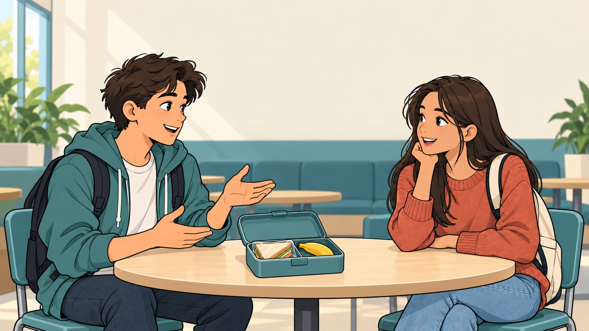

> La merenda di Luca è ancora nel contenitore. Il lavoro sul tavolo non è finito.

1. **Luca:** Ho fame, non riesco più a concentrarmi. Facciamo una pausa?
2. **Sara:** Possiamo prima finire questa parte?
3. **Luca:** Mi servono dieci minuti adesso, poi riparto.
4. **Sara:** Ho paura che dopo ci perdiamo e non finiamo più.
5. **Luca:** Mettiamo un timer e riprendiamo da questa slide.
6. **Sara:** Va bene. Segno il punto, tu prendi la merenda.

**Osserva**

- Quali bisogni o obiettivi dichiarano i personaggi?
- Quale proposta li prende entrambi in considerazione?

**Interpreta e verifica**

- I bisogni si presentano sempre in un ordine identico per tutti?
- Come cambia lo scambio quando i bisogni vengono formulati esplicitamente?

**Metti in scena e trasforma:** Inventate una negoziazione fra pausa, tempo e lavoro comune. Cercate un accordo concreto e verificabile.

**Guida alla discussione:** I modelli dei bisogni sono strumenti di lettura, non una scala rigida da applicare a ogni persona. La scena non impone che un bisogno annulli tutti gli altri.

## 30 · Lo faccio per il voto o per interesse?

**Percorso:** 4 · Relazioni, emozioni e contesti

**Obiettivo:** Confrontare motivazioni intrinseche ed estrinseche e la loro possibile coesistenza.

**Prima di osservare:** Si può svolgere la stessa attività per interesse verso il contenuto, per un risultato esterno o per entrambe le ragioni. Le motivazioni vanno ascoltate, non dedotte dal solo comportamento.

**Vignetta:** Luca e Sara devono scegliere un esempio per la presentazione valutata.

**Illustrazione:** assets/project.jpg

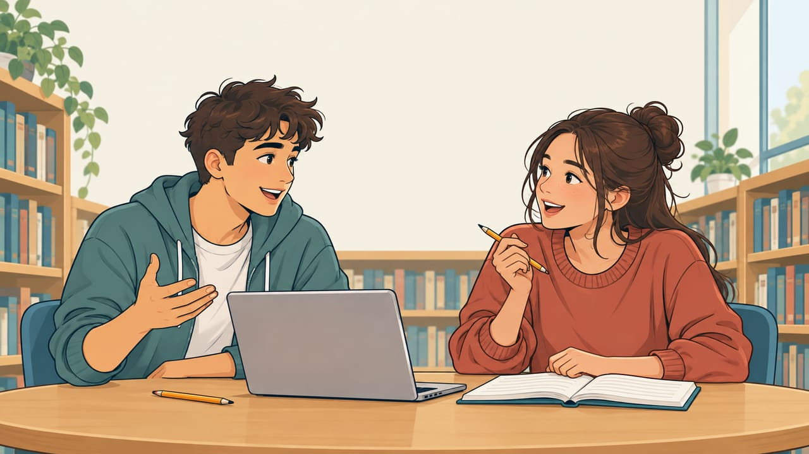

> Luca e Sara devono scegliere un esempio per la presentazione valutata.

1. **Luca:** Questo esempio sulle chat mi incuriosisce. Lo mettiamo?
2. **Sara:** Se ci aiuta a prendere un buon voto, sì.
3. **Luca:** A me interessa anche capire perché ci fraintendiamo così spesso.
4. **Sara:** In effetti “Fai come vuoi” ha fatto litigare anche me con un’amica.
5. **Luca:** Allora partiamo da quello. Cerco due messaggi inventati.
6. **Sara:** Io controllo le consegne, così non dimentichiamo nessun punto.

**Osserva**

- Quali motivi per lavorare vengono dichiarati?
- Quali riguardano l’attività stessa e quali un risultato esterno?

**Interpreta e verifica**

- Le due forme di motivazione si escludono necessariamente?
- Il comportamento visibile basta per conoscere il motivo di una persona?

**Metti in scena e trasforma:** Attribuite a due personaggi fittizi motivazioni diverse per la stessa azione e scrivete le domande necessarie per conoscerle.

**Guida alla discussione:** Non dividere gli studenti in tipi fissi o giudicare moralmente le motivazioni. La stessa attività può essere sostenuta da ragioni diverse.

## 31 · Papà scrive: dove ci vediamo?

**Percorso:** 5 · Famiglia, scuola e vita quotidiana

**Obiettivo:** Distinguere le persone dai ruoli comunicativi e verificare un riferimento spaziale.

**Prima di osservare:** Mittente e destinatario sono ruoli nello scambio, non identità fisse. La posizione grafica di un messaggio può cambiare da un telefono all’altro senza cambiarne l’autore.

**Vignetta:** Paolo aspetta nell’auto parcheggiata. Matteo esce dalla scuola guida e controlla il telefono.

**Illustrazione:** assets/hu-father-son.jpg

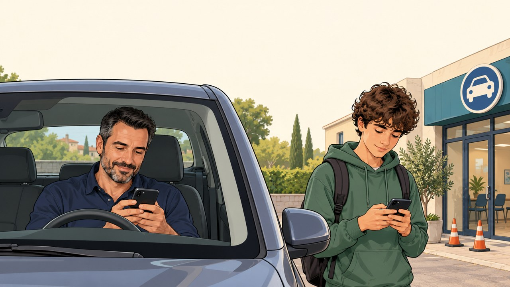

> Paolo aspetta nell’auto parcheggiata. Matteo esce dalla scuola guida e controlla il telefono.

1. **Papà Paolo:** Ci vediamo al parcheggio dietro l’incrocio dove ti ho lasciato.
2. **Matteo:** Quello vicino alla farmacia o quello davanti al parco?
3. **Papà Paolo:** Vicino alla farmacia. Sono all’ingresso pedonale.
4. **Matteo:** Va bene, arrivo dalla scuola guida.
5. **Papà Paolo:** Ti aspetto qui.
6. **Matteo:** Ti vedo! Sto arrivando.

**Osserva**

- Chi è il mittente del primo messaggio? Chi lo è della risposta?
- Quale indicazione iniziale può riferirsi a due luoghi diversi?

**Interpreta e verifica**

- Cambiare telefono cambia il mittente di un messaggio già inviato?
- La risposta “Ok” garantirebbe da sola di aver capito il luogo?

**Metti in scena e trasforma:** Disegnate la stessa chat vista dai due telefoni. Mantenete autori e ordine dei messaggi; spiegate perché i lati sullo schermo possono cambiare.

**Guida alla discussione:** Paolo e Matteo restano le stesse persone. Nel primo messaggio Paolo è mittente, nella risposta lo è Matteo. Il colore o il lato della bolla dipende dall’interfaccia e non definisce il ruolo. La richiesta di precisazione verifica il referente.

## 32 · Il vocale: una parola coperta dal rumore

**Percorso:** 5 · Famiglia, scuola e vita quotidiana

**Obiettivo:** Segnalare una ricezione incompleta e scegliere un mezzo più adatto.

**Prima di osservare:** Un vocale ricevuto solo in parte può richiedere una conferma scritta. Il passaggio dall’orale allo scritto modifica gli indizi e la possibilità di rileggere il contenuto.

**Vignetta:** Paolo invia un vocale dall’auto ferma. Fuori dalla scuola guida Matteo sente il traffico.

**Illustrazione:** assets/hu-father-son.jpg

> Paolo invia un vocale dall’auto ferma. Fuori dalla scuola guida Matteo sente il traffico.

1. **Papà Paolo:** Sono al parcheggio vicino alla farmacia. Ti aspetto all’ingresso pedonale. _Nella recitazione simulate un rumore breve sulla parola “farmacia”._
2. **Matteo:** Non ho sentito dove. Me lo scrivi?
3. **Papà Paolo:** Farmacia, ingresso pedonale. Ti mando anche il punto sulla mappa.
4. **Matteo:** Eccolo, ora l’ho trovato.
5. **Papà Paolo:** Riesci a raggiungermi da lì?
6. **Matteo:** Sì, sono a due minuti. Arrivo.

**Osserva**

- Quale parte del messaggio Matteo dice di non aver ricevuto bene?
- Come cambiano codice e modalità quando Paolo scrive?

**Interpreta e verifica**

- Il rumore è la stessa cosa che non conoscere una parola?
- Perché una conferma precisa è più utile di “Ho capito” se resta un dubbio?

**Metti in scena e trasforma:** Confrontate una versione solo vocale e una con conferma scritta. Il rumore si simula nella recitazione, non è aggiunto all’audio incluso.

**Guida alla discussione:** Il codice linguistico rimane italiano; cambia la modalità orale/scritta e l’accesso al messaggio. Una mappa introduce anche segni grafici. Non dedurre la comprensione dal solo stato “ascoltato”.

## 33 · Un biglietto sul tavolo

**Percorso:** 5 · Famiglia, scuola e vita quotidiana

**Obiettivo:** Riconoscere il canale cartaceo e gli impliciti di un messaggio quotidiano.

**Prima di osservare:** Un’espressione quotidiana può riferirsi ad azioni diverse. Chiarire il verbo attraverso una domanda permette di evitare un equivoco senza attribuire intenzioni negative.

**Vignetta:** Sul tavolo della cucina c’è il biglietto di Teresa: «Prendi la merenda prima di uscire». Giulia sta preparando lo zaino.

**Illustrazione:** assets/hu-grandmother.jpg

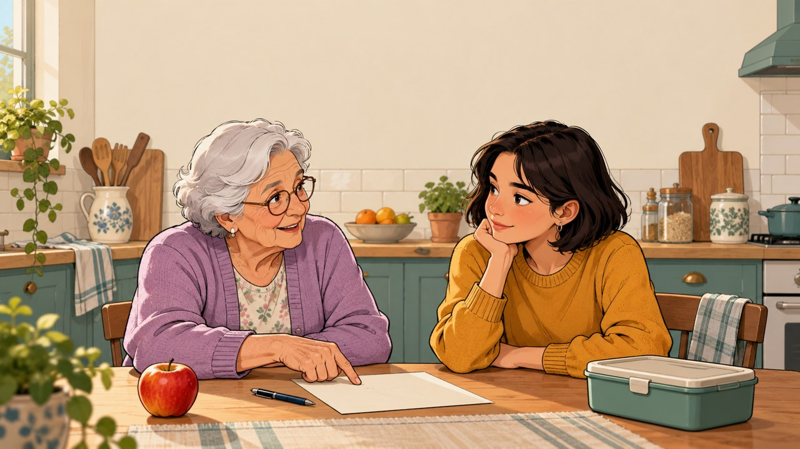

> Sul tavolo della cucina c’è il biglietto di Teresa: «Prendi la merenda prima di uscire». Giulia sta preparando lo zaino.

1. **Nonna Teresa:** Hai visto il biglietto? Prendi la merenda prima di uscire.
2. **Giulia:** Devo mangiarla adesso? Ho appena finito di pranzare.
3. **Nonna Teresa:** No, intendevo portarla con te! È nel contenitore.
4. **Giulia:** Ah, allora la metto nello zaino e la mangio alla pausa.
5. **Nonna Teresa:** Sì, prendi anche la mela se ti va.
6. **Giulia:** Grazie, nonna. Così non devo tornare a prenderla.

**Osserva**

- Quali due azioni vengono associate al verbo “prendere”?
- Quale risposta chiarisce che cosa intendeva Teresa?

**Interpreta e verifica**

- Il biglietto era sufficiente per Giulia? Perché?
- Come si potrebbe riscriverlo per evitare questo equivoco?

**Metti in scena e trasforma:** Scrivete un biglietto informativo e uno con una richiesta esplicita. Scambiateli e confrontate le interpretazioni.

**Guida alla discussione:** Nel dialogo il canale è acustico; nel biglietto è visivo e cartaceo. Il supporto carta non è il codice, che qui è l’italiano scritto.

## 34 · Suona la campanella: che cosa significa?

**Percorso:** 5 · Famiglia, scuola e vita quotidiana

**Obiettivo:** Interpretare un segnale convenzionale in relazione al contesto.

**Prima di osservare:** Un segnale convenzionale acquista significato nel contesto. Lo stesso suono può richiamare passaggi diversi dell’orario scolastico.

**Vignetta:** Amir chiude il quaderno appena suona la campanella. La professoressa è ancora accanto al banco.

**Illustrazione:** assets/hu-teacher.jpg

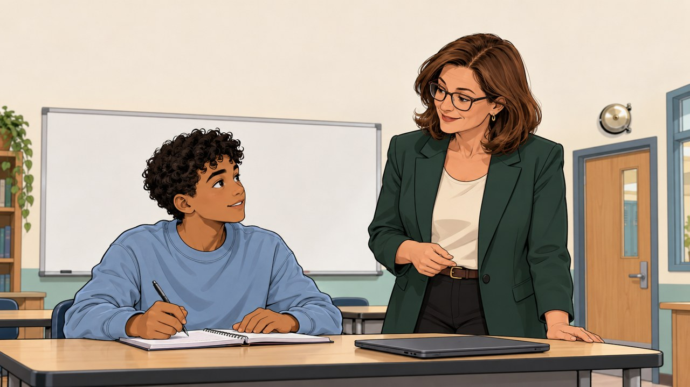

> Amir chiude il quaderno appena suona la campanella. La professoressa è ancora accanto al banco.

1. **Amir:** Finalmente! Metto tutto nello zaino?
2. **Prof.ssa Rinaldi:** Aspetta, non usciamo: è il cambio di lezione.
3. **Amir:** Ah, pensavo fosse già l’ultima ora.
4. **Prof.ssa Rinaldi:** Abbiamo ancora il laboratorio. Porta anche il quaderno.
5. **Amir:** Giusto, l’avevo dimenticato. Andiamo in quello al piano di sopra?
6. **Prof.ssa Rinaldi:** Sì, ci aspetta il resto della classe.

**Osserva**

- Quale interpretazione propone Amir?
- Quale informazione aggiunge l’insegnante?

**Interpreta e verifica**

- Il suono da solo permette sempre di sapere quale attività inizia?
- In un’altra scuola le convenzioni potrebbero essere diverse?

**Metti in scena e trasforma:** Inventate due contesti con la stessa campanella e significati diversi. Indicate il destinatario collettivo.

**Guida alla discussione:** Distinguere l’istituzione che organizza il segnale dal dispositivo che lo emette materialmente. La campanella non usa parole ma un codice convenzionale.

## 35 · L’email senza allegato

**Percorso:** 5 · Famiglia, scuola e vita quotidiana

**Obiettivo:** Confrontare mittente, destinatario, messaggio e supporto in un’email scolastica.

**Prima di osservare:** Il testo di un messaggio può annunciare un documento che non è stato effettivamente trasmesso. Il feedback permette di individuare la differenza tra intenzione e ricezione.

**Vignetta:** Al banco, Amir e la professoressa controllano l’email della consegna.

**Illustrazione:** assets/hu-teacher.jpg

> Al banco, Amir e la professoressa controllano l’email della consegna.

1. **Amir:** Professoressa, le è arrivata la mia presentazione?
2. **Prof.ssa Rinaldi:** È arrivata l’email, ma il file non c’è.
3. **Amir:** Davvero? Avevo scritto “in allegato”… Ah, non l’ho caricato!
4. **Prof.ssa Rinaldi:** Puoi inviarlo adesso?
5. **Amir:** Sì, eccolo. Questa volta controllo prima di premere invio.
6. **Prof.ssa Rinaldi:** Adesso c’è. Ti mando la conferma, grazie.

**Osserva**

- Che cosa è arrivato e che cosa manca?
- Quando risponde la professoressa, quale ruolo assume?

**Interpreta e verifica**

- Inviare un testo che nomina un file significa aver trasmesso anche il file?
- Quale feedback verifica la ricezione del documento?

**Metti in scena e trasforma:** Preparate una finta email con oggetto, destinatario, testo e allegato rappresentato su carta. Non usate indirizzi reali.

**Guida alla discussione:** La conversazione mostrata è in presenza. Il laboratorio analizza separatamente l’email citata. La conferma di ricezione non coincide con una valutazione positiva del lavoro.

## 36 · L’annuncio al binario tre

**Percorso:** 5 · Famiglia, scuola e vita quotidiana

**Obiettivo:** Riconoscere un destinatario collettivo e integrare informazioni sonore e visive.

**Prima di osservare:** Un annuncio pubblico ha molti destinatari. Un’informazione incompleta può essere verificata confrontando numero, destinazione e indicazioni visibili.

**Vignetta:** Un annuncio si diffonde dagli altoparlanti. Davide e Rosa guardano verso i binari.

**Illustrazione:** assets/hu-station.jpg

> Un annuncio si diffonde dagli altoparlanti. Davide e Rosa guardano verso i binari.

1. **Davide:** Ha detto binario tre. Andiamo?
2. **Signora Rosa:** Aspetta, era il nostro treno?
3. **Davide:** Non ho sentito il numero. Guardiamo il tabellone.
4. **Signora Rosa:** Eccolo: stesso numero del biglietto, binario tre.
5. **Davide:** Anche la destinazione coincide. Siamo in tempo.
6. **Signora Rosa:** Bene, prendiamo il sottopassaggio.

**Osserva**

- A chi è rivolto l’annuncio, oltre ai due interlocutori?
- Quali dati verificano sul tabellone?

**Interpreta e verifica**

- La frase isolata basta a identificare un treno preciso?
- Come si completano canale sonoro e supporto visivo?

**Metti in scena e trasforma:** Simulate un annuncio completo e uno incompleto. Gli ascoltatori devono formulare una domanda utile.

**Guida alla discussione:** L’altoparlante è lo strumento di diffusione; il mittente organizzativo è il servizio della stazione. La scena non riproduce annunci reali.

## 37 · Il fischio non è una parola

**Percorso:** 5 · Famiglia, scuola e vita quotidiana

**Obiettivo:** Distinguere codice non verbale, canale sonoro e regola condivisa.

**Prima di osservare:** Un segnale sonoro può comunicare senza essere una parola. Nel gioco, fischio e gesti si interpretano attraverso le regole condivise.

**Vignetta:** Durante la partita l’arbitro fischia e indica il punto della rimessa. Sofia si ferma con il pallone.

**Illustrazione:** assets/hu-referee.jpg

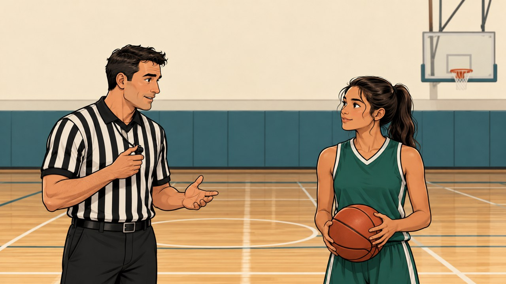

> Durante la partita l’arbitro fischia e indica il punto della rimessa. Sofia si ferma con il pallone.

1. **Arbitro Marco:** Fermi un momento! Palla fuori.
2. **Sofia:** Era uscita? Non me ne sono accorta.
3. **Arbitro Marco:** Sì, rimessa da qui.
4. **Sofia:** Tocca a noi o all’altra squadra?
5. **Arbitro Marco:** A voi. Aspetta che gli altri si sistemino.
6. **Sofia:** Va bene. Ragazze, ripartiamo da qui!

**Osserva**

- Quale informazione porta il fischio e quale aggiunge il gesto?
- Chi riceve il segnale oltre a Sofia?

**Interpreta e verifica**

- Un suono può comunicare anche senza una lingua parlata?
- Che cosa occorre condividere per capirlo?

**Metti in scena e trasforma:** Create un piccolo codice di tre segnali per un gioco. Spiegate le convenzioni prima della simulazione.

**Guida alla discussione:** Non confondere non verbale con non sonoro: un fischio è sonoro ma non è una parola. Gli audio inclusi leggono il dialogo; il fischio si può simulare durante la recitazione.

## 38 · Il rosso comunica anche senza parole

**Percorso:** 5 · Famiglia, scuola e vita quotidiana

**Obiettivo:** Individuare un codice visivo convenzionale e un destinatario collettivo.

**Prima di osservare:** I segnali visivi usano convenzioni condivise. Il codice è il sistema di segni; il canale è ciò che permette al segnale di essere percepito.

**Vignetta:** Nicolò e Amina si fermano sul marciapiede davanti alle strisce. Il semaforo è rosso.

**Illustrazione:** assets/hu-street.jpg

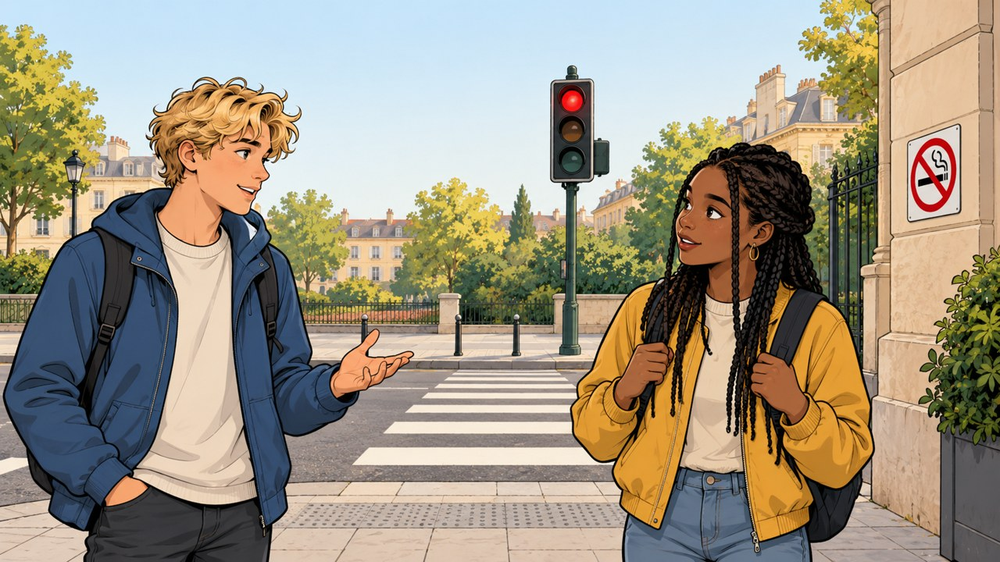

> Nicolò e Amina si fermano sul marciapiede davanti alle strisce. Il semaforo è rosso.

1. **Nicolò:** Aspetta, è rosso.
2. **Amina:** Hai ragione, stavo guardando il telefono.
3. **Nicolò:** Mettilo via, ti stavo quasi perdendo!
4. **Amina:** Fatto. Abbiamo ancora tempo per l’autobus?
5. **Nicolò:** Sì, passa fra dieci minuti.
6. **Amina:** Allora aspettiamo, senza correre.

**Osserva**

- Quale segnale vedono i personaggi?
- Qual è la differenza fra il colore convenzionale e il mezzo che lo rende percepibile?

**Interpreta e verifica**

- Il dispositivo è una persona che parla?
- Perché è utile distinguere l’ente che comunica dal dispositivo usato?

**Metti in scena e trasforma:** Rappresentate il segnale su carta e indicate codice, canale e destinatari. Confrontatelo con un messaggio vocale.

**Guida alla discussione:** La scena analizza il segnale e non sostituisce le regole della circolazione. Un dispositivo può trasmettere una comunicazione predisposta da un’istituzione.

## 39 · A chi parla questo cartello?

**Percorso:** 5 · Famiglia, scuola e vita quotidiana

**Obiettivo:** Leggere un simbolo pubblico e riconoscere il destinatario non nominato.

**Prima di osservare:** Un cartello può rivolgersi a chiunque si trovi in un luogo, senza nominare ogni destinatario. Il simbolo e la posizione aiutano a ricostruire il significato.

**Vignetta:** All’ingresso dell’edificio, Amina nota il cartello con la sigaretta barrata.

**Illustrazione:** assets/hu-street.jpg

> All’ingresso dell’edificio, Amina nota il cartello con la sigaretta barrata.

1. **Nicolò:** Guarda quel cartello. Non si può fumare qui.
2. **Amina:** Vale solo dentro o anche vicino all’ingresso?
3. **Nicolò:** Da qui non capisco dove finisce l’area.
4. **Amina:** C’è un altro avviso sulla porta. Andiamo a leggere?
5. **Nicolò:** Sì, così non restiamo nel dubbio.
6. **Amina:** Ecco, qui è indicato anche l’ingresso.

**Osserva**

- Quali elementi grafici permettono di riconoscere il divieto?
- Il destinatario è nominato oppure definito dalla situazione?

**Interpreta e verifica**

- Il simbolo e il cartello sono la stessa cosa di codice e canale?
- Perché la posizione del cartello contribuisce a interpretarlo?

**Metti in scena e trasforma:** Inventate un cartello per uno spazio scolastico e chiedete a un altro gruppo che cosa capisce.

**Guida alla discussione:** Distinguere il significato convenzionale del simbolo dal supporto materiale su cui appare. Non occorre che il destinatario sia chiamato per nome.

## 40 · Nella nostra famiglia: chiedere prima

**Percorso:** 5 · Famiglia, scuola e vita quotidiana

**Obiettivo:** Negoziare ruoli e accordi nella vita di una famiglia ricostituita senza presupporli.

**Prima di osservare:** Gli accordi quotidiani richiedono informazioni condivise e ascolto. La forma della famiglia non determina la qualità della comunicazione: conta come le persone negoziano ruoli e bisogni.

**Vignetta:** Roberto e Chiara guardano il programma settimanale. Elena, la compagna di Roberto, si è offerta di accompagnarla.

**Illustrazione:** assets/hu-family.jpg

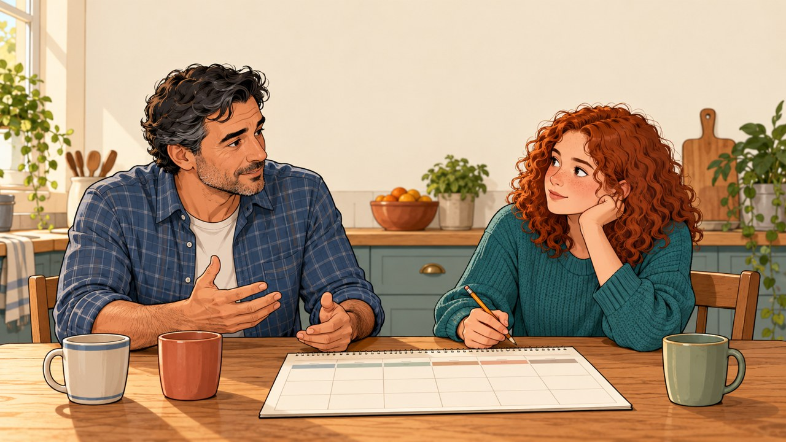

> Roberto e Chiara guardano il programma settimanale. Elena, la compagna di Roberto, si è offerta di accompagnarla.

1. **Roberto:** Domani viene Elena a prenderti dopo scuola.
2. **Chiara:** Ma io mi ero organizzata con Martina. Non lo sapevo.
3. **Roberto:** Scusa, ho cambiato il programma senza avvisarti.
4. **Chiara:** Posso prima sentire Martina? Dovevamo studiare insieme.
5. **Roberto:** Certo. Poi decidiamo con Elena dove e a che ora incontrarvi.
6. **Chiara:** Va bene, le scrivo adesso e ti faccio sapere.

**Osserva**

- Quale decisione Roberto presenta come già presa?
- Quale bisogno esprime Chiara senza giudicare Elena?

**Interpreta e verifica**

- Condividere una casa significa avere automaticamente gli stessi accordi?
- Quali persone devono essere coinvolte nella conferma?

**Metti in scena e trasforma:** Create una scena fittizia in cui nonno, zia o un altro adulto aiuta nell’organizzazione. Formulate l’accordo con chi, dove e quando.

**Guida alla discussione:** Le forme familiari non determinano la qualità della comunicazione. La scena mette a fuoco accordi e ascolto, senza classificare famiglie come migliori o peggiori e senza riprendere casi di cronaca.

## 41 · Il manifesto vuole convincerci

**Percorso:** 5 · Famiglia, scuola e vita quotidiana

**Obiettivo:** Confrontare scopo informativo e persuasivo, immagini e parole.

**Prima di osservare:** Un messaggio persuasivo può usare immagini ed emozioni per attirare l’attenzione. Per comprenderlo occorre riconoscere anche chi propone l’iniziativa e quale azione chiede.

**Vignetta:** In biblioteca è esposto un manifesto con un cane. Accanto, un avviso invita a portare coperte pulite venerdì per una raccolta scolastica.

**Illustrazione:** assets/hu-library-poster.jpg

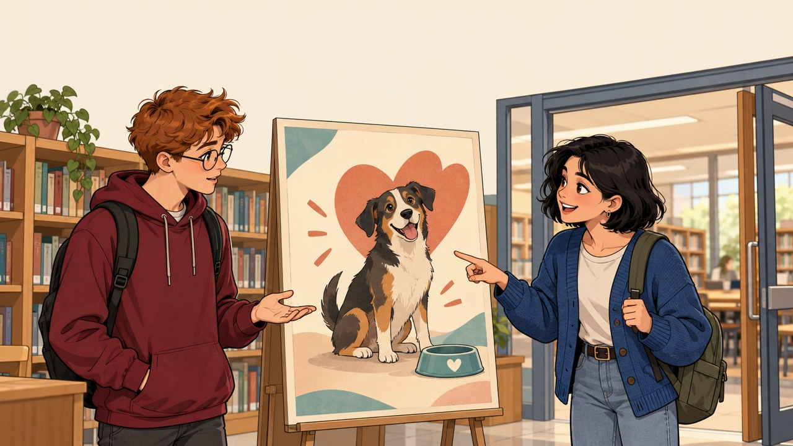

> In biblioteca è esposto un manifesto con un cane. Accanto, un avviso invita a portare coperte pulite venerdì per una raccolta scolastica.

1. **Tommaso:** Guarda quel cane! Vorrei partecipare alla raccolta.
2. **Elena:** Che cosa dobbiamo portare?
3. **Tommaso:** Coperte pulite, venerdì qui a scuola.
4. **Elena:** Io ne ho una che non usiamo. Ma chi le raccoglie?
5. **Tommaso:** Non lo vedo. Chiediamo in biblioteca prima di dirlo agli altri.
6. **Elena:** Sì. Poi avviso anche mia sorella.

**Osserva**

- Quale effetto dell’immagine riferisce Tommaso?
- Quali informazioni rendono concreta la richiesta?

**Interpreta e verifica**

- Provare un’emozione dimostra da solo che una proposta è affidabile?
- Che cosa occorre verificare prima di condividerla?

**Metti in scena e trasforma:** Progettate un manifesto fittizio con mittente riconoscibile, scopo, destinatari e istruzioni chiare.

**Guida alla discussione:** L’immagine proposta non riproduce una campagna reale. Distinguere l’effetto riferito da un personaggio da un effetto garantito su tutti i destinatari.

## 42 · “Aprito”: una regola da scoprire

**Percorso:** 5 · Famiglia, scuola e vita quotidiana

**Obiettivo:** Usare un esempio fittizio per distinguere osservazione e spiegazioni dello sviluppo linguistico.

**Prima di osservare:** Nello sviluppo linguistico l’iperregolarizzazione consiste nell’estendere una regola a un’eccezione. Forme come “aprito” possono suggerire una costruzione attiva di regole, oltre all’imitazione. Un singolo episodio non dimostra una teoria né permette diagnosi.

**Vignetta:** Durante la lezione, Amir racconta un esempio inventato: un bambino dice «ho aprito» invece di «ho aperto».

**Illustrazione:** assets/hu-teacher.jpg

> Durante la lezione, Amir racconta un esempio inventato: un bambino dice «ho aprito» invece di «ho aperto».

1. **Amir:** Il bambino del nostro esempio dice “ho aprito”. Ma nessuno gli ha insegnato quella parola.
2. **Prof.ssa Rinaldi:** Che cosa potrebbe avergli fatto scegliere proprio “aprito”?
3. **Amir:** Forse ha sentito “finito” e “dormito” e ha provato a fare lo stesso.
4. **Prof.ssa Rinaldi:** E se un adulto gli dice “ho aperto”, che cosa potrebbe succedere?
5. **Amir:** Magari la ripete giusta, poi la volta dopo dice ancora “aprito”.
6. **Prof.ssa Rinaldi:** Annotiamo entrambe le forme e osserviamo altri esempi.

**Osserva**

- Qual è la forma prodotta nel caso inventato?
- Quale regolarità potrebbe aver usato il bambino?

**Interpreta e verifica**

- Ripetere ciò che si sente e costruire una regola sono la stessa spiegazione?
- Un singolo episodio permette di valutare lo sviluppo di una persona?

**Metti in scena e trasforma:** Confrontate due ipotesi: apprendimento tramite modelli e rinforzi; predisposizione alla costruzione di regole. Cercate domande che ciascuna ipotesi suggerisce.

**Guida alla discussione:** Il resoconto di lezione suggerisce il confronto Skinner–Chomsky. Presentarlo come confronto storico di spiegazioni, non come diagnosi o prova conclusiva. Non assegnare età rigide né interpretare la fluidità di parola come misura dell’intelligenza.

## Estensione dai materiali di classe

Dodici nuovi episodi fittizi ispirati alle schede sulla comunicazione, al percorso padre–figlio, al tema delle forme familiari e al resoconto sul linguaggio. Nessun dato personale degli studenti o caso di cronaca è riportato. Otto illustrazioni originali aggiuntive. Per ogni segnale citato nel dialogo il laboratorio distingue i sei elementi del segnale da quelli della conversazione corrente. Le schede originali restano materiali di riferimento, senza essere pubblicate integralmente.
